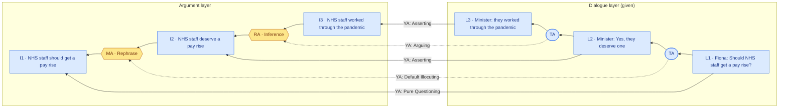
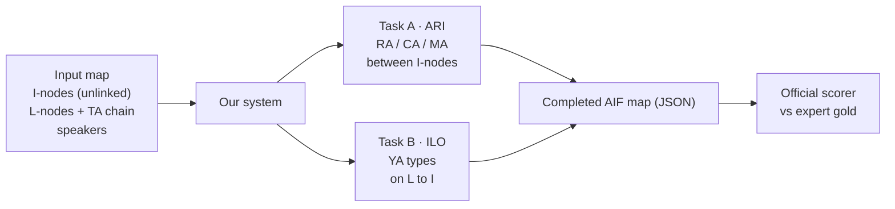
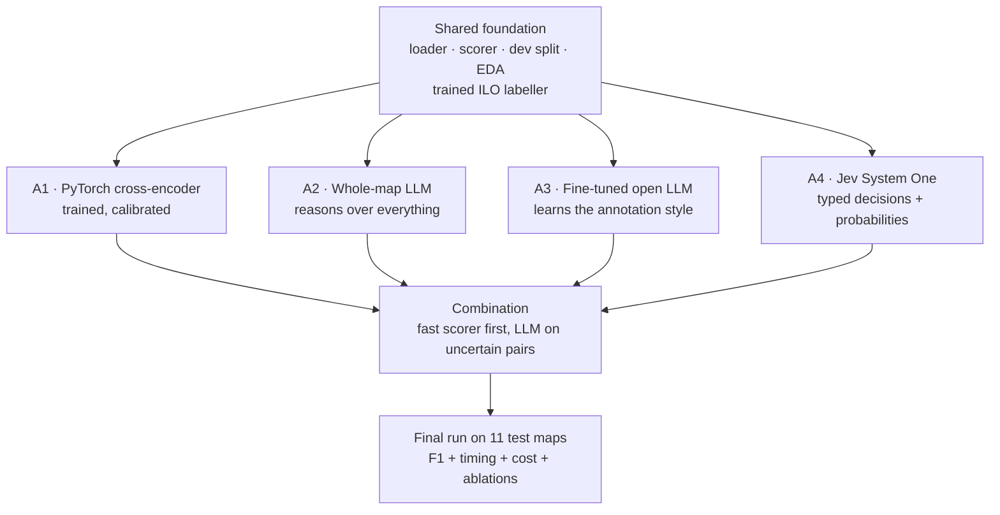

# DialAM-2024 — Dialogical Argument Mining

**Working rules:** understand → plan → user approves → experiment. Don't run experiments, training or scoring until the user asks.
Keep plans concise. The plan lives in `PLAN.md`; decisions and phase status live in `decisionlog.md`.

---

## 1. The problem in one paragraph
In a televised debate (BBC *Question Time*), people ask, claim, agree, attack and justify. **Argument mining** turns that
talk into a graph: *what was said*, *what it means*, and *how the meanings support or attack each other*.
DialAM-2024 (a shared task at the ArgMining 2024 workshop) gives us debates where the text has already been cut into
units. The job is to **draw the missing connections**. The 2024 winner scored 67.05 F1. The goal is to beat it with
2026 methods and to measure which methods help.

## 2. The representation: IAT argument maps
Maps follow **Inference Anchoring Theory (IAT)**. They have two layers, joined by "anchors".

| Layer | Node | Meaning |
|---|---|---|
| Dialogue (right) | **L**-node (locution) | Exactly what someone said: `"Speaker : text"` |
| | **TA** (transition) | "this utterance followed that one", i.e. the dialogue order |
| Argument (left) | **I**-node (proposition) | The content of a locution, rewritten to stand alone ("he" → "Boris Johnson") |
| | **RA** / **CA** / **MA** (S-nodes) | Inference (support) / Conflict (attack) / Rephrase between I-nodes |
| Anchor | **YA** (illocution) | *How* something was said: Asserting, Pure/Assertive/Rhetorical Questioning, Agreeing, Arguing, Restating, Disagreeing… |

A worked example: the moderator asks a question and a panellist answers with a reason.

*Blue = supplied as input. Yellow nodes and all YA arrows = what we must predict. A question's answer is linked to the question by MA.*

Three rules shape the problem:
- **Direction matters.** An RA arrow goes premise → conclusion. MA and CA arrows point "up" (later → earlier).
- **An RA can have several premises** ("linked" argument: A *and* B together support C). Otherwise one conclusion can have several separate RAs ("convergent"), or one premise can support several conclusions ("divergent").
- **YAs anchor at two points.** L→I (how a locution states its content) and TA→S-node (the dialogue move that created a relation).

## 3. The task: input → output

*Figure: the system completes the map. The scorer compares it with expert gold, pair by pair.*
- **ARI** (argument relation identification): for every pair of propositions, which relation, and in which direction?
- **ILO** (illocutionary relation identification): for every (locution, proposition) pair, is there an illocution, and which one?
- Maps are stored as **AIF JSON**: `{"nodes": [...], "edges": [...], "locutions": [...]}`. Relation nodes are ordinary nodes, wired in with two edges (source → relation node → target).

## 4. How it is scored (checked against the official scripts)
The scorer does **not** compare graphs. It turns them into a **table of pairs** and runs classification metrics on it.

| Sub-task | Pairs scored | Labels |
|---|---|---|
| ARI | every *ordered* pair of distinct I-nodes (n≈16 → ~240 pairs) | Inference, Conflict, Rephrase, None |
| ILO | every (L-node, I-node) pair | the YA type on an **L→I** path, or None |

Consequences:
- **Most of the graph is invisible to the scorer.** TA-anchored YAs (Arguing, Restating, Disagreeing…) and L→L YAs are never scored, and linked arguments score the same as convergent ones. We still output them so the maps are valid IAT.
- **Metric = macro-F1 per map, then averaged over maps.** Each label counts equally, whatever its frequency. **Global** = mean of ARI and ILO.
  - **General**: every pair, including "None". **Focused**: only pairs that have a gold relation.
  - A high general score with a low focused score means the system predicts too little. The reverse means it predicts too much.
- ⚠ **The rare-label trap:** the macro average covers only labels present in *gold or prediction*. One spurious Conflict in a map with no gold Conflict adds a zero-scoring class and can cut that map's score by about a quarter. Rare classes need high confidence.
- Checked (`common/score.py`, `python -m common.check_foundation`): the port equals the official scripts in 688/688 comparisons, and gives
  the majority baseline 29.53 / 35.30 / 32.41. The paper prints 29.52 / 35.29 / 32.40; its table isn't an exact per-map mean (`decisionlog.md` D015).

## 5. The data
| Path | Content |
|---|---|
| `data/training/` | 1,478 fully annotated maps (QT30 corpus: 30 episodes, 2020–21) |
| `data/test/` | 11 **input** maps (I, L, TA only) |
| `data/evaluation/` | **Gold** for those 11, wrapped as `{"AIF": …}` with the same node IDs. **Never train or tune on these.** Dev data comes from `training/`, split by episode. |
| `splits/` | Fixed train/dev lists (1,250 / 228 maps, 5 dev episodes), made by `common/split.py` |
| `common/` | Shared foundation: loader and graph view (`aif.py`), `score.py`, `validate.py`, `split.py`, `timing.py` |
| `eda/` | Exploratory data analysis: findings with figures (`README.md`), `run_eda.py`, `findings.json` |
| `decisionlog.md` | Every decision, plus the phase map: the single record of phase numbering and status |
| `ilo/` | Shared trained ILO labeller (Task B, and the L→I links ARI needs on test maps): `python -m ilo.train / tune / evaluate --run=<run>`; results per run in `results/ilo/<run>/`, the run in use named in `results/ilo/selected.json` |
| `reports/` | One findings report per phase; the source for the final write-up (`reports/README.md` is the index) |
| `reference/` | Overview paper, annotation and data-format specs, official scorers (`eval-scripts/`) |

Key numbers (training):
- **Relations:** Rephrase 5,848 · Inference 5,687 · **Conflict 1,232 (rare)**. 90% of RAs have one premise.
- **Scored illocutions (L→I):** Asserting 18,747 ≫ Pure Q 1,183 > Assertive Q 239 ≈ Rhetorical Q 222 > Default Illocuting 133 > Agreeing 107 > Challenging 40.
- **Map size:** about 16 I-nodes per map. About 2 L-nodes per I-node, because maps include *analyst-copy* L-nodes (`"Anna: Speaker : …"`; only about 2% are linked by `Analysing`). These are annotation bookkeeping, not dialogue: they never sit in the turn chain or anchor a proposition (`eda/README.md` §1).
- **Test set:** 11 maps with 11–35 I-nodes each, deliberately rich in linked, convergent and divergent arguments (gold: 53 RA, 13 CA, 46 MA).

## 6. What happened in 2024, and why
| F1 (general / focused) | ARI | ILO | Global |
|---|---|---|---|
| Best 2024 | 55.3 / 35.9 | 81.2 / 72.1 | **67.05 / 48.25** (DFKI-MLST) |
| Ours: A1 + ILO labeller, test (2026-10-03) | 51.4 / 30.8 | **92.6 / 84.3** | 72.01 / 57.53: see `reports/A1-cross-encoder.md` |
| **Ours: A2 (Sonnet 5.5, whole map) + ILO labeller, test (2026-10-05)** | **55.8** / 33.3 | 91.6 / 83.2 | **73.67 / 58.27**: see `reports/A2-whole-map-llm.md` |
| Ours: A3 (fine-tuned Qwen3-4B) + ILO labeller, test (2026-10-06) | 53.7 / 32.1 | 92.6 / 84.3 | 73.17 / 58.17: see `reports/A3-finetuned-llm.md` (on dev it trails A1 and A2) |

Every winning system was a **pairwise encoder classifier** (DeBERTa/RoBERTa). It read two sentences at a time with no
surrounding dialogue. This caused five failures:
1. **ARI is the bottleneck.** Arguments depend on context, and a two-sentence window can't see it.
2. **Conflict** was mostly missed and sometimes invented.
3. **Direction** errors: divergent arguments were read as convergent.
4. **No global consistency.** Each pair was decided alone.
5. **The 2024 LLMs lost to encoders.** They were weaker models with unreliable output formats.

ILO looked comparatively easy. Each proposition is essentially a rewritten locution, so linking is largely a similarity problem (94% of turns by similarity alone).
But the type is not reliably visible on the surface ("?" is almost absent from the transcripts), and rare types weigh heavily in macro-F1, so ILO is learned too (`eda/README.md` §3).

## 7. Approaches, and why each follows
Every approach answers the same question: *how can a model see more context and give calibrated decisions on the
rare, direction-sensitive relations?*

*Figure: four independent approaches on one shared foundation, compared and then combined.*

**Shared foundation.** A loader and writer, the ported scorer, a dev split, and exploratory data analysis (EDA) of structural cues:
how far apart related propositions are in the dialogue, whether conflict tends to cross speakers, whether answers rephrase questions.
A trained ILO labeller (ModernBERT on turn + proposition + neighbouring turns, one-to-one decoding, rare-type thresholds) handles Task B.
It also supplies the L→I links that the ARI approaches need on test maps.

**A1 — PyTorch cross-encoder (the fixed 2024 recipe).** A *cross-encoder* is a transformer (DeBERTa-v3 / ModernBERT) that reads
both propositions together plus a window of surrounding dialogue and speaker tags, and outputs a probability for each label.
We fine-tune it in PyTorch on our pairs.
- *Candidate pruning* (dropping pairs more than *k* turns apart) is cheap but modest: at k = 8 it keeps 98% of relations and removes about a quarter of the pairs (`eda/README.md` §5), so the loss and thresholds still carry most of the imbalance.
- A *weighted or focal loss* upweights the rare Conflict class.
- *Per-class thresholds*, tuned on dev for the per-map macro-F1, avoid the rare-label trap.
- **Why:** it fixes failures 1, 2 and 4-lite cheaply on the local GPU. It's the strongest known baseline, modernised.

**A2 — Whole-map LLM, no training.** Claude Sonnet 5.5 reads the *entire* map at once and returns every relation
as schema-constrained JSON, with similar training maps as examples (few-shot). *Self-consistency* samples 3 answers and votes.
It runs through Claude Code's scripted mode (`claude -p`) on the user's Claude Pro login, so it costs $0 but is bounded by usage limits (D052).
- **Why:** it attacks failures 3 and 4 directly. Direction and convergent vs divergent are global, multi-step judgements, which is where reasoning models are strong.
- **Risks:** it gives no calibrated probabilities (votes stand in for them), it is slow under Pro's limits, and it may have seen QT30 during training.
- **Plan and status:** `reports/A2-whole-map-llm.md` and the phase map (A2.1–A2.5).

**A3 — Fine-tuned open LLM.** QLoRA (4-bit weights plus small trainable adapters) fine-tunes Qwen3-4B-Instruct-2507 to generate the relation list for a map (Qwen3-8B can't train on the 8 GB card, D066).
- **Why:** it tests whether *learning the IAT annotation style* beats a general model's size.
- **Outcome (final, 2026-10-06):** test Global 73.17 / 58.17, between A1 and A2. On dev it trails both (ARI 47.65 / 27.23): it learns the format and density but not the Inference judgement. See `reports/A3-finetuned-llm.md` and `reports/A3-discussion.md`. It runs locally in a separate venv (`~/.venvs/a3`, `requirements-a3.txt`).

**A4 — Jev (TypeSafe AI's System One model), no training.** Jev doesn't write text. It takes a *state* (up to 32k tokens) and a set of typed
questions (`choice` among up to 255 options, `score` on a rubric, `boolean`), and answers all of them in parallel with probabilities.
We put the whole map in the state and ask, in as few requests per map as the size limit allows:
- one `choice` per candidate pair: {A→B inference, B→A inference, conflict, rephrase, none};
- one `choice` per proposition over its candidate targets × relation types, plus "none". The targets compete, which tests whether deciding jointly (A2's advantage) works without generating text.

Each question is asked in two option orders, and the probabilities are averaged.
- **Why it fits:**
  - Every scored item here is exactly such a decision.
  - It sees the whole-map context like A2, and gives calibrated probabilities like A1. Those are needed for thresholding against the rare-label trap.
  - At $0.042 per 1M input tokens, with output free, it's cheap enough to run the full dev set repeatedly.
- **Caveats:**
  - Questions are answered independently, so our code enforces consistency.
  - It can't be fine-tuned.
  - Calibration and speed are vendor claims, so we measure them ourselves.
  - It's in early access (since 2026-09-15).
  - *Our* hypothesis, not TypeSafe's: with no step-by-step reasoning before answering, it may lag on RA direction and implicit conflict.
- **Setup (D073):**
  - Python (`a4_jev/`, in the `dialam` venv, using `httpx`) posts `{model: "typesafe-ai/jev", state, questions}` to the Vercel AI Gateway's `POST https://ai-gateway.vercel.sh/v1/evaluate`. There is no Node runner; the AI SDK's `experimental_evaluate` is now a deprecated alias of `experimental_decide`.
  - The key is `AI_GATEWAY_API_KEY` in WSL `~/.profile`, never in the repo.
  - Jev isn't on the gateway's free tier (D074). It runs on a small paid credit the user added, with auto top-up off and a cap (D075). Report each run's cost, and stop and ask before anything beyond the measured projection (≈ $0.80 after A4.1).
  - Limits: 64k tokens per request (32k for the state plus the longest question) and up to 255 options per choice.
  - Measured in A4.1 (D076):
    - the state is billed once per request;
    - Jev counts about 3 characters per token (2.69–3.27), so requests are capped at 50k estimated tokens;
    - about 0.9 s per request;
    - answers aren't deterministic, so they are cached and committed.
  - Scope is the core only (D076): pair and source questions, no turn-type questions and no extra ablations.
- **Plan and status:** `reports/A4-jev.md` and the phase map (A4.1–A4.5).

**Combination.** The methods have complementary strengths. A1 or A4 is fast and calibrated, and A2 is slow but reasons.
So a cheap pass decides the confident pairs, and only the uncertain ones go to A2.

**Measured for every approach:** ARI / ILO / Global (general and focused), training time, inference time, cost, and
*ablations* (switch off one component, such as context, pruning, thresholds or the LLM step, and re-score to see what it contributed).

## 8. Environment
Windows 11 (Python 3.14 + PyMuPDF for docs). GPU: RTX 5060 Ti with 8 GB, and 16 GB RAM.
**ML code runs in WSL2 Ubuntu 24.04**, because Smart App Control blocks torch's unsigned DLLs on Windows:
`wsl -e bash -lc 'cd "/mnt/c/Argument Mining" && ~/.venvs/dialam/bin/python -m <module>'`.
The venv (Python 3.12, torch 2.14+cu130, transformers 5.17) is pinned in `requirements.txt`. Details are in `decisionlog.md` D007–D011.
