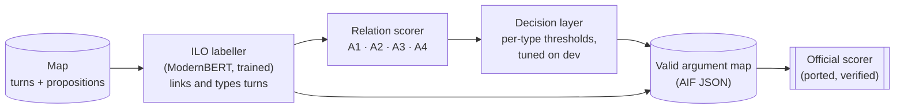

# Dialogical Argument Mining, Revisited

**Can 2026 NLP methods beat the best system of the DialAM-2024 shared task at reconstructing the arguments in televised debates, and which kind of method helps?**

Kunal Kamra · October 2026 · [Short report](reports/06-short-report.md) · [Final report](reports/05-final-report.md) · [Decision log](decisionlog.md)

## At a glance

- **Task.** Given BBC *Question Time* debates already segmented into turns and propositions ([DialAM-2024](https://aclanthology.org/2024.argmining-1.8/), QT30 corpus), predict **(A)** the argument relations between propositions (support, attack or rephrase; the corpus calls them Inference, Conflict and Rephrase) and **(B)** the speech act (illocution) linking each turn to its proposition.
- **Four post-2024 methods** share one verified pipeline: a fine-tuned ModernBERT cross-encoder (A1), Claude reading the whole map (A2), a QLoRA-tuned Qwen3-4B (A3), and Jev, TypeSafe AI's new System One decision model (A4).
- **Result.** Every system beats the 2024 winner on Global F1, the task's headline metric. An average of A1, A2 and A4 scores **74.51 / 59.47 Global F1** (general / focused) against **67.05 / 48.25**.
- **But the gain is uneven.** 93% of the margin (81% under focused scoring) comes from Task B, where a trained illocution labeller scores 92.6 against 2024's best of 81.2. On argument relations the best systems are level with 2024 (56.4 against 55.3), well inside the noise of an 11-map test set.
- **Method ranking** on 225 dev maps (cross-fitted thresholds, paired bootstrap): Claude > Jev ≈ fine-tuned encoder > fine-tuned Qwen. Claude's lead over the encoder is +4.1 F1 (95% CI 2.2–6.1). Jev matches the encoder with no training, at $0.003 per map.
- **Why relations plateau.** The hard part is deciding *whether* two propositions are connected at all, often through an unmarked concession or elaboration, under labels that annotators themselves agree on only moderately. Four very different models stall at the same level, so the limit is the task and its labels more than the models. Our safeguards, the pipeline and the later test debates were checked and ruled out.


*Global F1 above the 2024 winner on the 11 test maps, split into the part from illocutions (blue) and from relations (orange).*

## How it works



Every approach plugs into the same pipeline, so the four are directly comparable. Only the relation scorer changes. The illocution labeller handles Task B for all of them (A2 also let Claude override a few turn types) and gives each test proposition its turn and speaker.

## The four approaches

- **A1 · Fine-tuned encoder.** ModernBERT-base (150M parameters), trained for 94 minutes on ~105k labelled proposition pairs. For each pair it reads both propositions, the whole dialogue, their distance and whether one speaker said both, and outputs a probability for each relation. This is the 2024 winning recipe, given context.
- **A2 · Frontier LLM, prompted.** Claude Sonnet 5.5, not trained: it reads the whole map after 4 similar solved training maps and lists every relation as JSON. It ran at effort `xhigh`, the only setting that made it reason first, on the expectation that this would help a lot: a 20-map pilot suggested +11 focused points, but on 225 dev maps it added about 1. Three answers per map are combined by vote.
- **A3 · Fine-tuned small LLM.** Qwen3-4B, stored in 4-bit with small trainable adapters (QLoRA) so it fits an 8 GB GPU, trained for 110 minutes on 1,231 maps to write each map's relations. Eight sampled answers are combined by vote.
- **A4 · Decision model.** Jev, TypeSafe AI's new System One model, doesn't write text. It takes a state (here, the map plus a one-page guide to the labels) and a set of *typed questions*, such as a multiple-choice "how is P3 related to P2: supports it, is supported by it, attacks it, rephrases it, or none?", and returns a probability for every option. *No training* means it is used as is: no fine-tuning and no labelled examples. It was asked about each relation two ways, per pair and per proposition.

## Results

| Test F1 (general / focused) | Relations (ARI) | Illocutions (ILO) | **Global** | Dev ARI (honest) |
|---|---|---|---|---|
| 2024 winner (DFKI-MLST, DeBERTa-v3 pairs) | 55.33 / 30.40 | 78.78 / 66.10 | 67.05 / 48.25 | — |
| A1 · ModernBERT-base cross-encoder, fine-tuned | 51.38 / 30.77 | 92.64 / 84.28 | 72.01 / 57.53 | 50.50 |
| A2 · Claude Sonnet 5.5, whole map, 4 worked examples | 55.77 / 33.34 | 91.56 / 83.20 | 73.67 / 58.27 | 54.63 |
| A3 · Qwen3-4B, QLoRA fine-tuned | 53.70 / 32.05 | 92.64 / 84.28 | 73.17 / 58.17 | 47.65 |
| A4 · Jev (TypeSafe AI), typed questions, no training | 54.21 / 30.98 | 92.64 / 84.28 | 73.42 / 57.63 | 52.17 |
| **A1 + A2 + A4, averaged** | **56.39 / 34.65** | 92.64 / 84.28 | **74.51 / 59.47** | **55.51** |

Global is the mean of ARI and ILO. Every row's ILO comes from the shared illocution labeller; A2's differs because Claude was also allowed to override a few turn types, which cost it 1.1 points. *General* scores every pair, including the ~95% with no relation; *focused* scores only the pairs that have one. Each test configuration was frozen beforehand and scored once. The 11 test maps are the only fair comparison with 2024; the 225 dev maps are the only reliable way to rank our systems. Cost and speed per map: A1 ~1 s and $0; A2 ~25 s and $0.18 (API-equivalent); A3 ~22–40 s and $0; A4 0.8 s and $0.003.

## What makes the numbers trustworthy

- **Scorer verified:** the port of the official scripts agrees with them in 688 of 688 comparisons and reproduces the published majority baseline.
- **No leakage:** the dev split is grouped by episode, recovered from the debate panels because maps carry no episode label (1,250 / 228 maps, 0 leaked pairs). A node-ID artefact that gives away 74% of turn–proposition links was banned in every approach.
- **Honest tuning:** thresholds are cross-fitted across dev episodes, and differences between systems are tested with a paired bootstrap over 225 maps.
- **Test set untouched until the end:** each test configuration, including the choice of ensemble, was fixed on dev before its single scored run. Later checks on test are labelled post-hoc and never fed back into a system.
- **Traceable:** every number in the reports comes from a committed file under `results/`, and every decision (88 of them) is in [`decisionlog.md`](decisionlog.md) with its rationale and status.

## Key findings

1. **The win over 2024 is mostly a Task B win.** Task B is largely a matching problem: in the training data, text similarity alone links 94% of turns to the right proposition, and 90% of illocutions are *Asserting*. On dev, a trained labeller with one-to-one decoding links 98.3% of turns at 99.6% precision.
2. **Relation mining is still hard.** On dev, no method closes more than about a third of the gap between predicting nothing (30.9) and labelling every candidate pair correctly (98.6). On test, the final system gets 56 of 124 relations right and finds 2 of 13 attacks.
3. **Each model has a recognisable profile.** Jev reads each question literally, so it finds the most support but calls elaborations "support" where annotators wrote "rephrase". The trained models learn the annotators' habits. Claude is the best all-rounder.
4. **How a judgement is posed matters as much as the model.** Asking Jev each relation two ways scored 52.2 on dev, against 50.5 and 46.3 for either way alone. Reasoning added Claude only 0.8. The fine-tuned 4B LLM learned the output format but not the support judgement.
5. **The benchmark shapes the result.** The rare-label penalty makes guessing an attack unattractive, the general and focused scores reward opposite strategies, and an 11-map test set can't separate systems within about ±8 points.

## Why relations are hard, even for 2026 models

- **The task is detection.** A map has about 200 ordered proposition pairs and 8 relations, and most connections are implicit: a concession counts as an attack with no "but", an elaboration as a rephrase. 82–86% of every system's errors are missed or invented relations, not a wrong type or direction.
- **The labels are conventions.** QT30's annotators agree at 0.56 (CASS), so some "errors" are readings a person could defend. Models that apply plain meaning (Jev, Claude) are marked wrong where the convention differs.
- **The data is thin where it matters.** The 1,478 training maps hold only 1,232 attacks, 56% of them within one speaker's own talk. Those within-speaker attacks stay at 7–12% recall for every method.
- **The models are not the main limit.** A 150M encoder, a frontier LLM, a fine-tuned 4B LLM and an untrained decision model land within 7 points of each other. Whole-dialogue context added the encoder 1.5 points and reasoning added Claude 0.8. Claude's real edge is long-range relations: 30–37% recall two or more turns apart, against 12–16% for the encoder.
- **The score dilutes gains.** It averages the relation types with the near-perfect "no relation" class, so a 17-point gain in support (Inference) F1 on test moved the relation score by only 5.


*Left: the errors each system makes on the 1,873 dev gold relations, mostly missed or invented relations. Right: recall by turn distance.*

## Repository

```
.
├── README.md             this page
├── reports/              findings; start with 06-short-report.md, then 05-final-report.md
│   └── figures/          report figures, redrawn by reports/short_report_figures.py
├── common/               shared foundation: AIF loader, official-scorer port, split, validation, fine-tuning loop
├── eda/                  exploratory analysis of the corpus
├── ilo/                  Task B: the trained illocution labeller, shared by every approach
├── a1_cross_encoder/     A1 · fine-tuned ModernBERT cross-encoder
├── a2_llm/               A2 · whole-map Claude prompting (prompts, runner, decision layer)
├── a3_finetune/          A3 · QLoRA fine-tuning of Qwen3-4B
├── a4_jev/               A4 · Jev decision model (question design, API client, runner)
├── combination/          the final system: mean of A1, A2 and A4 pair scores
├── results/              every committed number: training logs, dev reports, test scores
├── splits/               the fixed, episode-grouped train / dev split
├── reference/            2024 overview paper, annotation and data-format specs, official scorers
├── decisionlog.md        phase map and every decision (D001–D088), with status
├── PLAN.md               the research plan, written before the experiments
├── CLAUDE.md             project brief for the AI agents: task, scoring, data, environment
├── requirements.txt      pinned ML environment (Python 3.12, torch 2.14 + CUDA 13.0)
└── requirements-a3.txt   separate environment for A3's QLoRA stack
```

`data/`, `cache/` and `checkpoints/` are git-ignored. The corpus is not redistributed here.

## Reproducing

1. **Data.** Download the DialAM-2024 data from the shared task ([dialam.arg.tech](http://dialam.arg.tech); QT30 is also at [corpora.aifdb.org/qt30](http://corpora.aifdb.org/qt30)) into `data/training/` (1,478 maps), `data/test/` (11 input maps) and `data/evaluation/` (their gold).
2. **Environment.** Linux or WSL2 with an 8 GB NVIDIA GPU: `uv venv ~/.venvs/dialam --python 3.12 && uv pip install --python ~/.venvs/dialam/bin/python -r requirements.txt`. A3 uses its own environment, built from `requirements-a3.txt`.
3. **Check the foundation:** `python -m common.check_foundation` (13 gates: scorer parity, split, validator).
4. **Run a stage.** Each report ends with its exact commands. In outline:

| Stage | Commands (from the repo root) | Needs |
|---|---|---|
| Illocution labeller | `python -m ilo.data`, `ilo.train --run=v1`, `ilo.tune --run=v1`, `ilo.evaluate --run=v1` | GPU, ~20 min |
| A1 encoder | `python -m a1_cross_encoder.build_pairs`, `.train --run=v1`, `.tune --run=v1`, `.predict --run=v1 --split=test` | GPU, ~95 min |
| A2 Claude | `python -m a2_llm.runner --run=dev-v1 --export`, `a2_llm.tune --run=dev-v1`, `a2_llm.evaluate` | Claude Code CLI with a Claude plan |
| A3 Qwen | `python -m a3_finetune.train --run=v1`, `a3_finetune.tune --run=v1` | A3 environment, GPU, ~2 h |
| A4 Jev | `python -m a4_jev.runner --run=dev --export`, `a4_jev.tune` | `AI_GATEWAY_API_KEY` (Vercel AI Gateway), ~$1 |
| Combination | `python -m combination.run --test` | outputs of A1, A2, A4 |
| Report figures | `python reports/short_report_numbers.py`, then `python reports/short_report_figures.py` | numpy, matplotlib |

## How this project was built

The project was designed and directed by Kunal Kamra and implemented with AI coding agents (Claude Code and Claude Science), in gated phases. Each phase was planned, approved, run, checked against a gate set in advance, and logged in the [decision log](decisionlog.md) before the next began. Each system was scored on the test gold once, at a final run the author approved in advance.

## Limitations

- One configuration and one seed per approach; ablations were cut to the core for A3 and A4.
- Training-data contamination isn't ruled out for the hosted models (A2, A4), since QT30 has been public since 2022. Their dev → test changes (A2 +1.1, A4 +2.0) are of the same order as the local encoder's (+0.9), which argues against memorisation, but no probe was run.
- The test set has 11 maps, and the human ceiling in F1 is unknown (QT30's annotators agree at 0.56 CASS).

## References

- Ruiz-Dolz, R., Lawrence, J., Schad, E. and Reed, C. (2024). [Overview of DialAM-2024: Argument Mining in Natural Language Dialogues](https://aclanthology.org/2024.argmining-1.8/). *Proceedings of the 11th Workshop on Argument Mining*, pp. 83–92. ACL.
- Hautli-Janisz, A., Kikteva, Z., Siskou, W., Gorska, K., Becker, R. and Reed, C. (2022). QT30: A Corpus of Argument and Conflict in Broadcast Debate. *Proceedings of the 13th Language Resources and Evaluation Conference*, pp. 3291–3300.
