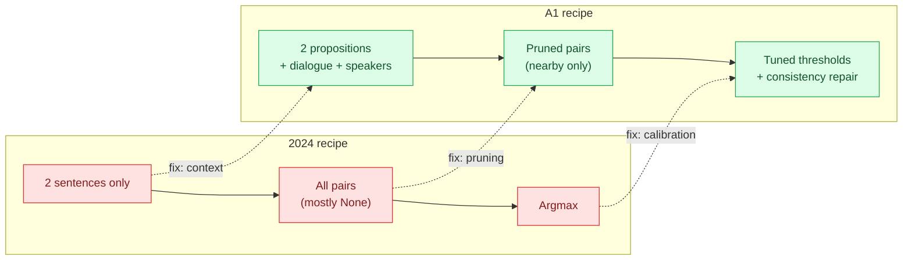
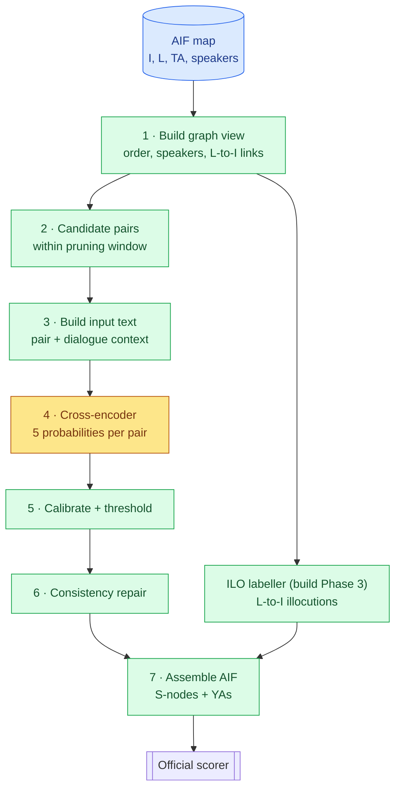
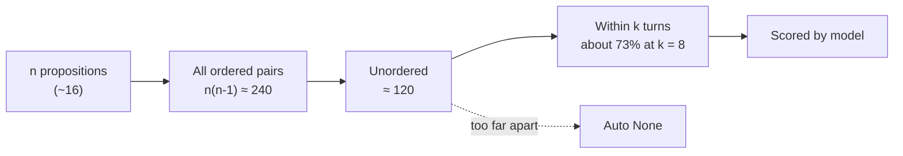
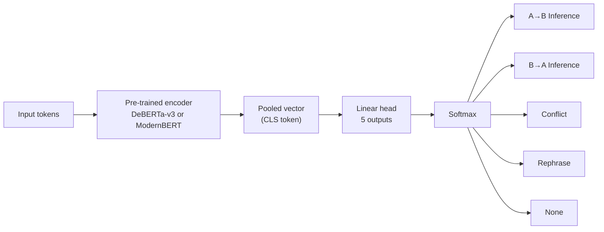
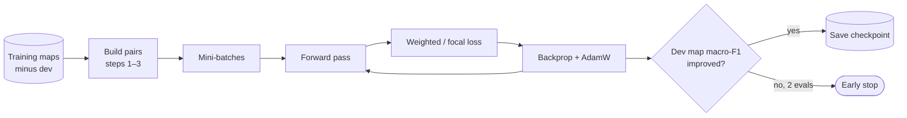
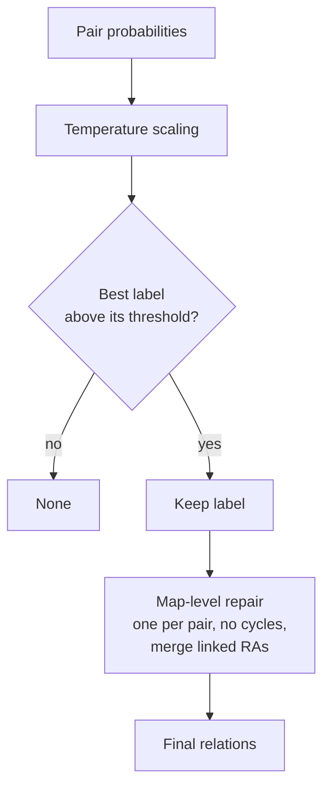

# Approach 1 — PyTorch cross-encoder

> **Status:** see the phase map in [`../decisionlog.md`](../decisionlog.md), the single record of progress (A1's phases are A1.1–A1.7). Background (IAT, scoring, data) is in [`../CLAUDE.md`](../CLAUDE.md); the cross-approach plan is in [`../PLAN.md`](../PLAN.md).

**One sentence:** train a transformer to look at *two propositions plus the surrounding dialogue* and say how they relate, then turn its probabilities into careful, consistent decisions tuned to the official metric.

---

## 1. The idea in plain words
The 2024 winners already used this model family. They lost points for three reasons:
1. They showed the model **two sentences with no context**.
2. They trained on **every possible pair**, so ~95% of examples were "None" and the model learned to say "None".
3. They took the **top-scoring label** (argmax), which invents rare labels such as Conflict and costs a lot under per-map macro-F1.

A1 keeps the model and fixes all three: **add context, prune hopeless pairs, tune decision thresholds.**


*Figure: each A1 change fixes one known 2024 weakness.*

---

## 2. Key concepts (glossary)
| Concept | What it means here |
|---|---|
| **Proposition (I-node)** | A stand-alone statement of what someone said. ARI links these. |
| **Candidate pair** | An ordered pair (A, B) of propositions we might link. |
| **Cross-encoder** | A transformer that reads *both* texts in **one** input, so every word of A can attend to every word of B. More accurate than encoding each separately (a "bi-encoder"), but it must run once per pair. |
| **DeBERTa-v3 / ModernBERT** | Pre-trained encoder models. We add a small classification head on top and fine-tune the whole thing. ModernBERT accepts much longer inputs (8k tokens). |
| **Fine-tuning** | Starting from a pre-trained model and continuing training on our labelled pairs, so it learns this annotation style. |
| **Logits → softmax → probabilities** | The head outputs one score per label; softmax turns them into probabilities that sum to 1. |
| **Class weights / focal loss** | Loss tweaks that make mistakes on rare labels (Conflict) cost more, so the model doesn't ignore them. |
| **EDA** | *Exploratory data analysis* (Phase 2, [`../eda/README.md`](../eda/README.md)): counting and measuring the training maps to test our assumptions before modelling, e.g. relation distances, direction patterns, speaker effects. |
| **Pruning window** | Only pairs whose locutions are within *k* dialogue turns become candidates. *k* is set in EDA so ~98% of gold relations survive. |
| **Temperature scaling** | One number fitted on dev that makes probabilities honest (a 0.8 means right ~80% of the time). |
| **Per-class threshold** | Minimum probability required to output a label. Conflict gets the strictest one. |
| **Dev split** | ~15% of training maps, **grouped by episode**, used for early stopping and tuning. The 11 test maps are never touched until the final run. |
| **Macro-F1 per map** | The official metric: F1 per label, averaged over labels, then over maps. Why rare-label mistakes hurt so much. |

---

## 3. End-to-end pipeline

*Figure: one map flowing through A1. Blue = data, green = deterministic code, yellow = the trained model.*

### Step 1 — Graph view
Parse the JSON into a simple structure: the dialogue in order (L-nodes along the TA chain), each L-node's speaker, and which I-node each L-node expresses. For test maps the L→I link isn't given, so we use the links predicted by the shared ILO labeller (build Phase 3). Analyst-copy L-nodes (`"Anna: Speaker : …"`) are dropped.

### Step 2 — Candidate pairs (pruning)
Every proposition gets a **dialogue position** (the turn of its locution). A pair is a candidate only if the two positions are within *k* turns. Each **unordered** pair is scored once; direction is part of the label (next step).


*Figure: pruning shrinks the work and the None-heavy class imbalance before any model runs.*

### Step 3 — Input text
Each candidate becomes one text pair (as built in A1.1, `build_pairs.py`):
```
text_a: NHS staff deserve a pay rise
text_b: NHS staff worked through the pandemic [SEP] distance: 1 turns; same speaker [SEP]
        Fiona: Should NHS staff get a pay rise? | [[A]] Minister: Yes, they deserve one [[/A]] | [[B]] Minister: they worked through the pandemic [[/B]] | …
```
- The **whole dialogue** of the map is the context (D019). Every pair fits in 1,024 tokens; a window around the pair is only a fallback for longer maps.
- **Distance** and **same-speaker** are written out as plain words (D021). The EDA found both strongly predictive.
- A propositions' turns come from gold links in training and from the ILO labeller's predicted links on dev and test (D040).

### Step 4 — The model

*Figure: the cross-encoder turns one pair into five probabilities. Direction lives in the label, not in the input order.*

Conflict and Rephrase are also directional in the gold (later → earlier). We set their direction by dialogue order, which EDA will confirm is almost always right.

### Step 5 — Training (offline, once)

*Figure: standard supervised fine-tuning, but early stopping watches the real metric, not the loss.*

Fitting in 8 GB VRAM: **fp16** (half-size numbers), **gradient checkpointing** (recompute activations instead of storing them), **gradient accumulation** (several small batches act as one big one).

### Step 6 — Decision layer (where most of the gain is)
Probabilities aren't answers. We turn them into answers in two stages, both tuned on dev only.

**6a. Calibrate and threshold.** Apply temperature scaling, then for each pair pick the best non-None label **only if** its probability beats that label's threshold; otherwise None. Thresholds are grid-searched to maximise **per-map macro-F1 on dev**.

**6b. Consistency repair.** Each pair was judged alone, so fix contradictions at map level:
- at most one relation per pair;
- never both A→B and B→A inference;
- **linked arguments:** when several premises support the same conclusion and are uttered together, merge them into one RA node (not scored, but correct IAT).


*Figure: the decision layer guards against the rare-label trap and enforces a sane graph.*

### Step 7 — ILO and assembly
- **ILO** comes from the shared trained labeller (build Phase 3, `ilo/`): ModernBERT on (turn, proposition, neighbouring turns), with one-to-one decoding and per-type thresholds.
- **Assembly** writes each relation as an S-node (RA/CA/MA) with two edges, adds the L→I YAs, and the unscored TA-anchored YAs (RA → Arguing, MA → Restating/Default Illocuting, CA → Disagreeing) so maps stay valid IAT.
- Output goes to the official scorer.

---

## 4. How to execute (when approved)
| Phase | Step | Command (planned) | Output |
|---|---|---|---|
| 0 | Install deps | WSL2 venv from `requirements.txt`; check with `python -m a1_cross_encoder.check_env` ([`../decisionlog.md`](../decisionlog.md) D008–D010) | — |
| 0–3 | Prerequisites | Environment, foundation, EDA (→ window *k*) and the ILO labeller done | `common/`, `eda/`, `ilo/` |
| A1.1 | Build pair datasets | `python -m ilo.predict --split=dev` (and `test`), then `python -m a1_cross_encoder.build_pairs` | `cache/a1/{train,dev,test}.jsonl`, `results/a1/pairs.json` |
| A1.2–A1.3 | Train | `python -m a1_cross_encoder.train --model modernbert-base` | checkpoint + `results/timing.csv` |
| A1.4 | Tune decisions | `python -m a1_cross_encoder.tune --split dev` | `thresholds.json` |
| A1.5 | Dev score | `python -m a1_cross_encoder.predict --split dev` then scorer | dev F1 table |
| A1.6 | Ablations | re-run A1.4–A1.5 with one lever off each time | ablation table |
| A1.7 | Final test run (once) | `python -m a1_cross_encoder.predict --split test` then scorer vs `data/evaluation/` | final F1 |

Planned layout:
```
a1_cross_encoder/
  README.md        this file
  build_pairs.py   steps 1–3: graph view, pruning, input text
  model.py         encoder + 5-way head, loss
  train.py         step 5
  tune.py          step 6a: temperature + thresholds
  repair.py        step 6b: consistency repair
  predict.py       steps 4, 6, 7 end to end → AIF JSON
```

---

## 5. What we measure
- **Scores:** ARI / ILO / Global, general and focused, next to 2024's 67.05 / 48.25.
- **Ablations** (one lever off at a time): no context window · no speaker/TA features · no pruning · argmax instead of thresholds · DeBERTa vs ModernBERT.
- **Cost:** training time (per epoch, total), inference per map, peak VRAM. No API spend.

## 6. Expectations and risks
- **Expect** a solid, cheap gain mostly on the *general* score. Context helps Conflict; thresholds stop invented labels. This is the baseline A2–A4 must beat.
- **Won't fully fix** direction on divergent arguments or global structure: pairs are still judged one at a time.
- **Risks:** long windows slow training (tune *k* and window size); probabilities drift on test (temperature scaling); DeBERTa-large may be tight on 8 GB (fall back to base, or ModernBERT).
