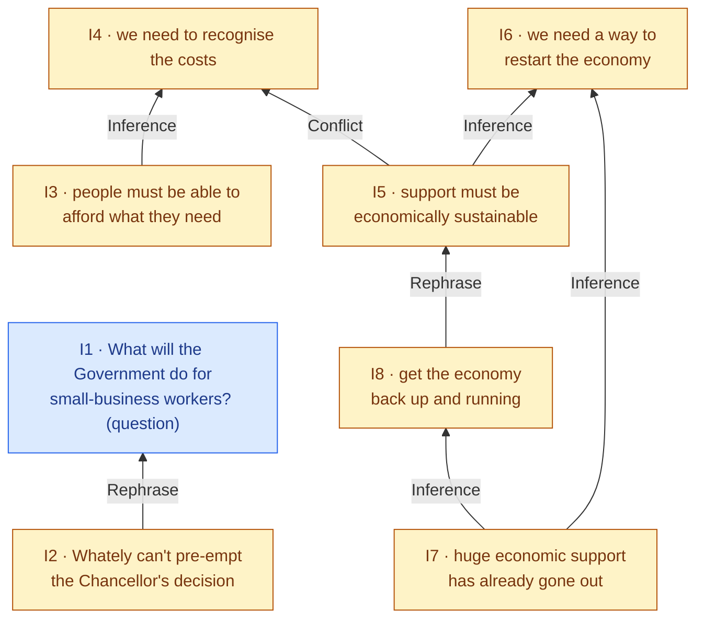
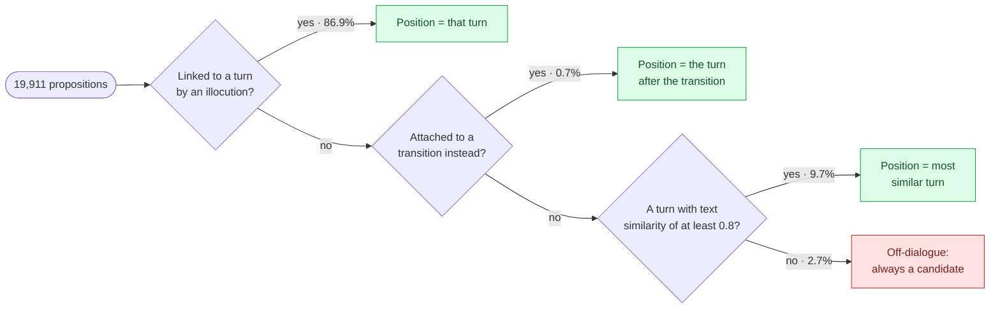
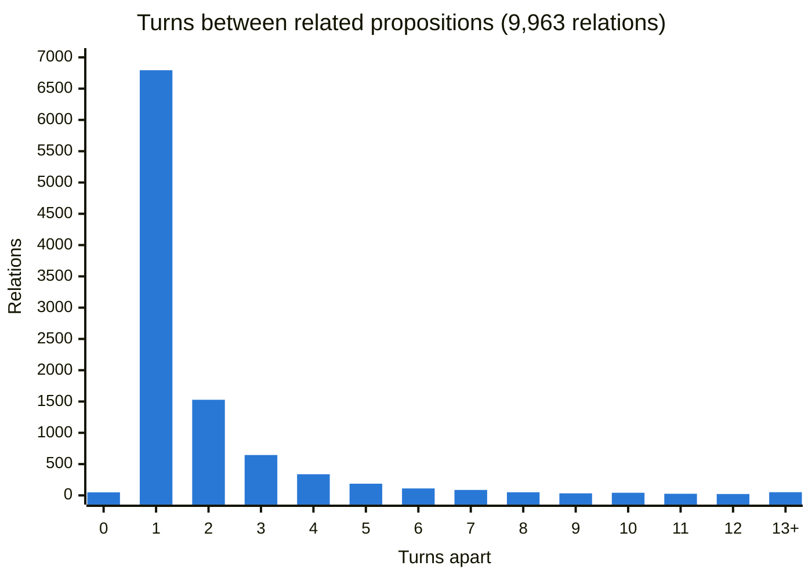
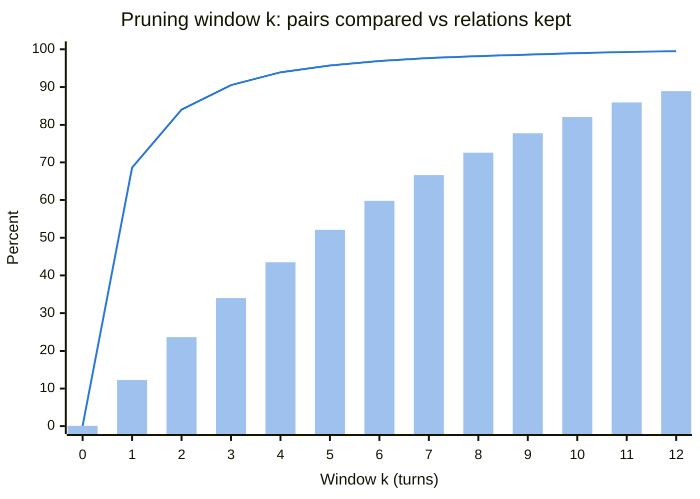
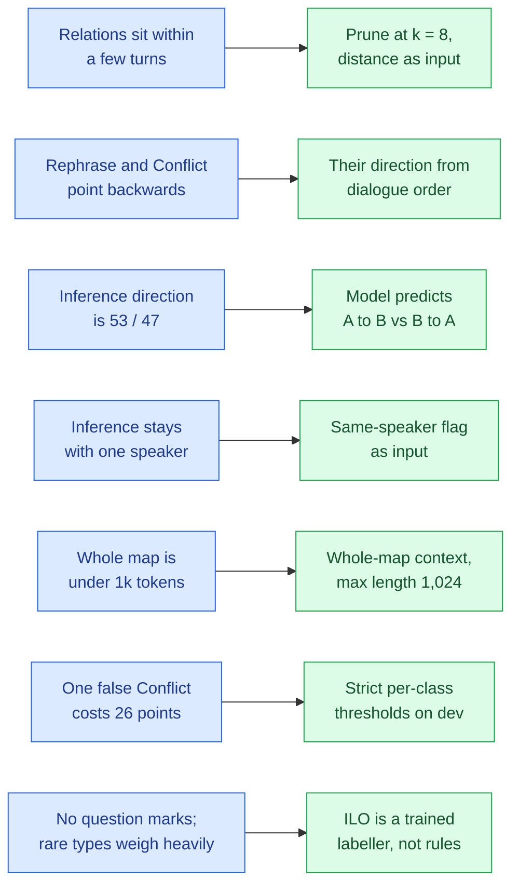

# What the data tells us: exploratory analysis of DialAM-2024

> **Phase 2 of the build** (the A1 part of PLAN Phase 1). All four approaches use these findings.
> Background on maps, IAT and scoring is in [`../CLAUDE.md`](../CLAUDE.md), and every decision that follows from here is in
> [`../a1_cross_encoder/decisionlog.md`](../a1_cross_encoder/decisionlog.md).
> Numbers come from [`run_eda.py`](run_eda.py) (raw output: [`findings.json`](findings.json)) and take about 2.5 minutes to run:
> `python -m eda.run_eda` from the repo root, in the WSL venv.

Before building models we asked the data the questions our design depends on:
- How far apart are related statements?
- Which way do the arrows point?
- Can surface cues give away a question?
- How long are the inputs?
- Is the test set really unseen?

This document answers them in the order a map is built: first the dialogue, then what each turn *means*, then how the meanings relate. It ends with what each answer changes in our design.

**Data used.** The **training split only** (1,250 maps, see [`../splits/`](../splits/)), so the dev split stays untouched for tuning.
Where a statistic is about pairs or relations, it uses the **1,231 "test-like" maps**, those with at most 40 propositions (the largest test map has 35).
The 19 larger training maps are covered separately in §1. From the test set we read the **inputs** only: sizes, dates and text. The gold answers stay sealed until the final run.

---

## At a glance

| # | Finding | Number | What it changes |
|---|---|---|---|
| 1 | Related propositions are close together | 69% are in adjacent turns; 98% within 8 turns | Compare pairs within **8 turns** only (§5) |
| 2 | Distance alone is a strong clue | Adjacent pairs are related **43%** of the time, against 8% overall | Give the model the distance explicitly (§5) |
| 3 | Rephrase and Conflict point backwards | 97.8% and 97.7% go from the later to the earlier statement | Their direction can be read off the dialogue (§4) |
| 4 | Inference direction is a coin flip | 53% "because" vs 47% "so" | The model must predict Inference direction (§4) |
| 5 | Inference stays within one speaker | 94.5% same speaker, against a 66% base rate | Give the model a same-speaker flag (§6) |
| 6 | Conflict is absent from most maps | 57% of maps have none; one false Conflict costs **26 points** there | Conflict needs a strict threshold (§7) |
| 7 | A whole map fits into one model input | Pair + entire dialogue ≤ 837 tokens | Show the model the **whole map** instead of a window (§8) |
| 8 | "?" doesn't mark questions here | Only 7% of question turns contain "?" | Use question words and the "xxx" placeholder instead (§3) |
| 9 | Plain text similarity links turns to propositions | 94.2% correct at the first guess | A strong starting point for the Phase 3 rules (§2) |
| 10 | The test set is unseen text | 0 shared or near-identical propositions; 9 of 11 maps are from 2022–23 | No leakage; expect some topic drift (§9) |

---

## 1. What a map is

A map is one file in the corpus: a short stretch of a *Question Time* episode that annotators marked up as one unit (a "nodeset").
**We don't choose where maps begin and end.** The boundaries come with the data, and they are also the unit of scoring:
the scorer only pairs propositions *within* a map, so no relation ever crosses from one map to another.

A typical map is a question and the discussion it starts:

| | Training maps (median / 90th pct) | Test inputs (median / max) |
|---|---|---|
| Dialogue turns | 14 / 22 | 16 / 35 |
| Propositions | 14 / 21 | 15 / 35 |
| Speakers | 2 / 4 | 2 / 7 |

- 27% of training maps open with the host, Fiona Bruce.
- Almost half of all L-nodes (**46.6%**) are *analyst copies*: annotation bookkeeping such as `"Anna: Helen Whately : …"`. They never sit in the dialogue chain and never express a proposition, so they are removed from the dialogue (decision D014).
- **19 training maps are giants**, with 41 to 287 propositions. They hold only 12.8% of the relations but **60% of all proposition pairs**, because pairs grow with the square of map size. Left in, they would dominate every pair-level statistic and most of the training data, so this document excludes them from pair statistics. Phase 4 decides how to train on them.

Here is one real test-like map (training map `nodeset18299`). It already shows most of what makes the task hard:

*Figure 1: propositions and gold relations of one 8-turn map. Blue = the host's question, amber = the guest's answer. Arrows go from premise (or later statement) to conclusion (or earlier statement).*

The answer rephrases the question (I2 → I1). I6 has two separate reasons (*convergent*), and I7 supports two conclusions (*divergent*); the 2024 systems got these directions wrong. The guest even conflicts with herself (I5 → I4). The rest of this document measures how common each of these patterns is.

---

## 2. Turns and propositions: who says what

Every scored decision depends on knowing **which turn each proposition comes from**:
- ILO scores exactly that link.
- ARI needs it to know how far apart two propositions are and who said them.

In training maps the link is given by an illocution (L→I). In test maps it isn't, so it must be predicted (Phase 3).

**The link is almost always one-to-one.**
- 98.8% of linked propositions come from exactly one turn.
- 99.8% of turns that express anything express exactly one proposition.
- **20% of turns express no proposition at all**: interruptions, "yes", the host's scene-setting.

**Every proposition needs a place in the dialogue**, to measure distances. We place each one by the first rule that applies:

*Figure 2: how a proposition gets a dialogue position. Green = placed (97.3% in total), red = not placed.*

The third rule matters. 12.4% of propositions have **no illocution at all**, yet 97.5% of them take part in a relation. Their text almost always matches a turn in the same map, so the annotators left the link out; the proposition is still there. The third rule places most of them. After all three rules, **only 3 relations in the test-like maps involve a proposition with no position**.

**Plain text similarity is a strong starting point.** For each turn, we picked the proposition whose text is most similar (`difflib` ratio). That guess is right for **94.2%** of 17,473 turns. The Phase 3 rules add the one-to-one constraint and dialogue order on top of this.

---

## 3. How the kind of speech act shows

ILO asks *how* each turn was said. In training it is overwhelmingly one answer:

| Label (L→I) | Count | Share |
|---|---|---|
| Asserting | 15,784 | 90.1% |
| Pure Questioning | 1,023 | 5.8% |
| Assertive Questioning | 220 | 1.3% |
| Rhetorical Questioning | 193 | 1.1% |
| Default Illocuting | 123 | 0.7% |
| Agreeing | 95 | 0.5% |
| Challenging / Disagreeing / Arguing / Restating | 38 / 19 / 10 / 4 | 0.4% together |

The plan assumed a "?" would give questions away. **It doesn't: the transcripts have almost no question marks.** Other cues work far better:

| Cue | Pure Q. | Rhetorical Q. | Assertive Q. | Asserting |
|---|---|---|---|---|
| Turn contains "?" | 7.3% | 8.3% | 7.3% | 0.2% |
| Turn **starts with a question word** (what, why, do, should…) | **74.5%** | **67.9%** | 41.8% | 4.0% |
| Proposition contains the placeholder **"xxx"** | **45.7%** | 18.7% | 6.4% | 0.4% |

The "xxx" is an annotation convention: a question's proposition leaves a slot for the unknown part, e.g. *"the Government going to do **xxx** to help workers…"*.
The two cues together separate questions from assertions well. Telling the three *kinds* of question apart is harder, and a rule baseline will probably miss Assertive and Rhetorical questions most. That gap is where a learned classifier could earn its place.

---

## 4. The relations, and which way they point

In the test-like training maps there are **5,057 Inference, 4,044 Rephrase and 865 Conflict** pairs (as the scorer counts them: one per premise).

- Nearly every map has an Inference (95.9%) and a Rephrase (91.7%). **Conflict appears in only 43.4% of maps.**
- **12.7% of Inferences are *linked*** (2 to 4 premises together). The scorer sees each premise as its own pair, so this matters only for valid output maps.
- Only 12 proposition pairs carry two different relations, so predicting **one label per pair** loses almost nothing.

**Direction** is where the relation types differ sharply. We compare the turn of the arrow's source with the turn of its target:

| Relation | Later → earlier | Earlier → later | Same turn |
|---|---|---|---|
| Rephrase | **97.8%** | 1.0% | 1.2% |
| Conflict | **97.7%** | 2.3% | 0% |
| Inference | 53.1% ("B, because A") | 46.8% ("A, so B") | 0.0% |

Rephrase and Conflict almost always point back to what was said before, so their direction can be read off the dialogue order at a cost of about 2%.
**Inference has no default direction.** Premise-first and conclusion-first are almost equally common, so the model has to decide the direction itself. That is why A1's labels include *A→B Inference* and *B→A Inference* as separate classes, and why getting direction wrong (the divergent-vs-convergent confusion in 2024) is a real risk, not an edge case.

---

## 5. How far apart related propositions are

Distance is the number of dialogue turns between the two propositions' positions:

*Figure 3: most relations join neighbouring turns. Median distance 1 for all three types; 90th percentile 3 (Inference, Conflict) and 4 (Rephrase).*

Relations connect **neighbouring turns**: 69% are exactly one turn apart and 84% within two. The tail is thin but long; the furthest relation spans 24 turns.

This suggests **pruning**: only compare propositions within *k* turns of each other, and call the rest None without asking the model. Pruning is cheaper, and it removes pairs that are almost never related. The price is that a relation outside the window can never be found. The trade-off:

*Figure 4: bars = share of the 127,417 proposition pairs the model must score (cost); line = share of the 9,895 related pairs still reachable (the recall ceiling).*

| Window *k* | Pairs compared | Relations kept | Related share among compared pairs |
|---|---|---|---|
| 1 | 12.3% | 68.6% | **43.3%** |
| 2 | 23.6% | 84.0% | 27.6% |
| 3 | 34.0% | 90.5% | 20.7% |
| 5 | 52.1% | 95.7% | 14.3% |
| **8** | **72.6%** | **98.2%** | 10.5% |
| 10 | 82.1% | 99.0% | 9.4% |
| all | 100% | 100% | 7.8% |

Two conclusions:
1. **k = 8 keeps 98.2% of relations** (the plan's ~98% target) and drops 27% of pairs. That's a useful saving but smaller than the plan assumed ("removes most None pairs"). Most of the class imbalance survives pruning, so the class weighting and thresholds in A1 still carry most of the load.
2. **Distance is highly informative in itself.** Neighbouring propositions are related 43% of the time, against 8% overall. Rather than a hard cutoff doing all the work, the model should *see* the distance and learn how much it matters.

Per type, the 98% window is 6 turns for Inference, 8 for Conflict and 10 for Rephrase. Rephrases reach furthest back, because answers point to questions asked several turns earlier (§6).

---

## 6. Speakers and questions

Is a relation more likely between two statements by the *same* speaker? The comparison needs a baseline: among all pairs within 8 turns, **66%** share a speaker.

| Relation | Same speaker | Different speakers | Compared with the 66% baseline |
|---|---|---|---|
| Inference | **94.5%** | 5.5% | Strongly same-speaker: people argue for their own claims |
| Rephrase | 81.7% | 18.3% | Mostly same-speaker restatement; the rest are answers to questions |
| Conflict | 56.1% | **43.9%** | More cross-speaker than baseline, yet over half are a speaker contradicting themselves |

So a **same-speaker flag** is a strong clue for Inference. For Conflict it points the right way but isn't decisive; "Conflict means different speakers" would be a bad rule.

**Questions and answers.** 46.2% of questions receive a Rephrase from their answer, and 18.6% of all Rephrases point at a question. Answering a question counts as rephrasing it, which Figure 1 showed as I2 → I1. This is a well-defined pattern a model can learn from the question cues in §3.

**Unscored links, for completeness.** Each relation also gets an illocution on its transition, which isn't scored but is needed for a valid map:

| Relation | Most common | Share |
|---|---|---|
| Inference | Arguing | 97.9% |
| Rephrase | Restating (Default Illocuting 13.7%) | 85.9% |
| Conflict | Disagreeing (Challenging 4.3%) | 94.3% |

---

## 7. The rare-label trap, measured

The metric averages F1 over the labels present in a map, gold *or predicted*. A label that appears only in the prediction adds a class with F1 = 0. We measured the cost directly: take a **perfect** prediction, add **one** wrong label, and re-score.

| Situation | Maps | ARI/ILO F1 (general) after one mistake |
|---|---|---|
| One false Conflict, map has **no** gold Conflict | 695 | **73.7** (from 100) |
| One false Conflict, map already has a Conflict | 553 | 93.1 |
| One false new illocution type (e.g. Challenging) | 1,217 | **72.8** |

**57% of maps have no Conflict**, and in those maps a single wrong Conflict costs about a quarter of the ARI score. The same holds for ILO's rare types.
This is why every approach ends in a **decision layer**: predict a rare label only when the probability clears a strict threshold, tuned on dev for the per-map metric. A missed Conflict costs less than an invented one.

---

## 8. How long the inputs are

Measured in ModernBERT tokens (the tokenizer A1 uses):

| Text | Median | 99th pct | Max |
|---|---|---|---|
| One proposition | 14 | 44 | 91 |
| One turn (speaker + words) | 17 | 49 | 96 |
| A whole map (all turns + all propositions) | 504 | 898 | 1,392 |
| A whole **test** map | 580 | 953 | 953 |

A model input is two propositions plus some surrounding dialogue. For the pairs within 8 turns:

| Dialogue context in the input | Median | 99th pct | Max |
|---|---|---|---|
| Only the turns between the two (w = 0) | 127 | 271 | 423 |
| ± 2 turns around them (w = 2) | 192 | 346 | 522 |
| ± 5 turns (w = 5) | 264 | 428 | 592 |
| **The entire dialogue of the map** | **352** | **621** | **837** |

**Every pair, with its map's entire dialogue, fits in 1,024 tokens.** ModernBERT reads up to 8,192. So A1 doesn't have to choose a window: the model can see the whole map for every pair, which directly targets 2024's biggest weakness (no context). The windowed version becomes an ablation. The cost is compute: about 1.8× the tokens of w = 2.
A rough estimate from the Phase 0 throughput (15–19k tokens/s for ModernBERT-base): about 30 min per training epoch with the whole map, against about 17 min with w = 2. Phase 5 measures this properly.

For the whole-map approaches (A2–A4), even the largest test map is under 1,000 tokens, so prompts with several full example maps stay small and cheap.

---

## 9. Is the test set different?

- **No text leakage.** None of the 11 test maps' propositions appears in the training split, exactly or near-exactly (word overlap ≥ 0.8), and no test turn does either.
- **Mostly later debates.** Test maps 1–2 are dated 2020-06-04. Maps 3–11 come from 2022–2023 episodes, *after* the corpus's 2020–21 period, so topics shift (e.g. strikes and NHS pay rather than lockdown).
  Models that memorise topics will transfer worse than models that learn structure. This favours cues like distance, speaker, direction and question form.
- **Similar shape.** Test maps are a little larger (median 15 propositions, max 35) but within the test-like range, and several are deliberately rich in linked, convergent and divergent arguments (CLAUDE.md §5).

---

## 10. What this changes

*Figure 5: blue = finding, green = design decision it leads to.*

| Approach | What the findings mean for it |
|---|---|
| **Phase 3 (shared ILO labeller, trained)** | Use text similarity (94% alone) only to pick each turn's candidate propositions, then let a trained model decide the link and the type. Decode one-to-one, allow turns with no proposition (20%), and threshold the rare types. The model must learn the question cues (question words, "xxx"), because "?" is missing. |
| **A1 cross-encoder** | Candidates within 8 turns (98.2% of relations). Input = the pair + the whole map's dialogue, with distance and same-speaker marked (max 1,024 tokens). Five labels, with Rephrase/Conflict direction from dialogue order. Class weights and strict thresholds, because pruning leaves most of the imbalance in place. |
| **A2 whole-map LLM** | Maps are small, so several full few-shot examples fit easily. Tell the model that Rephrase/Conflict point backwards, that Inference goes either way, and that Conflict is rare. |
| **A3 fine-tuned LLM** | Test-like maps fit in a short context. The 19 giant maps need splitting or dropping. |
| **A4 Jev** | The same k = 8 pruning cuts the questions per map by about a quarter; the state easily holds the whole map plus example maps. |

**Corrections to earlier assumptions** in `PLAN.md` / `CLAUDE.md`:
- "?" is not a usable question cue (§3).
- Pruning removes about a quarter of pairs, not most of them (§5).
- The whole map fits in the model input, so the plan's "dialogue window" can be the whole map (§8).

These are logged as proposed decisions D018–D024. After this analysis, ILO was switched from rules to a trained labeller (D025).

---

## Definitions

| Term | Meaning here |
|---|---|
| Turn | One dialogue L-node (not an analyst copy), in the order given by the transition (TA) chain |
| Position | The turn a proposition belongs to (§2, Figure 2) |
| Distance | The absolute difference between two propositions' positions, in turns |
| Test-like map | A training map with at most 40 propositions (1,231 of 1,250) |
| Pair | An unordered pair of propositions in one map; the scorer uses ordered pairs, so each appears twice there |
| Relation | One premise → conclusion (or later → earlier) link between two propositions, as the scorer counts it |
