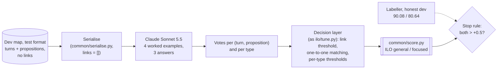

# Brief: can Claude do Task B better than the trained labeller? (dev test, D090)

*Written 2026-10-14 for a Claude Code session to execute. Self-contained: read this file, `CLAUDE.md` and the decision-log phase map, then work through the steps in order. Decision D090 in [`../../decisionlog.md`](../../decisionlog.md) records this protocol; its status is **Proposed** until the user approves it.*

---

## 1. The question, in plain words

Task B (illocutions, ILO) asks, for every dialogue turn: **which proposition does it say, and how** (asserted, asked, agreed…)? In every system so far, one trained component answers this: the ILO labeller in `ilo/` (ModernBERT-base). Its honest dev score is **90.08 / 80.64** (general / focused, cross-fitted), with links found at 98.3% recall and 99.6% precision. Claude has only ever been *given* those links. It typed turns once (A2), which gained +0.3 on dev and lost 1.1 on test.

**This experiment asks:** given a map in test format (turns and propositions, no links between them), can Claude Sonnet 5.5 do the whole of Task B, linking *and* typing, better than the labeller?

**Why it might:** most labeller misses are short reply turns ("Yes", "it stinks") whose proposition was rebuilt from context. The labeller only considers its top text-similarity candidates. A model that reads the whole map could catch them, and it knows the rare types (Agreeing, Challenging) that the labeller never predicts.

**Why it might not:** linking is nearly solved (remaining errors cost under 1 point). The labeller's precision comes from one-to-one matching and thresholds tuned to the metric, and every wrong rare type triggers the rare-label trap (one invented label in a map without it drops a perfect 100 to about 74).


*Figure 1: the experiment. Only Task B is predicted; relations are not involved.*

## 2. Rules that apply (from `CLAUDE.md`; do not relax any)

1. **Gated steps.** For each step below, explain it to the user, do it, check its gate, log it, and present the next step. **Ask before any step that makes Claude calls** (steps 3, 4 and 5): they use the user's Claude Pro usage.
2. **Never read `data/evaluation/`.** This is a dev-only experiment. Every system has had its single test run; a new test run is out of scope and would be a separate decision by the user.
3. **Dev in test-input format.** Dev maps are stripped with `common.aif.strip_to_input` (I, L and TA nodes only). Gold is used only for scoring and tuning.
4. **Score only with `common/score.py`** (or `ilo.tune.ilo_f1`, which `ilo/tune.py` asserts is equal to it). Report ILO general and focused as per-map macro scores averaged over maps.
5. **No node IDs or node order** reach the model (D029). `common/serialise.py` already guarantees this.
6. **Log every run** to `results/timing.csv` with `common.timing.timed("ilo_llm", "<stage>", ...)`.
7. **Record decisions** in `decisionlog.md` as they happen (D090 for this protocol; D091 onwards for anything decided along the way).
8. **Don't modify `a2_llm/`, `ilo/` or any committed result.** New code goes in `ilo_llm/`, new results in `results/ilo_llm/`, and the answer cache in `cache/ilo_llm/` (git-ignored).
9. **Running code:** ML code runs in WSL, for example
   `wsl -e bash -lc 'cd "/mnt/c/Argument Mining" && ~/.venvs/dialam/bin/python -m ilo_llm.check'`.

## 3. The protocol (fixed before any call)

| Setting | Value | Why |
|---|---|---|
| Maps | the 225 dev maps (`dev225` in `a2_llm/runner.resolve`) | the labeller's honest score is on these 225 |
| Input | `serialise(strip_to_input(gold), name, links=[])` | test format: with no links, propositions are placed only by text similarity (`common/positions.py`, ≥ 0.8), the rest listed as unplaced |
| Model | Claude Sonnet 5.5 via `a2_llm/claude_cli.py` (Pro login, `--json-schema`) | same route as A2 |
| Worked examples | 4 retrieved training maps (`a2_llm.prompt.Pool.nearest`), **rendered the same way as the target** (no links, similarity placement), followed by their gold answer | examples must match the input the model will see |
| Answers | 3 per map, voted | as A2 |
| Effort | chosen on the pilot (step 4): `medium` or `xhigh`; a tie (< 5 points on 20 maps) goes to `medium` | A2's tie rule; `medium` is 2.7× faster |
| Types | the labeller's 10: `ilo.data.LABELS[1:]` | A2's prompt had only 7; Disagreeing, Arguing and Restating are added |
| Decision layer | mirrors `ilo/tune.py`: link threshold on vote share, one-to-one Hungarian matching (`ilo.decode.decode_map`), per-type-group thresholds falling back to Asserting (`GROUPINGS["shared"]`) | the labeller's advantage includes this layer, so Claude gets the same one |
| Honest score | leave-one-dev-episode-out cross-fitting, the same 5 episodes as `ilo/tune.py main()` | the same protocol as the 90.08 / 80.64 |
| **Stop rule** | Claude is **better** only if its honest dev ILO exceeds the labeller's by more than 0.5 on **both** settings: general > **90.58** and focused > **81.14**. Otherwise **not better** | modelled on D038 (adopt v2 only if cross-fitted general beats v1 by more than 0.5), made stricter by also requiring focused, since Claude's risk is the rare-label trap. The paired bootstrap is reported either way |
| Prompt revision | at most **one**, on the pilot only, from reading its errors (as A2 went v0 → v1) | dev is never used to shape the prompt |

## 4. Steps

### Step 1 · Log D090 as Approved
When the user says go, change D090's status in `decisionlog.md` from Proposed to **Approved** (with the date), and set the phase-map row for phase 9 to *In progress*. Gate: the log matches section 3 exactly.

### Step 2 · Build `ilo_llm/`
Create the package (each file starts with a docstring in the style of `a2_llm/`):

- **`ilo_llm/prompts/system_v0.md`**, adapted from `a2_llm/prompts/system_v1.md`. Keep its *Input* section (minus the "Links to type" line) and its illocution definitions. Drop Task 2 (relations) and the Confidence section. Add:
  - the task: for **every** turn, the proposition it expresses (or `none`) and its type;
  - definitions for the three added types. Take them from the annotation spec in `reference/`; don't invent them;
  - the conventions the labeller learned (03 report, EDA): about 90% of illocutions are Asserting; a short agreement turn ("Yes") links to the claim agreed with; most turns link to the proposition placed under them, but short or rebuilt turns may link to an unplaced one or to one placed under a neighbouring turn; the host's questions are Pure or Assertive Questioning; a turn usually expresses one proposition, and a proposition is expressed by one turn.
- **`ilo_llm/schema.py`**: `schema(s)` returns `{"illocutions": [{"turn": <enum of this map's T ids>, "proposition": <enum of P ids + "none">, "type": <enum of the 10 types>}]}`, plus `problems(answer, s)` as in `a2_llm/schema.py`.
- **`ilo_llm/prompt.py`**: `render(s)` (the serialised text, with no "Links to type" line), `gold_answer(gold_aif, s)` (one entry per dialogue turn: its first gold link from `view(gold).anchors()` restricted to `v.turn`, else `none` with type Asserting), `example(name)` (rendered with `links=[]` plus its gold answer), and `user_message(s, examples)`. Reuse `a2_llm.prompt.Pool` for retrieval, but render examples with this module's `example()`.
- **`ilo_llm/parse.py`**: `votes(s, answers)` → for every (L-node, I-node) any answer linked: the link share (answers linking it ÷ number of answers) and the type shares. `rows_probs(s, votes)` → rows `{"map", "turn", "prop"}` and an `(n, 11)` array in `ilo.data.LABELS` order, with `P(None) = 1 − link share` and `P(type) = link share × type share`. This is exactly the shape `ilo.decode.decode_map` expects.
- **`ilo_llm/runner.py`**: copy `a2_llm/runner.py` and change:
  - `CACHE = ROOT/"cache"/"ilo_llm"/"answers"` and `OUT = RESULTS/"ilo_llm"`;
  - the `RUNS` table (below);
  - `jobs()`: this module's prompt and schema, `links=[]` for every split, and training maps excluded from their own example pool;
  - `evaluate()`: this module's `problems`;
  - the timing approach name: `timed("ilo_llm", ...)`.

  Keep the usage-limit handling, `--workers`, `--until-done` and `--export` unchanged.

  ```python
  RUNS = {
      "smoke":        {"split": "train", "maps": SMOKE, "samples": 1, "k": 4, "effort": "medium", "prompt": "v0"},
      "pilot-medium": {"split": "train", "maps": "pilot", "exclude": "pilot", "samples": 1, "k": 4, "effort": "medium", "prompt": "v0"},
      "pilot-xhigh":  {"split": "train", "maps": "pilot", "exclude": "pilot", "samples": 1, "k": 4, "effort": "xhigh",  "prompt": "v0"},
      "dev":          {"split": "dev",   "maps": "dev225", "samples": 3, "k": 4, "effort": "<chosen in step 4>", "prompt": "<v0 or v1>"},
  }
  ```
  `"pilot"` resolves to the 20 maps in `results/a2/pilot_maps.json`, and `"exclude": "pilot"` to its 210 excluded pool maps (no example from a pilot map's own debate).
- **`ilo_llm/tune.py`**: a `ClaudeDev` class with the interface of `ilo.tune.Dev` (`rows`, `raw`, `idx`, `names`, `gold`, `n_pairs`, `gold_aif`, `links()`, `scores()`). Build `gold` and `n_pairs` exactly as `Dev.__init__` does, and set `rows` / `raw` from `parse.rows_probs` over a run's answers. Then reuse `ilo.tune.tune()` (no temperature: use `raw` as it is) and the cross-fitting loop of `ilo.tune.main()`. Write `results/ilo_llm/<run>/thresholds.json`.
- **`ilo_llm/check.py`** (no calls), writing `results/ilo_llm/check.json`:
  1. **Gold round trip:** for each of the 225 dev maps, the gold answer → `problems()` empty → `votes` → `rows_probs` → `decode_map(link_min=0.5)` → `common.score.score_map`. Gate: mean ILO ≥ **98.6 / 94.7** (the one-to-one decoder ceiling in the 03 report, 98.63 / 94.73; one-to-one matching can't express turns with two propositions). Every map must be valid.
  2. **Prompts build:** every dev and pilot map gives a non-empty user message and a schema whose enums cover all its turns and propositions.
  3. **Prompt sizes:** min / median / max characters of system prompt + user message, next to A2's dev prompt sizes in `results/a2/check.json`. Gate: no prompt more than 1.2× A2's largest.
  4. **Reference reproduced:** recompute the labeller's honest per-map dev scores with `ilo.tune` (run v1, shared groups) and assert they average to **90.08 / 80.64**. Save them as `results/ilo_llm/labeller_per_map.json`; step 6's bootstrap needs them.

Run: `wsl -e bash -lc 'cd "/mnt/c/Argument Mining" && ~/.venvs/dialam/bin/python -m ilo_llm.check'`. **Gate:** all four checks pass.

### Step 3 · Smoke test (3 calls, ask first)
`... -m ilo_llm.runner --run=smoke`. Gate: 3/3 answers valid and answered by `claude-sonnet-5-5`, with no other model writing more than a few tokens. Takes about 30 s.

### Step 4 · Pilot: choose the effort (40 calls, ~10 min, ask first)
```
wsl -e bash -lc 'cd "/mnt/c/Argument Mining" && ~/.venvs/dialam/bin/python -m ilo_llm.runner --run=pilot-medium --export'
wsl -e bash -lc 'cd "/mnt/c/Argument Mining" && ~/.venvs/dialam/bin/python -m ilo_llm.runner --run=pilot-xhigh --export'
```
Score each with argmax decoding (`decode_map`, `link_min = 0.5`, no type thresholds) on the 20 pilot training maps. Write `results/ilo_llm/pilot.json` with ILO general / focused, link recall / precision, per-type counts, thinking tokens per call, seconds per call and API-equivalent cost.
- **Choose the effort** by the tie rule in section 3. Record the choice in D090.
- **Optional single revision:** if the errors show a clear, fixable pattern (write `results/ilo_llm/pilot_errors.md` first), make `system_v1.md`, re-run only the chosen effort as `pilot-<effort>-v1`, and keep v1 only if it is not worse. Log the revision as D091.
- **Sanity gate:** pilot ILO general ≥ 80. If it's lower, stop and report to the user (similarity + Asserting alone scores 76.0 on dev).
- Don't compare with the labeller here: it was trained on these maps.

### Step 5 · Dev run: 225 maps × 3 answers (675 calls, ask first)
Set the `dev` run's effort and prompt in `RUNS`, then:
```
wsl -e bash -lc 'cd "/mnt/c/Argument Mining" && ~/.venvs/dialam/bin/python -m ilo_llm.runner --run=dev --export --workers=2 --until-done'
```
- **Time:** at `medium` about 30 min (A2's medium dev pass: 225 calls in 598 s with 2 workers). At `xhigh` about 80 min of calls but up to ~12 h of wall time, because a Pro session holds about 450 `xhigh` calls and the runner sleeps through each reset.
- **Usage:** these calls draw on the same Claude Pro limits as the Claude Code session running this brief. Start the run in a separate terminal and check on it; don't keep a long session busy meanwhile.
- **Gate:** 675/675 accepted answers (`results/ilo_llm/dev/summary.json`). Raw answers are exported to `results/ilo_llm/dev/responses.jsonl.gz` and committed.

### Step 6 · Score and analyse (no calls)
`... -m ilo_llm.tune --run=dev`, then an `ilo_llm/evaluate.py` that writes `results/ilo_llm/dev/dev_report.json` with:
1. **Main result:** Claude's honest (cross-fitted) dev ILO general / focused, next to the labeller's 90.08 / 80.64, plus Claude's argmax and tuned-on-all-dev scores (optimistic, labelled as such).
2. **Paired bootstrap** over the 225 maps (Claude − labeller, general and focused; 10,000 resamples, seed 13): reuse `a3_finetune.tune.bootstrap` with the per-map scores from check 4.
3. **Verdict** by the stop rule in section 3, stated in one line.
4. **Linking:** recall and precision against gold (labeller: 98.27% / 99.62%), and a breakdown of the disagreements:
   - links Claude finds that the labeller misses (and how many are right);
   - links the labeller finds that Claude misses;
   - pairs where both link the turn but to different propositions.

   Give 5 short examples of each kind (turn text, proposition text, gold).
5. **Per-type F1** pooled over dev (`ilo.evaluate.per_type` works with a `ClaudeDev`), for both systems, especially the six rare types the labeller never predicts.
6. **Rare-label trap:** the number of maps where each system predicts a type absent from that map's gold.
7. **Cost:** calls, seconds per call, API-equivalent cost and Pro sessions used.

**Figure** `reports/figures/ilo-claude-vs-labeller.png`, drawn by a script `reports/ilo_claude_figure.py` that reads only committed results:
- **a**, honest dev ILO (general and focused) for both systems, with bootstrap intervals for the difference;
- **b**, per-type F1 for both systems, annotated with each type's number of gold instances.

Match the style of `reports/short_report_figures.py` (reuse its rcParams and colours: the labeller in A1's grey family, Claude in A2's blue). Check the rendered image before saving: no overlapping labels, axes starting at sensible values, and every number traceable to `dev_report.json`.

### Step 7 · Write up, log, commit
1. **`reports/03-ilo-labeller.md`:** add a section "Can Claude do Task B? (D090, dev only)". It should have a short narrative, the main table, the figure, the disagreement examples and the verdict, with every number taken from `results/ilo_llm/`.
2. **`README.md`:** add one sentence, which depends on the verdict.
   - **Not better:** add it to *Findings* or *Limitations*, e.g. "Claude doing Task B end to end did not beat the trained labeller on dev (X vs 90.08)".
   - **Better:** add it to *Findings*, stating that this is dev-only and that the test set was not re-run.
3. **`decisionlog.md`:** set D090 to **Done** with the result. Update phase 9 in the phase map, and update `CLAUDE.md`'s "Current state" with one line.
4. **`results/timing.csv`** must have a row for every run.
5. **Commit** to main with the user's identity:
   `git -c user.name="Kunal Kamra" -c user.email="$(git log -1 --format=%ae 7462dc3)" commit -m "..."`.
   Tell the user to run `git push origin main`.

## 5. What not to do
- Don't run anything on the 11 test maps, and don't open `data/evaluation/`.
- Don't tune the prompt, effort or examples on dev. Only the decision layer is tuned on dev, and only cross-fitted for the honest score.
- Don't give Claude the labeller's links or types; this is the end-to-end test.
- Don't present the A1 + A2 + A4 combination anywhere (D089).
- Don't change A2's or the labeller's committed numbers.

## 6. Expected outputs
| Path | What |
|---|---|
| `ilo_llm/` | prompts, schema, prompt, parse, runner, tune, check, evaluate |
| `results/ilo_llm/check.json`, `labeller_per_map.json` | gates and the reference per-map scores |
| `results/ilo_llm/pilot.json`, `pilot_errors.md`, `pilot-*/` | pilot scores and the effort choice |
| `results/ilo_llm/dev/` | `summary.json`, `responses.jsonl.gz`, `thresholds.json`, `dev_report.json` |
| `reports/figures/ilo-claude-vs-labeller.png`, `reports/ilo_claude_figure.py` | the figure and its script |
| `reports/03-ilo-labeller.md`, `README.md`, `decisionlog.md`, `CLAUDE.md` | the write-up and the log |

## 7. Budget
| Step | Calls | Time | Cost |
|---|---|---|---|
| 3 · smoke | 3 | ~30 s | $0 (Pro) |
| 4 · pilot | 40 (+20 if revised) | ~10–15 min | $0 (Pro) |
| 5 · dev | 675 | ~30 min (`medium`) to ~12 h wall (`xhigh`) | $0 on Pro; about $25–40 API-equivalent |
| 2, 6, 7 | 0 | under 1 h of compute | $0 |
