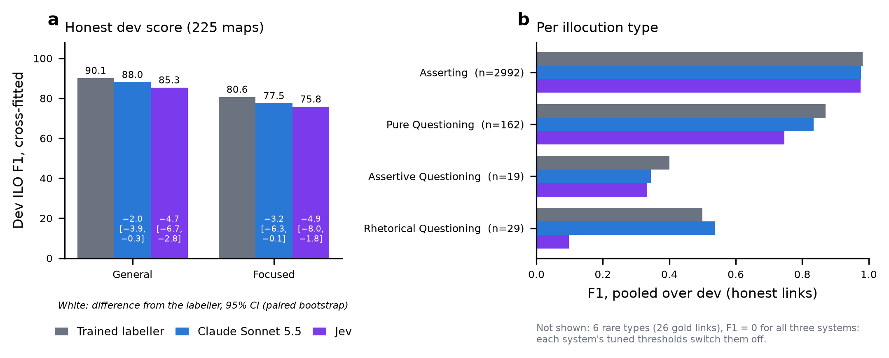

# Phase 3 · Discussion — the ILO labeller: why a small trained model holds Task B

> **Status:** written 2026-10-14, after the two dev tests of general models doing Task B (D090 Claude, D099 Jev). It is a companion to the findings report [`03-ilo-labeller.md`](03-ilo-labeller.md), which has every detail.
> **Sources:** `results/ilo/v1/` (`dev_report.json`, `headroom.json`, `train_summary.json`, `thresholds_shared.json`), `results/a1/v1/test_global.json` (the test score), `results/ilo_llm/dev/dev_report.json` (Claude), `results/ilo_jev/dev/dev_report.json` (Jev) and `results/ilo_llm/check.json` (the decoder's ceiling). The 2024 figure is quoted from the overview paper (`reference/2024.argmining-1.8.pdf`).

## At a glance

| Question | Answer |
|---|---|
| What is it? | A ModernBERT-base classifier that reads one (turn, proposition) pair with two turns of context on each side. One-to-one matching and thresholds tuned to the metric turn its probabilities into links and types. |
| How good is it? | Dev ILO **90.08 / 80.64** (honest, cross-fitted). Test **92.64 / 84.28**, against 2024's best of 81.17 / 72.09. |
| What does it cost? | 19.5 min of training on an 8 GB GPU, and 0.21 s per map. |
| Can a frontier model replace it? | **No.** Doing the whole task from the same input with the same decision layer, Claude Sonnet 5.5 scores 88.03 / 77.48 and Jev 85.35 / 75.76. Both are significantly below the labeller. |
| Where are its remaining points? | In typing the minority types. With Assertive / Rhetorical Questioning and the six rare types typed right, it would reach 97.07 / 90.49. |

## 1. Why a small model wins this task

Task B looks like understanding dialogue, but most of it is **matching under a fixed convention**:
- **Matching does most of the work.** Predicting nothing scores 38.21 / 0. Linking each turn to its most similar proposition and calling everything Asserting already scores 75.99 / 59.38.
- **The labeller adds 14 points of general F1.** It links better (98.27% recall at 99.62% precision, against 97.43% / 98.68% for similarity) and learns when a turn is a question.
- **The decision is local.** A turn, its candidate proposition and the turns around it are enough. The one global rule, one proposition per turn and one turn per proposition, is not learned at all: one-to-one matching enforces it.
- **The decision layer is tuned to the metric.** The model's probabilities go through a link threshold (0.10) and type thresholds (0.3–0.5 for the question types). These are tuned on dev for the per-map macro F1, which punishes any invented rare type.

Nothing here needs world knowledge or long reasoning. It needs the annotators' habits, and 1,231 annotated maps teach those.

## 2. What the general models showed

Both models got the same test-format input (turns and propositions, no links), the same description of the task, the types and the annotators' habits, and **the labeller's own decision layer** (03 report §11).

| Dev, 225 maps | Labeller | Claude Sonnet 5.5 | Jev |
|---|---|---|---|
| ILO, honest (general / focused) | **90.08 / 80.64** | 88.03 / 77.48 | 85.35 / 75.76 |
| Link recall / precision | 98.33% / 99.62% | 97.89% / 98.69% | **98.98% / 99.56%** |
| F1: Pure / Assertive / Rhetorical Questioning | **0.870 / 0.400** / 0.500 | 0.834 / 0.345 / **0.537** | 0.746 / 0.333 / 0.098 |
| Maps with a type absent from their gold | 18 | 30 | **17** |

*Figure 1: honest dev ILO and per-type F1 for the three systems (the same figure as Figure 3 of the 03 report).*

**Three lessons:**
1. **Reading the whole map can improve linking, but only if the reader follows the convention.**
   - **Jev** finds 24 correct links the labeller misses. These are mostly short turns whose proposition was rebuilt from context, outside the labeller's text-similarity candidates.
   - **Claude** follows meaning rather than the convention. In 35 wrong links it credits a relayed claim ("As James said a moment ago, …") to the turn that relays it, where the annotators credit the turn that first said it.
2. **Typing is learned, not described.** The question types are judgements that gold doesn't mark consistently on the surface.
   - Claude over-calls Rhetorical Questioning (38 predicted for 29 gold).
   - Before thresholds, Jev makes a rare type its first choice 147 times, against 26 rare gold links in all of dev. Once thresholds silence those guesses, it under-calls questions.
   - The labeller learned the annotators' balance from their examples.
3. **The decision layer is the equaliser.** For all three systems, tuning switches the six rare types off in every fold, because guessing them costs more than it gains (the rare-label trap). The tuned layer lifts Jev from 74.42 to 85.35. Without it, a general model would look far worse than it is.

## 3. Where the labeller's remaining points are

Correcting one group of types in its tuned predictions (no retraining; all of dev, so optimistic):

| Dev ILO if… | General / focused | Maps affected |
|---|---|---|
| As is | 90.16 / 80.67 | — |
| The six rare types are right | 93.04 / 85.13 | 22 of 225 |
| Assertive and Rhetorical Questioning are right | 94.17 / 85.89 | 40 of 225 |
| Both | 97.07 / 90.49 | — |
| Every linked pair is typed right | 97.87 / 90.61 | — |

Decoding the gold links themselves through the same one-to-one decoder scores 98.70 (`results/ilo_llm/check.json`). With every linked pair typed right the labeller would reach 97.87, so **better linking is worth under 1 point** (0.83). That bounds what Jev's better linking could add. The points are in typing, and neither general model types better.

## 4. Lessons for similar tasks
- **A task with a fixed annotation convention and a matching structure favours a small trained model** plus a decision layer tuned to the metric. Prompting a frontier model with the same conventions written out did not match it: Claude was 2.1 points behind and Jev 4.7.
- **Use the general model only where the trained model is blind,** and check what that is worth first. Here it is turns rebuilt from context, which is under 1 point.
- **Report general models through the same decision layer as the baseline.** Their raw outputs (Jev's simple decode, 74.42) understate them, and their tuned scores are the fair comparison.

## 5. Open items
- **The rare types** stay unsolved by every system: 26 gold links in 22 dev maps. A different signal is needed, such as transition-anchored examples or the answered turn as explicit context (03 report §10).
- **A hybrid** (Jev's links with the labeller's types) is bounded at under 1 point by §3, so it was not run.
- **Both tests are dev only.** The 11 test maps were not re-run for either model (D090, D099).

## Reproduce
See the 03 report: §4–§6 for the labeller, and §11 for the Claude and Jev tests and the figure (`python reports/ilo_llm_figure.py`).
