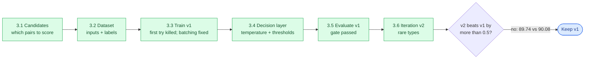
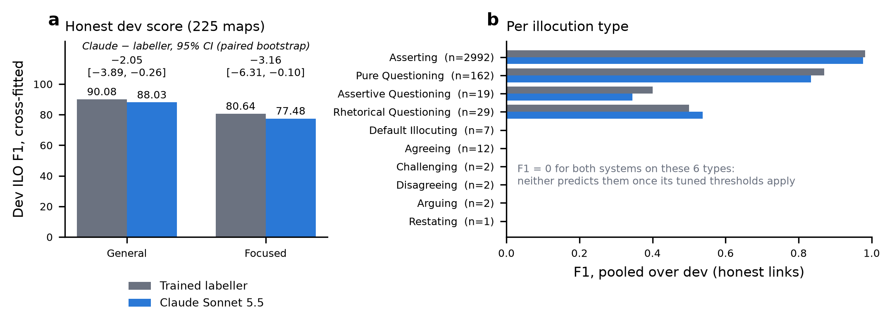

# Phase 3 — The trained ILO labeller: findings

> **Status:** passed (2026-10-01). **Run in use: v1** ([`../results/ilo/selected.json`](../results/ilo/selected.json)). A second run, v2, was trained and evaluated but not adopted.
> **Branch / commits:** `phase3-ilo`: `c34e68c` (3.1–3.2), `66df3ad` (3.3–3.5), `2d70813` (iteration v2).
> **Sources:** every number below comes from a committed file in [`../results/ilo/`](../results/ilo/): `dataset.json` for the data, and `v1/` and `v2/` for each run (training log, summary, thresholds, dev report, headroom). Decisions are D025 and D028–D039 in [`../decisionlog.md`](../decisionlog.md).
> **Claude as the labeller (D090, dev only, §11):** not better. Claude Sonnet 5.5 doing Task B end to end scores 88.03 / 77.48 on dev, against the labeller's 90.08 / 80.64 (numbers in [`../results/ilo_llm/`](../results/ilo_llm/)).
> **Scope:** Task B (ILO) for every approach, plus the turn↔proposition links that the ARI approaches need on test maps.
> **Test result (scored with A1, D050):** ILO **92.64 / 84.28** on the 11 test maps, perfect on 7 of them, against 2024's best of 81.17 / 72.09. Every system uses its links, and all but A2's submission (which let Claude override 3 types) use its turn types, so it is behind most of the project's Global margin over 2024 ([final report](05-final-report.md)).

## At a glance

| # | Finding | Number | Consequence |
|---|---|---|---|
| 1 | The trained labeller works | Dev ILO **90.08 general / 80.64 focused** (v1, cross-fitted) | Task B is in good shape: +14 general over text similarity and +52 over predicting nothing |
| 2 | Linking is nearly solved | 98.3% of links found, at 99.6% precision | Test maps get reliable positions and speakers for ARI |
| 3 | Typing the minority types holds the rest | Correct Assertive/Rhetorical and rare types would reach 97.1 / 90.5 | That is where ILO's remaining points are |
| 4 | Undertraining was *not* the cause | v2 (3 full epochs, gentler learning rate) scored 89.74 cross-fitted, and its 7 Agreeing guesses on dev were all wrong | v1 kept. Rare types need a different design, or stay switched off |
| 5 | 22 maps have no illocution layer | 19 train + 3 dev (the late "giant" batches) | Excluded from ILO training and scoring; kept for ARI |
| 6 | Text similarity misses context-rebuilt turns | e.g. "Exactly." or "it stinks" | Candidates borrowed from neighbouring turns: 99.6% recall |
| 7 | Fixed-size batches overflowed the 8 GB card | 7.7 GB and 4k tokens/s, versus 4.3 GB and 26k tokens/s with token budgets | Every training run uses token-budget batches |
| 8 | Flex attention is slower on real batches | 2.7k vs 14.2k tokens/s with standard attention | Standard attention (SDPA) is the default |
| 9 | It's cheap | Training takes 20–42 min; inference 0.21 s per map | No cost concern for the final run |

---

## How Phase 3 ran


*Figure 1: the steps of Phase 3 and the final decision.*

| Step | What happened | Decision |
|---|---|---|
| 3.1 | Similarity alone keeps 98.8% of links at best; borrowing neighbours' candidates reaches 99.6% | D028; D029 (no node-ID shortcuts) proposed |
| 3.2 | 22 maps turned out to have no illocution layer; rare types are very rare | D030, D031 |
| 3.3 | First run killed by the tool's time limit and overflowing GPU memory; fixed with token budgets; v1 trained detached | D032–D034 |
| 3.4 | Temperature and thresholds tuned on dev, scored honestly by leaving one episode out | D035 |
| 3.5 | v1 evaluated against baselines: gate passed; minority types weak | D036 |
| 3.6 | v2: longer, gentler training, checkpoint chosen by the tuned score. Not better; v1 kept | D038, D039 |

## 1. What the labeller does

ILO scores every (locution, proposition) pair. In practice that means **linking each dialogue turn to at most one proposition, and saying how it was said**. The plan first assumed simple rules would do. EDA showed otherwise: "?" is almost absent, and the rare types weigh as much as Asserting in macro-F1. So the user chose a trained model (D025).

```mermaid
flowchart LR
  M[("Map in test format<br/>turns + propositions")] --> C["Candidates<br/>similarity: own 5,<br/>prev 5, next 3"]
  C --> X["Input text<br/>turn + proposition<br/>+ 2 turns either side"]
  X --> B["ModernBERT-base<br/>11 probabilities"]
  B --> T["Temperature<br/>v1: 1.05"]
  T --> H["One-to-one matching<br/>link if 1 - P(None) at least 0.10"]
  H --> Y["Type thresholds<br/>questions 0.3-0.5"]
  Y --> O[("YA links<br/>L to I with type")]
  classDef data fill:#dbeafe,stroke:#2563eb,color:#1e3a8a
  classDef step fill:#dcfce7,stroke:#16a34a,color:#14532d
  classDef model fill:#fde68a,stroke:#b45309,color:#78350f
  class M,O data
  class C,X,T,H,Y step
  class B model
```


*Figure 2: the labeller end to end. Blue = data, green = deterministic steps (tuned on dev), yellow = the trained model.*

## 2. Candidates (3.1, D028)

The model only scores candidate pairs; everything else is None. Text similarity alone isn't enough:

| Candidates per turn | Gold links kept | Pairs |
|---|---|---|
| Most similar only (K = 1) | 94.3% | 22k |
| K = 3 | 97.5% | 66k |
| K = 6 | 98.8% | 131k |
| **Own 5 + previous turn's 5 + next turn's 3** | **99.6%** | 206k |

- **Why similarity misses:** 371 of the 433 misses at K = 3 are short turns whose proposition was rebuilt from context. "Exactly." becomes the claim agreed with; "it stinks" becomes what "it" refers to.
- **The fix:** borrow the candidates of neighbouring turns. That rescues 183 links, mostly rare types.
- **Recall per type:** every type is ≥ 98.3%, except Agreeing (93.7%) and Disagreeing (94.7%).
- **No node IDs:** the labeller never uses node IDs or node order (proposed rule D029). In 74% of links the proposition's ID is the turn's ID + 2, an annotation-tool artefact.

## 3. Data (3.2, D030–D031)

One example per candidate pair:
```
A: Jeane Freeman: Exactly.
B: Jeane Freeman can enforce it when people can fly into England … by xxx
   [SEP] before: Michael Forsyth: How are you going to enforce that? / …   [SEP] after: …
```

| | Train | Dev |
|---|---|---|
| Maps (with an illocution layer) | 1,231 | 225 |
| Examples / true links | 158,864 / 11.0% | 29,506 / 10.9% |
| Tokens: median / max | 108 / 300 | 108 / 243 |

- **22 maps have no illocution layer.** 1,614 pairs looked like links (turn text ≈ proposition text) but had no gold link, and 1,553 of them sit in 22 maps with *zero* linked turns: the late re-annotation batches (nodesets 24807–25475), which are also EDA's giant maps. They carry relations but were never annotated for illocutions. They're excluded from ILO training and dev scoring and kept for ARI. Test maps are fully annotated.
- **Rare types are very rare:**

  | Type | Train | Dev |
  |---|---|---|
  | Asserting | 15,721 | 2,984 |
  | Pure Questioning | 1,002 | 161 |
  | Assertive Questioning | 216 | 19 |
  | Rhetorical Questioning | 192 | 29 |
  | Default Illocuting | 123 | 7 |
  | Agreeing | 89 | 11 |
  | Challenging | 38 | 2 |
  | Disagreeing | 18 | 2 |
  | Arguing | 10 | 2 |
  | Restating | 4 | 1 |

## 4. Training run v1 (3.3, D032–D034)

**Setup** (recipe `v1` in `ilo/train.py`):
- ModernBERT-base, max 320 tokens, batches capped at 4,096 padded tokens (≤ 64 pairs).
- AdamW at learning rate 5e-5, 6% warm-up then linear decay, bf16.
- Class weights (most frequent / count)^0.5, capped at 30.
- Dev evaluated every half epoch; stop after 2 evaluations without improvement on the *simple* decode (one-to-one matching, most probable type, no thresholds).

**Sanity checks before training:**
- **Decoder ceiling:** decoding the gold labels scores 98.63 / 94.73, with 99.16% linking recall. The gap is candidate misses plus turns that express two propositions.
- **Majority baseline:** all-None scores 38.21 / 0.
- **Memorisation:** the model learns 72 examples perfectly in 100 steps.

**Curve** (dev, simple decode):

| Epoch | ILO general / focused | Link recall / precision |
|---|---|---|
| **0.5** | **89.46 / 78.06** (kept) | 97.5% / 99.7% |
| 1.0 | 86.41 / 72.31 | 96.3% / 99.7% |
| 1.5 | 88.05 / 73.18 | 96.3% / 99.8% |

**Cost:** 19.5 min (13 min per epoch), 22.5k tokens/s, 4.35 GB peak.

**Engineering lessons** (these apply to every later training run):

| Problem | Evidence | Fix |
|---|---|---|
| GPU memory overflow | Fixed 32-pair batches reached about 9.6k tokens; 7.72 GB of 7.9 used, and 3.7–4.9k tokens/s as the driver spilled into RAM | Token-budget batches: 4.33 GB and 26.3k tokens/s (6× faster) |
| Flex attention recompiles | Every new batch shape triggers a recompile: 2.7k vs 14.2k tokens/s with standard attention | SDPA is the default; flex only pays off at fixed shapes |
| Tool time limit | The first run was killed at step 600 by the 10-min background limit (`v1/train_log_run1_killed.jsonl`) | Long runs go detached, monitored through the progress log |

## 5. Decision layer (3.4, D035)

Fitted on dev, and scored honestly by **leave-one-episode-out** (tune on 4 dev episodes, score the 5th):
- **Temperature** (one number that softens or sharpens all probabilities): 1.05 for v1, already well calibrated.
- **Link threshold** on 1 − P(None): **0.10** for v1. It's low because one-to-one matching already blocks most false links. The search range was widened twice, from 0.20 to 0.05 to 0.01, because the optimum kept landing on the floor.
- **Type thresholds** on P(type | link): Pure and Assertive Questioning 0.5, Rhetorical 0.3, rare types 0. Grouping the rare types or not made no difference.

## 6. Results for v1 on dev (3.5, D036)

| Dev ILO F1 | General | Focused |
|---|---|---|
| Majority (no illocutions) | 38.21 | 0.00 |
| Text similarity, one-to-one, all Asserting | 75.99 | 59.38 |
| Model, simple decode | 89.46 | 78.06 |
| **Model, tuned (cross-fitted)** | **90.08** | **80.64** |
| Ceiling of this design | 98.63 | 94.73 |

**Linking:** 98.27% recall and 99.62% precision, against 97.43% / 98.68% for similarity with the same matching.

**Per type** (pooled over dev):

| | Asserting | Pure Q. | Rhetorical Q. | Assertive Q. | Six rare types |
|---|---|---|---|---|---|
| Gold / predicted | 2,992 / 2,988 | 162 / 176 | 29 / 14 | 19 / 6 | 26 / **0** |
| F1 | 0.98 | 0.87 | 0.51 | 0.40 | 0 |

**For reference only:** 2024's best ILO was 81.2 / 72.1, but on the 11 *test* maps, so it isn't directly comparable. On those same test maps, the labeller later scored 92.64 / 84.28 (A1.7, D050).

## 7. The rare-type iteration: v2 (D038–D039)

**Why:** v1's kept checkpoint came from half an epoch, and v1 never predicted any rare type. v1's probabilities hinted at undertraining: Default Illocuting got probability about 0.001 despite 123 training examples, and Assertive/Rhetorical were often the second choice.

**What changed** (recipe `v2`; data, model, weights and batching unchanged):
- all 3 epochs;
- learning rate 3e-5 instead of 5e-5;
- **every checkpoint judged by its *tuned* score** (about 13 s per evaluation);
- every evaluation's dev probabilities kept.

| v2 epoch | 0.5 | 1.0 | 1.5 | **2.0** | 2.5 | 3.0 |
|---|---|---|---|---|---|---|
| Tuned general / focused | 89.06 / 80.36 | 89.41 / 80.12 | 89.93 / 79.99 | **90.39 / 81.97** | 89.66 / 80.43 | 89.39 / 80.09 |
| Temperature | 1.10 | 1.15 | 1.40 | 1.20 | 1.55 | 1.65 |

**Cost:** 42.1 min (14 min per epoch). The rising temperature shows the model growing overconfident with longer training.

**Comparison** (both runs tuned on the same, widened grid):

| Dev ILO | v1 | v2 |
|---|---|---|
| Tuned on all of dev (optimistic) | 90.16 / 80.67 | 90.40 / 82.29 |
| **Cross-fitted (honest)** | **90.08 / 80.64** | 89.74 / 81.29 |
| Linking recall / precision | 98.27 / 99.62% | 98.61 / 99.59% |
| Assertive / Rhetorical Q. F1 | 0.40 / 0.51 | 0.46 / 0.56 |
| Rare-type predictions | none | none: tuning switches them off |

- **Rare types:** with suppression off, v2 predicts **Agreeing 7 times on dev, all wrong**, and still never Default Illocuting. The tuning therefore disables them. Predicting them would add a zero-scoring class to those maps (the rare-label trap).
- **Decision:** the stop rule (cross-fitted general must beat v1 by more than 0.5) failed by −0.34, so **v1 stays selected**. v2 is slightly better on focused and on questions, but all v1/v2 differences are within dev's noise.
- **What this teaches:** the gap is not undertraining. This design (one pair at a time, ±2 turns of context, 89 Agreeing examples) can't learn Agreeing or Default Illocuting well enough to beat the rare-label penalty.

## 8. Where the remaining points are

Re-scoring the tuned predictions with one group of types corrected to gold (no retraining; `python -m ilo.evaluate --run=<run> --headroom`):

| Dev ILO F1 if… | v1 | v2 | Maps affected |
|---|---|---|---|
| As is | 90.16 / 80.67 | 90.40 / 82.29 | — |
| Rare types correct | 93.04 / 85.13 | 93.31 / 86.88 | 22 of 225 |
| Assertive + Rhetorical correct | 94.17 / 85.89 | 93.79 / 86.77 | 40 of 225 |
| Both | **97.07 / 90.49** | **96.73 / 91.47** | — |
| Every linked pair typed correctly | 97.87 / 90.61 | 97.90 / 92.07 | — |

Linking costs under 1 point; minority-type typing holds about 7. These are upper bounds. Global is the mean of ARI and ILO, so the whole gap is worth about 3.5 Global points (general).

## 9. Lessons for the other approaches
- **Reuse `common/finetune.py`** (A1.2): token-budget batches, SDPA, and detached launch for runs over 10 minutes.
- **Choose checkpoints by the tuned metric and keep every evaluation's probabilities.** It's cheap, the selection is honest, and it matters most for rare classes such as A1's Conflict. Recalibrate each checkpoint, because the temperature drifts.
- **Use the labeller's predicted links on test maps:** they give each test proposition its turn and speaker. A1.1 builds test-format inputs from them, not from gold.
- **Rare classes on dev are tiny** (1–12 examples here), so thresholds are cross-fitted by episode and gains under about 0.5 are noise.
- **Not predicting a rare class can be correct.** When a model can't predict it reliably, the tuned layer switching it off beats guessing.
- **22 maps lack illocutions but have relations.** ILO ignores them; ARI decides on them in A1.1 (D022).

## 10. Open items
- **Rare types** (not planned now): add transition-anchored Agreeing / Disagreeing / Challenging examples as training signal; give reply turns the turn they answer as explicit context; or revisit after A1, if ILO becomes the bottleneck.
  - *Outcome:* ILO never became the bottleneck, so the labeller was not retrained. A2 let Claude override its turn types: +0.3 on dev, but −1.1 on test (3 changes, all wrong; D063–D064). A3 and A4 keep the labeller's types.
- ~~**D029** (no node-ID shortcuts) still needs a user decision.~~ Approved on 2026-10-01; every approach follows it.

## 11. Can Claude do Task B? (D090, dev only)

**The question.** Every system in the project uses this labeller for Task B. Claude had only ever been *given* its links. Could Claude Sonnet 5.5 do the whole task from a test-format map instead: find each turn's proposition *and* type it?

**Setup** (fixed before any call, D090; brief in [`../plans/claude-ilo-dev-test/README.md`](../plans/claude-ilo-dev-test/README.md)):
- **Input.** Each dev map is serialised with no links, so propositions sit under the turn whose wording they match, and the rest are listed apart.
- **Prompting.** Four retrieved training maps serve as worked examples, rendered the same way. The model gives 3 answers per map, which are voted, over the labeller's 10 types.
- **Decision layer.** It is the labeller's own: a link threshold on vote share, one-to-one matching and per-type thresholds. It is scored honestly, by leaving one dev episode out.
- **Settings.** Effort `medium` was chosen on the 20-map pilot: `xhigh` scored 85.64 / 80.33 against 88.61 / 81.39, and a tie goes to `medium` (D094–D095). The prompt was not revised.
- **Stop rule.** Claude counts as better only if it beats 90.08 / 80.64 by more than 0.5 on **both** settings.

**Verdict: not better.** Claude's honest dev ILO is **88.03 / 77.48** against the labeller's **90.08 / 80.64**. The paired bootstrap puts the labeller significantly ahead on both settings.

| Dev ILO F1 (225 maps) | Labeller | Claude Sonnet 5.5 |
|---|---|---|
| Simple decode (one-to-one, most likely type) | 89.46 / 78.06 | 87.36 / 77.11 |
| Tuned on all of dev (optimistic) | 90.16 / 80.67 | 88.23 / 77.77 |
| **Cross-fitted (honest)** | **90.08 / 80.64** | **88.03 / 77.48** |
| Claude − labeller, honest (95% interval, 10,000 resamples) | | general −2.05 [−3.89, −0.26]; focused −3.16 [−6.31, −0.10] |
| Maps where Claude / the labeller is better (general) | | 28 / 54 |
| Link recall / precision (honest links) | 98.33% / 99.62% | 97.89% / 98.69% |
| Maps with a type absent from their gold (rare-label trap) | 18 | 30 |


*Figure 3: **a**, honest dev ILO, with the paired-bootstrap difference. **b**, per-type F1 pooled over dev; n is each type's number of gold links. Drawn by [`ilo_claude_figure.py`](ilo_claude_figure.py) from `results/ilo_llm/dev/dev_report.json`.*

**Where Claude loses:**
- **It over-calls question types.** It predicts Rhetorical Questioning 38 times for 29 gold. In 30 maps it predicts a question type that the map's gold doesn't contain, against the labeller's 18. Each such map gains a zero-scoring class (the rare-label trap), which is why the focused gap (−3.2) is larger than the general one (−2.1). Per-type F1 is a mixed picture:

  | Type | Labeller F1 | Claude F1 |
  |---|---|---|
  | Pure Questioning | 0.870 | 0.834 |
  | Assertive Questioning | 0.400 | 0.345 |
  | Rhetorical Questioning | 0.500 | **0.537** |

- **It credits reported claims to the turn that reports them.**
  - 56 turns are linked by Claude alone; only 21 of those links are right, and all 35 wrong ones take a proposition that gold credits to *another* turn.
  - Typically a speaker quotes or relays someone ("As James said a moment ago, that will be different for different schools"; "The chief scientist of the WHO has said schools should go back…"). The annotators credit the claim to the original turn, sometimes a reported-speech turn they added themselves ("Chief Scientist of the WHO: schools should go back…").
  - The labeller links 40 turns that Claude leaves unlinked, and 38 of them are right.
  - Where both systems link a turn to different propositions (6 turns), Claude is right 5 times.
- **The rare types don't survive.** Claude's raw answers do propose them (Agreeing 45 times, Disagreeing 12 and Restating once, across 675 answers). But the tuned thresholds switch all six rare types off in every fold, as they do for the labeller: guessing them costs more than it gains.

**Examples of the link disagreements** (from `dev_report.json`, §4):

| Kind | Turn | Proposition linked | Right? |
|---|---|---|---|
| Claude only | Chris Philp: As James said a moment ago, that will be different for different schools | the process of going back will be different for different schools | no: gold links it from "James Graham: that will be different for different schools" |
| Claude only | Camilla Tominey: No | Camilla Tominey does or does not have some of the fears we have heard from teachers… | no: gold links it from Fiona Bruce's question |
| Claude only | Kofie Unknown: I am a BAME man. | Kofie Unknown is a Black, Asian and minority ethnic man. | yes |
| Labeller only | Chief Scientist of the WHO: schools should go back in the way we have seen schools go back in parts of Europe | schools should go back in the way we have seen… | yes |
| Labeller only | Helle Thorning-Schmidt: Why not? | we should be doing innovative education like Denmark here | yes |
| Different proposition | Mark Harper: The problem is this problem is going to be with us forever | Claude: "the problem is the COVID is going to be with us forever"; labeller: "COVID is going to be with us forever" | Claude |

**Cost:** 675 calls (3 answers × 225 maps), all accepted on the first try. 4.5 s per call (median), no thinking tokens at `medium`, 26 minutes with 2 workers, inside one Pro session, and $12.97 API-equivalent (paid by the Pro plan). The labeller needs 0.21 s per map on the local GPU.

**What it means.** The trained labeller stays. Linking is a matching problem with a clear convention: a proposition belongs to the turn that first said it. The labeller learned that convention from 1,231 maps. Claude, reading the whole map, follows the meaning instead, and often credits a relayed claim to the turn that relays it. Typing questions is a judgement where gold is not consistent on the surface, and Claude's extra Rhetorical calls cost more than they gain. The test set was not re-run (D090).

**Reproduce** (no calls if the answers are cached; else 675 calls on a Claude Pro login):
```bash
python -m ilo_llm.check                                           # gates, labeller per-map scores
python -m ilo_llm.runner --run=pilot-medium --export              # and --run=pilot-xhigh
python -m ilo_llm.pilot                                           # results/ilo_llm/pilot.json
python -m ilo_llm.runner --run=dev --export --workers=2 --until-done
python -m ilo_llm.tune --run=dev                                  # results/ilo_llm/dev/thresholds.json
~/.venvs/a3/bin/python -m ilo_llm.evaluate --run=dev              # results/ilo_llm/dev/dev_report.json (bootstrap needs the a3 venv)
python reports/ilo_claude_figure.py                               # any Python with numpy + matplotlib
```

## Reproduce
```bash
# from the repo root, inside WSL (see CLAUDE.md §8)
python -m ilo.candidates                    # 3.1  recall table
python -m ilo.data                          # 3.2  cache/ilo/*.jsonl, results/ilo/dataset.json      (~4 min)
python -m ilo.train --run=v1                # 3.3  checkpoints/ilo/v1/, results/ilo/v1/            (~20 min, run detached)
python -m ilo.tune --run=v1                 # 3.4  results/ilo/v1/thresholds_shared.json           (~2 min)
python -m ilo.evaluate --run=v1             # 3.5  results/ilo/v1/dev_report.json
python -m ilo.evaluate --run=v1 --headroom  #      results/ilo/v1/headroom.json
python -m ilo.train --run=v2                # 3.6  the same for v2                                  (~42 min, run detached)
```
