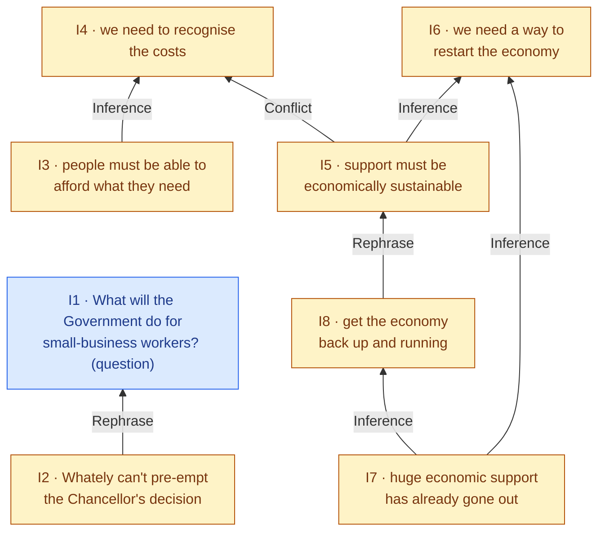
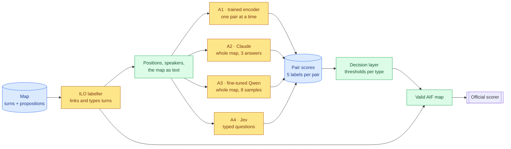

# DialAM-2024 revisited: final report

> **What this is:** the whole project end to end, for a reader who knows none of it: the task, the data, what the 2024 shared task achieved, our four approaches, what they scored and why, and what the benchmark can and cannot measure. The per-phase reports hold the details; they are listed at the end.
> **Status:** final (2026-10-06). Each system's pre-registered configuration was scored on the 11 test maps exactly once; later checks are marked post-hoc.
> **Evidence:** every number comes from a committed file under `results/` or `eda/`, through the report cited in each section, or from the 2024 overview paper ([`../reference/2024.argmining-1.8.pdf`](../reference/2024.argmining-1.8.pdf)). Decisions D001–D086 are in [`../decisionlog.md`](../decisionlog.md).

## Summary
- **The task.** In televised debates (BBC *Question Time*), already cut into units by annotators, a system must say which claims **support**, **attack** or **restate** which others (*relations*), and *how* each utterance was said: asserted, asked, agreed (*illocutions*). The 2024 shared-task winner scored **67.05** on the official F1 measure (48.25 in its stricter "focused" form, §2.3).
- **The aim.** Beat that with 2026 methods, and find out *which kind of method* helps, at what cost.
- **What we built.** One shared pipeline (official scoring, a trained illocution labeller, a tuned decision step) with four interchangeable relation scorers: a trained encoder (A1), Claude reading the whole map (A2), a fine-tuned small open LLM (A3) and a decision model, Jev (A4). The final system averages A1, A2 and A4.
- **Result.** All four systems and the combination beat the 2024 winner; the combination scores **74.51 / 59.47**. But **most of the margin comes from illocutions** (F1 92.6 against 2024's 78.8–81.2). On relations, our best systems are within about one point of 2024's best on test, which 11 maps cannot separate.
- **Which method works.** On the 225-map dev set, which can rank systems, **Claude reading the whole map finds relations best** (+4.1 over the trained encoder, significant). **Jev matches the trained encoder with no training**, at $0.003 a map. **Fine-tuning a 4B open LLM was the worst trade-off.**
- **How far there is to go.** Four very different methods land within 7 points of each other on dev relations (47.7–54.6 F1), where the pipeline would allow 98.6. **Conflict is unsolved:** most annotated attacks are a speaker's own unmarked concessions, and no system finds more than about one in five.
- **The main lesson.** Where a label means what it says (support, attacks between people), the model that reads each question literally, Jev, finds the most. Where it follows the annotators' conventions (an elaboration counts as a restatement; a question can be "assertive"), models trained on the labels do better and Jev does worst. Claude sits between and is best overall. A speaker's concession counted as an attack defeats them all.

---

## 1. What we set out to do
The research question: **which post-2024 method class solves dialogical argument mining best, and at what cost and speed?** Success meant beating the 2024 best Global score (67.05 / 48.25), recording every approach's F1, time, cost and ablations, and showing which 2024 failure each new method fixes. All three were met, with ablations cut to the core for A3 and A4 by user decision (D071, D076). The work ran in gated phases (foundation, data analysis, illocution labeller, A1–A4, combination), with every decision logged as it was made.

---

## 2. The task

### 2.1 Argument maps
The data follows **Inference Anchoring Theory (IAT)**, which keeps *what was said* apart from *what it means*:


*Figure 1: an illustrative three-turn map. Blue boxes are given. The arrows between propositions (relations) and from locutions to propositions (illocutions) must be predicted.*

- **Locutions (L)** are the turns: exactly what someone said, with the speaker. **Transitions (TA)** record their order.
- **Propositions (I)** are the content of each turn, rewritten by annotators to stand alone ("they" becomes "NHS staff").
- **Relations** join propositions: **Inference** (support, premise → conclusion), **Conflict** (attack) and **Rephrase** (the same point again). An answer counts as a Rephrase of its question.
- **Direction matters.** Inference can point either way in time; Conflict and Rephrase point from the later statement back to the earlier one. One premise can support two conclusions (*divergent*), two premises can separately support one conclusion (*convergent*), or several can support it only together (*linked*).
- **Illocutions** say how a turn expresses its proposition. Most are **Asserting**. Questions come in three kinds: **Pure** (a genuine question), **Assertive** (one that also conveys the speaker's own position) and **Rhetorical** (asked to make a point). Rarer types include Agreeing and Challenging.

### 2.2 What a system must predict
Test maps arrive with turns, propositions and turn order only; segmentation and proposition writing are already done. A system must add:
- **Task A, relation identification (ARI):** every relation between propositions, with its type and direction;
- **Task B, illocution identification (ILO):** which turn expresses which proposition, and with which illocution.

The output is a complete map in **AIF** (the Argument Interchange Format, a JSON graph the official scorer reads).

### 2.3 How it is scored
The official scorer does not compare graphs. It turns each map into a **table of pairs**:
- **ARI:** every ordered pair of propositions gets Inference, Conflict, Rephrase or None. A typical map has some 200 ordered pairs and 8 relations, so about 95% of pairs are None.
- **ILO:** every (turn, proposition) pair gets an illocution type or None.

F1 (the balance of precision and recall) is computed for each label, **averaged over the labels present in that map's gold or prediction (macro-F1), then averaged over maps.** Two settings:
- **General** scores every pair, None included. Predicting nothing scores 29.5 on ARI.
- **Focused** scores only the pairs that have a gold relation.
- **Global** is the mean of ARI and ILO.

**The rare-label trap.** Every label present in a map's gold *or* prediction counts as one class in the average, however rare. A Conflict prediction pays only if it lands on exactly the right pair. A wrong one costs points in every map: in the 57% of maps with no gold Conflict, one wrong Conflict adds a zero-scoring class and turns a perfect 100 into **73.7**; in the others it costs about 7 points (to 93.1; `eda/README.md` §7). So when unsure, abstaining is the safe bet. This property shapes every system in this project.

---

## 3. The data
The corpus is **QT30**: 30 *Question Time* episodes from 2020–21, annotated as **1,478 maps**, each a short stretch of debate (typically one audience question and the discussion it starts). We split them **by episode** into train (1,250 maps) and dev (228 maps from 5 episodes, of which 225 carry illocution annotation and are scored). The **11 test maps** are the official ones; their gold answers stayed sealed until each system's final run. Source: [`../eda/README.md`](../eda/README.md).

| A typical map | Training (median / 90th pct) | Test inputs (median / max) |
|---|---|---|
| Turns | 14 / 22 | 16 / 35 |
| Propositions | 14 / 21 | 15 / 35 |
| Speakers | 2 / 4 | 2 / 7 |
| Relations | 8.3 per map on dev | test gold in all: 65 Inference, 13 Conflict, 46 Rephrase pairs |

**Labels are very unbalanced.** Training relations: Rephrase 5,848, Inference 5,687, **Conflict 1,232**. Illocutions: **Asserting 90%**, Pure Questioning 6%, and 4% spread over eight other types.

**What the data analysis found, and what it means for a model:**

| Finding | Number | Consequence |
|---|---|---|
| Related propositions are close | 69% one turn apart; 98% within 8 turns | Pairs far apart can be skipped |
| Distance is a strong clue | neighbouring pairs are related 43% of the time, against 8% overall | Models should see the distance |
| Rephrase and Conflict point back | 97.8% / 97.7% later → earlier | Their direction can be read from turn order |
| Inference direction is a coin flip | 53% "because", 47% "so" | The model must judge direction from meaning |
| Support stays within one speaker | 94.5% of Inferences, against a 66% base rate | Same-speaker is a strong hint |
| Conflict is absent from most maps | 57% of maps have none | Predict Conflict only when sure |
| Question marks are missing | in only 7% of question turns | Question types must be learned, not read off |
| A whole map is short | under 1,000 tokens, even the largest test map | Every model can read the whole map |
| Text similarity links turns to propositions | 94.2% right at the first guess | Linking (part of ILO) is close to solved |

Here is one real map. It shows most of what makes the task hard:


*Figure 2: training map `nodeset18299`. Blue = the host's question, amber = one guest's answer.*

- The reply counts as **rephrasing the question** (I2 → I1), even though it declines to answer it.
- I6 has two separate reasons (**convergent**), and I7 supports two conclusions (**divergent**). Getting these directions right is where 2024 systems failed.
- The guest **attacks her own point** (I5 → I4), a contrast within one answer with no "but" to mark it. Many annotated Conflicts look like this.

**Quirks of the data:**
- **Almost half of all turn nodes (46.6%) are annotation bookkeeping**, analysts' copies of turns. They are filtered out.
- **19 "giant" training maps** (41–287 propositions) hold 60% of all proposition pairs and, like 3 dev maps, have no illocution annotation. No model trained on them.
- **Node IDs leak the answer:** in 74% of links, a proposition's ID is its turn's ID + 2, an artefact of the annotation tool. We banned every node-ID signal (D029); a system that used them would score higher here and be useless on new debates.
- **The test set is later and harder.** 9 of the 11 test maps come from 2022–23 debates, after the training period, and the organisers chose them for their linked, convergent and divergent arguments. No test text appears in training.

---

## 4. What happened in 2024
Six teams submitted to DialAM-2024. Test results (overview paper, Tables 1–3; F1 general / focused):

| Team | Method | ARI | ILO | Global |
|---|---|---|---|---|
| **DFKI-MLST** (1st) | DeBERTa-v3 classifying pairs; proposition and turn text combined | **55.33** / 30.40 | 78.78 / 66.10 | **67.05 / 48.25** |
| Pungene | BERTScore alignment, then BERT pair classifiers in a pipeline | 46.22 / 20.51 | **81.17** / 69.95 | 63.70 / 45.23 |
| KnowComp | prompt-based fine-tuning of DeBERTa, three stages | 32.75 / 9.06 | 78.90 / 44.33 | 55.82 / 26.70 |
| Pokemon | filter + classifier (DeBERTa, RoBERTa-MNLI); tried LLaMA, kept encoders | 30.64 / **35.89** | 59.36 / 51.39 | 45.00 / 43.64 |
| Turiya | RoBERTa + biaffine classifiers; also prompted an LLM with the whole map | 30.75 / 6.65 | 53.31 / 30.41 | 42.03 / 18.53 |
| RoBERTa-large baseline | pair classifier | 26.46 / 22.80 | 45.75 / **72.09** | 36.10 / 47.45 |
| Majority baseline | predicts no relation anywhere | 29.52 / 0 | 35.29 / 0 | 32.40 / 0 |

*A sixth team, misaka, scored the same as KnowComp and published no description.*

**Why 2024 scored as it did:**
1. **Relations were the bottleneck.** The best ARI was 55.3, just 26 points above predicting nothing. Every strong system was a **pairwise encoder** that classified two texts at a time, as described in the paper. Our starting hypothesis was that the missing dialogue context was the main problem; A1 tested part of it (§8).
2. **The None flood split the field.** With about 95% of pairs None, most teams were **pessimistic** (high general, low focused) and Pokemon **optimistic** (the best focused ARI, near-majority general); §9 explains why the two settings pull apart.
3. **Conflict was mostly missed, and sometimes invented** (paper §6), and the rare-label trap punishes both.
4. **Direction errors in argument structure:** divergent arguments were read as convergent (test maps 3, 4 and 6), and linked arguments were never produced.
5. **LLM entries did not beat the encoder entries.** Turiya's ARI was near the majority baseline, although the paper notes its prompted LLM beat its own classifier in the general setting; Pokemon tried LLaMA and kept encoders. The paper gives no reason. Our hypothesis, weaker models and free-text output, is what A2 and A3 tested.
6. **Illocutions were handled better (78–81 general),** by classifying each (turn, proposition) pair, after aligning them by text similarity in Pungene's case. The paper's own conclusion is that the best systems modelled both tasks together, or did illocutions first.

These points set our agenda: give relation models context, decide with the metric in mind, try current LLMs with a fixed output format, and treat illocutions as a joint linking problem.

---

## 5. What we built

### 5.1 One pipeline, four interchangeable relation scorers
Every approach runs through the same pipeline. Only the box that scores pairs changes, so the four are directly comparable:


*Figure 3: the shared pipeline. Yellow = models, green = deterministic steps, blue = data.*

- **The scorer** is a port of the official scripts, equal to them in 688 of 688 comparisons.
- **The ILO labeller** handles Task B for every system. A ModernBERT-base encoder scores each turn against its most similar propositions, with the neighbouring turns as context; a one-to-one matching links each turn to at most one proposition, and minority types must clear tuned thresholds. Dev ILO is **90.1 / 80.6**, against 76.0 for text similarity alone, with **98.3% of links found at 99.6% precision** ([`03-ilo-labeller.md`](03-ilo-labeller.md)). Its links also give each test proposition the position and speaker the relation models need.
- **Pair scores** share one format: for each candidate pair, five scores (None, A→B Inference, B→A Inference, Conflict, Rephrase), with Conflict and Rephrase directed by turn order. A1 and A4 score only pairs at most 10 turns apart (keeping about 98.5% of relations); A2 and A3 may link any pair.
- **The decision layer** keeps a pair's best relation only if its score clears a **per-type threshold** tuned on dev for the per-map metric, strictest for Conflict. It is the guard against the rare-label trap.
- **Map assembly** adds the relation nodes and the unscored dialogue-side illocutions, so every output is a valid IAT map.

### 5.2 The four approaches
A2–A4 read the map as text (`common/serialise.py`): turns in order, each followed by its proposition, renumbered so no node IDs appear:
```text
T1  Host: should NHS staff get a pay rise
    [P1] NHS staff should get a pay rise
T2  Minister: yes, they deserve one
    [P2] NHS staff deserve a pay rise
```

| | **A1 · trained encoder** | **A2 · frontier LLM** | **A3 · fine-tuned small LLM** | **A4 · decision model** |
|---|---|---|---|---|
| Model | ModernBERT-base (150M parameters), fine-tuned | Claude Sonnet 5.5, prompted | Qwen3-4B in 4-bit with small trained adapters (QLoRA) | Jev (TypeSafe AI), via an API |
| Reads | two propositions plus the whole dialogue, with distance and same-speaker written in | the map, after 4 similar solved training maps | the map | the map, plus a one-page guide to the labels |
| Produces | five probabilities per pair (a *cross-encoder*: both texts read in one pass) | a list of relations with confidences, 3 times; the vote share is the score | a list of relations, 8 samples; the vote share is the score | a probability for every option of typed questions, asked per pair and per proposition |
| Learns from | ~105k labelled pairs (1,231 maps) | 4 examples per prompt | 1,231 annotated maps | nothing; the guide states the corpus's base rates |
| Why try it | the 2024 recipe, fixed | sees the whole map, decides jointly | learns the conventions into an LLM | whole-map context with probabilities, no training |

A2 and A3 answer in JSON constrained by a per-map **schema**, so no answer is lost to parsing. Jev, a **decision model**, writes no text: it answers many typed questions against one shared *state*. A4 asks about each relation two ways, per pair ("how is P2 related to P3?") and per proposition ("which one proposition does P3 bear on, and how?", where the candidate targets compete), each in two option orders.

**The combination** averages the pair scores of A1, A2 and A4 and puts them through the same decision layer. It was chosen on dev and **pre-registered**, that is, fixed before its test run (D083). A3 was left out because adding it lowered the dev score. Routing (a fast system decides confident pairs, the LLM only uncertain ones) was planned but not run.

---

## 6. How to read the results
- **Two evaluation sets, two jobs.**
  - **Dev** (225 maps) is large enough to **rank our systems**. Thresholds are tuned on dev, so its scores are **cross-fitted** to stay honest: tuned on 4 dev episodes, applied to the 5th, in rotation. Differences are tested with a **paired bootstrap** (resampling maps to see whether a per-map advantage is larger than chance).
  - **Test** (the 11 official maps) is the **only fair comparison with 2024**. Each configuration was frozen beforehand, and its maps were saved before the gold was read.
- **Eleven maps cannot rank relation scores.** Per-map ARI ranges from 23 to 79, and each map is 1/11 of the mean. On random 11-map subsets of dev, the A3 − A1 ARI gap spans −11 to +5 (95%) around its dev value of −2.9: about **±8 points**. Test ARI differences smaller than that are not evidence. The illocution gaps over 2024 (+11 to +14) are far larger.
- **Comparing what systems find** uses **matched density**: each system is thresholded to predict as many relations as gold (8.3 per map), so recall differences reflect the model, not where its threshold sits.
- **Run-to-run noise** was measured only for Jev: two identical dev passes differ by 0.4.

---

## 7. Results

### 7.1 Test, against 2024
F1 general / focused on the 11 test maps:

| System | ARI | ILO | Global |
|---|---|---|---|
| 2024 winner (DFKI-MLST) | 55.33 / 30.40 | 78.78 / 66.10 | 67.05 / 48.25 |
| Best 2024 result per column (any entry or baseline) | 55.33 / 35.89 | 81.17 / 72.09 | 67.05 / 48.25 |
| A1 · trained encoder | 51.38 / 30.77 | 92.64 / 84.28 | 72.01 / 57.53 |
| A2 · Claude, whole map | 55.77 / 33.34 | 91.56 / 83.20 | 73.67 / 58.27 |
| A3 · fine-tuned Qwen3-4B | 53.70 / 32.05 | 92.64 / 84.28 | 73.17 / 58.17 |
| A4 · Jev | 54.21 / 30.98 | 92.64 / 84.28 | 73.42 / 57.63 |
| **A1 + A2 + A4 (pre-registered)** | **56.39 / 34.65** | 92.64 / 84.28 | **74.51 / 59.47** |
| A1 + A2 (reported beside it) | 57.69 / 36.37 | 92.64 / 84.28 | 75.17 / 60.32 |

- **Every system beats the 2024 winner on Global,** by 5.0–7.5 general and 9.3–11.2 focused.
- **The margin is illocutions.** The combination's +7.46 Global (general) over DFKI splits into **+6.93 from ILO** and +0.53 from ARI, since Global is the mean of the two; on focused, ILO gives about 80%. The labeller is perfect on 7 of the 11 test maps. (A2's submission let Claude override 3 turn types, all wrongly, which cost it 1.1 ILO.)
- **On relations, we are level with 2024.** The best ARI general (A2 55.77, combination 56.39) is 0.4–1.1 above DFKI's 55.33, well inside the ±8 test noise; A1 is 4 below it. On focused ARI only the A1 + A2 average (36.37) passes Pokemon's 35.89, which Pokemon reached by over-predicting.
- **Conflict:** no system found more than 2 of the 13. None put a Conflict into a map without one, but 5 of the 10 Conflicts predicted by A1, A2 and A4 were wrong.

We can't run DFKI's system on our dev set, so **whether our relation scoring beats 2024's can't be settled**.

### 7.2 Dev: the reliable ranking
Honest dev results (225 maps; "vs A1" is the paired bootstrap on ARI general):

| System | ARI | vs A1 (95% interval) | Global |
|---|---|---|---|
| A1 · trained encoder | 50.50 / 32.61 | — | 70.29 / 56.63 |
| A2 · Claude | **54.63 / 34.12** | **+4.14 [2.21, 6.12]** | 72.53 / 57.63 |
| A3 · fine-tuned Qwen3-4B | 47.65 / 27.23 | −2.85 [−4.7, −1.0] | 68.90 / 53.95 |
| A4 · Jev | 52.17 / 32.45 | +1.68 [−0.20, 3.65] | 71.16 / 56.56 |
| **A1 + A2 + A4** | **55.51 / 37.01** | | **72.83 / 58.84** |
| *Reference:* predicting no relation / every candidate pair right | 30.93 / 0 · 98.64 / 94.44 | | |

- **The ranking is A2 > A4 ≈ A1 > A3.** A2 is significantly better than A1 and than A4 (by 2.46); A3 is significantly worse than A1; A4 and A1 are within noise.
- **The combination adds about one point over A2** (+0.9 general, +2.9 focused; not tested for significance). Picking the better of A1 and A2 for each pair would score 66.1, so averaging captures only a small part of how differently they err.
- **Jev needs no labelled pairs, training or tuned thresholds.** With plain argmax (each pair's most probable label), it scores 50.84 against A1's 50.08, though its guide's base rates were measured on the corpus.

### 7.3 Cost and speed

| | A1 | A2 | A3 | A4 |
|---|---|---|---|---|
| Training | 94 min, 8 GB GPU | none | 110 min, 8 GB GPU | none |
| Per map | ~1 s | ~25 s | ~22–40 s | **0.8 s** |
| $ per map | $0 (local) | $0.18 API-equivalent ($0 on a Claude Pro plan) | $0 (local) | **$0.003** |
| Spent in the project | $0 | $0 ($57 API-equivalent) | $0 | $1.70 |

The ILO labeller adds 20 minutes of training and 0.2 s per map to every system.

---

## 8. What each model is good and bad at
At matched density on dev:

| | A1 encoder | A2 Claude | A3 fine-tuned | A4 Jev |
|---|---|---|---|---|
| Inference recall, neighbouring turns (707) | 0.39 | 0.42 | 0.25 | **0.51** |
| Inference recall, 2–3 turns apart (252) | 0.11 | 0.32 | 0.16 | **0.35** |
| Inference direction right | 86% | 84% | 83% | 87% |
| Gold Inferences called Rephrase | 129 | 121 | 252 | **42** |
| Gold Rephrases called Inference | **54** | 108 | — | 169 |
| Rephrase recall, neighbouring turns (~486) | 0.61 | 0.57 | **0.69** | 0.30 |
| Rephrase recall, many shared words (112) | **0.81** | 0.74 | — | 0.60 |
| Rephrase recall, no shared content words (102) | 0.23 | **0.43** | 0.41 | 0.16 |
| Conflict recall, different / same speaker (38 / 91) | 0.26 / 0.09 | 0.42 / 0.07 | 0.13 / 0.11 | **0.45 / 0.12** |
| Unrelated pairs given a relation (fewer is better) | 905 | 812 | **805** | 859 |

*Sources: [`04-comparison.md`](04-comparison.md) §3 and the A2–A4 discussions; "—" = not computed.*

**A1, the trained encoder, learns the annotators' surface habits.** It is best on restatements that share words and rarely mistakes a Rephrase for an Inference. But it judges each pair alone: at its own thresholds it predicts 52% more relations between neighbouring turns than gold, and 17% of its propositions start two or more relations (gold: 6%), so it over-draws divergent arguments. Reading the whole dialogue rather than two turns either side added only +1.5 general and +2.3 focused. A no-context version, 2024's setup, wasn't run, so how much context explains 2024's gap stays open.

**A2, Claude, applies the written definitions and decides all relations together.** Writing one list per map makes it cautious and best overall, and it recognises restatements in new words and attacks between speakers. The same list under-draws divergent arguments (0.7% of propositions start two or more relations), and conventions that contradict everyday meaning trip it, including question types. **Reasoning before answering added only ~1 point on dev**, though a 20-map pilot had suggested +11; four worked examples helped more (+4.5, also a pilot figure).

**A3, the fine-tuned Qwen, learned the format, the annotators' density and Rephrase** (best between neighbouring turns, and close to Claude on new wording). It didn't learn Inference: it calls twice as many gold Inferences "Rephrase" as A1 or A2, and its 8 samples agree too little for votes to work. Model size, 4-bit storage and the form of supervision are confounded (Qwen3-8B couldn't train on 8 GB), and the ablations weren't run, so *why* is a reasoned guess.

**A4, Jev, reads each question literally.** It finds the most support at every distance and the most attacks between speakers, with direction about as good as the others (87% on dev; 86% on test, against A2's 90%). But it reads elaborations as reasons, turning 169 gold Rephrases into Inference; neither stating the convention in its guide nor one worked example fixed that (+0.1, where A2 gained +2.6 from two examples). The design lesson: **how a judgement is split into questions matters more than wording.** Per-pair questions alone score 50.5, per-proposition questions 46.3, and their average 52.2.

**The ILO labeller has nearly solved linking.** Its remaining ~7 dev points sit in the minority types (Assertive and Rhetorical Questioning, and six rare types it never predicts, because a wrong guess costs more than a miss).

**The pattern.** No model wins everywhere. The literal reader (Jev) leads where a label means what it says: support, and attacks between people. The models trained on labels (A1, A3, the labeller) lead on restatement habits and question types. Claude leads on paraphrase in new words and is the best all-rounder. A speaker's concession, counted as an attack, defeats everyone (7–12% recall). Because A1 and A2 err in different places, averaging them gives the best result.

---

## 9. What the benchmark measures, and what it misses
The benchmark shapes these results as much as the models do.

- **The hardest parts of argument mining are already done.** Turns arrive segmented and propositions written out, with pronouns resolved and questions often marked by a placeholder ("xxx"). The task tests *connecting* given units, not *finding* arguments in a transcript, and it makes illocution linking largely text matching (94% by similarity alone).
- **Half of Global is the easier half.** ILO is 90% Asserting plus near-solved linking, yet weighs as much as ARI. Our 7.5-point Global win is mostly this half.
- **The scorer sees pairs, not structure.** Directed pairs capture convergent and divergent arguments, but linked arguments (premises that support a claim only together) score the same as convergent ones, and the dialogue-side illocutions and reported speech are never scored. There is no partial credit: attaching a premise to the wrong one of two near-identical propositions counts as one false and one missed relation (how often wasn't measured).
- **The metric discourages rare labels.** A Conflict guess pays only on the exact pair and costs points everywhere else, so every tuned system sets its strictest threshold on Conflict. Low recall is partly the metric working as designed, but only partly: Claude's raw answers listed just 32 of 130 dev Conflicts, and the encoder gave only 40 a probability above 0.2. The signal is weak, not just cut off.
- **General and focused reward opposite biases.** General is about 95% None, so predicting nothing scores 29.5. Focused ignores invented relations, and by the same union-of-labels rule, a single missed gold relation adds None as a zero-scoring class. Focused therefore rewards predicting *something* on every plausible pair, which is how Pokemon led it. Our thresholds, tuned for general, cost 1–5 focused points.
- **The labels are conventions, and humans agree only moderately.** QT30's inter-annotator agreement is 0.56 on the CASS measure (overview paper §3.1). Elaborations count as Rephrase, a concession as Conflict, an answer as a Rephrase of its question. A model reading plain meaning is marked wrong on choices a reader might defend. CASS is not on the F1 scale, so the human ceiling in F1 is unknown, but it is surely well below the pipeline's 98.6.
- **The test is small, unrepresentative and weights maps equally:** 11 maps, chosen for complex structure and mostly from later debates. An 11-proposition map weighs as much as a 35-proposition one.

**How this affects the models.** The benchmark rewards copying the annotators' conventions and deciding with the metric in mind. It under-rewards literal reading, makes Conflict unattractive to predict, and hides any gain in modelling linked arguments. That is why a 150M-parameter encoder stays within 4 points of a frontier LLM on relations, and why our largest measured gain came from the illocution half.

---

## 10. Limits
- **Contamination isn't ruled out** for A2 and A4, whose training data is unknown; QT30 and the 2024 test gold are public. Their dev → test changes (+1.1, +2.0) resemble A1's (+0.9), which argues against memorisation, but no probe was run.
- **One configuration and one seed per approach,** and no ablations for A3 and A4 beyond their core comparisons, so A3's causes and Jev's Rephrase failure (model or wording) are not separated. Most "why" explanations fit the evidence without being tested by intervention.
- **Not tried:** a larger encoder (the 8 GB GPU limits A1 to the base model), the giant maps' Conflict examples, routing in the combination, and a human ceiling.

---

## 11. Conclusions
**The research question.** The best accuracy comes from a frontier LLM reading the whole map, averaged with a trained encoder. The best accuracy per cost comes from the decision model, which matches the trained encoder with no training or GPU for under a cent per map, provided the questions are designed well. Fine-tuning a small open LLM is the worst trade-off: as much training as the encoder, and a lower score.

**What changed since 2024:**

| 2024 failure | Now | Evidence |
|---|---|---|
| Relations are the bottleneck | Better on dev, level on test | Dev ARI 54.6 (A2), 55.5 combined, against A1's 50.5; test within noise of DFKI |
| Conflict missed or invented | **Not fixed** | Invention is rarer (A1: 8 dev maps get a false Conflict, against 34 untuned), but dev recall is 6–12% at tuned thresholds; test ≤ 2 of 13 |
| Direction in argument structure | **Partly** | Pairwise direction 83–87% for every method; divergent arguments over-drawn by A1 (17% of propositions start 2+ relations), under-drawn by A2 (0.7%), gold 6% |
| No global consistency | Better | Joint decisions (A2's single list, A4's competing questions) invent 805–859 relations against A1's 905 at matched density |
| LLMs don't beat encoders | Reversed for a frontier LLM only | A2 > A1 by 4.1; the fine-tuned 4B LLM is 2.9 below |
| Illocutions | **Largely fixed** | Test ILO 92.6 against 81.2; the rarest types are still never predicted |

**Broader lessons:**
- **Very different methods converge well below the ceiling.** Four methods sit within 7 points on dev relations. Neither more context (+1.5 for A1) nor reasoning (+1 for A2) moved them much; most remaining errors concern the annotators' conventions and implicit attacks.
- **Measure on enough data.** A 20-map pilot overstated reasoning (+11 → +1), a +0.3 dev gain on turn types reversed on test (−1.1), and 11 test maps put A3 above A1. Only the 225-map dev set with cross-fitting gave rankings that held.
- **Thresholds protect more than they add.** For A1, A2 and A4 they add 0.4–2.6 ARI general, but they cut A1's dev maps with an invented Conflict from 34 to 8. The large gains came from the models: the trained labeller adds 14 ILO points over text similarity, and Claude 4.1 ARI points over the encoder.

**What we'd do next:** teach the conventions directly (concession examples for Conflict, elaboration examples for Rephrase); route only uncertain pairs to the LLM; train a larger encoder with the giant maps; and measure how often annotators themselves disagree on the pairs our systems "get wrong".

---

## Where to find more

| Topic | Report |
|---|---|
| The data, measured | [`../eda/README.md`](../eda/README.md) |
| The ILO labeller (Task B) | [`03-ilo-labeller.md`](03-ilo-labeller.md) |
| A1 · trained encoder | [`A1-cross-encoder.md`](A1-cross-encoder.md) |
| A2 · Claude, whole map | [`A2-whole-map-llm.md`](A2-whole-map-llm.md) · [discussion](A2-discussion.md) |
| A3 · fine-tuned Qwen3-4B | [`A3-finetuned-llm.md`](A3-finetuned-llm.md) · [discussion](A3-discussion.md) |
| A4 · Jev | [`A4-jev.md`](A4-jev.md) · [discussion](A4-discussion.md) |
| Four approaches and the combination, compared | [`04-comparison.md`](04-comparison.md) |
| Every decision, and the phase map | [`../decisionlog.md`](../decisionlog.md) |
