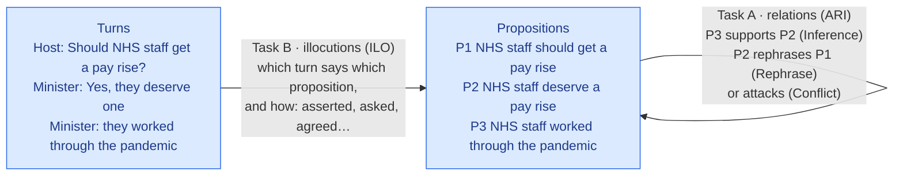
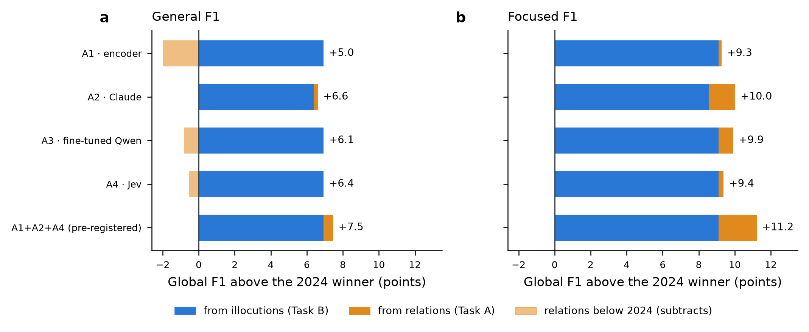
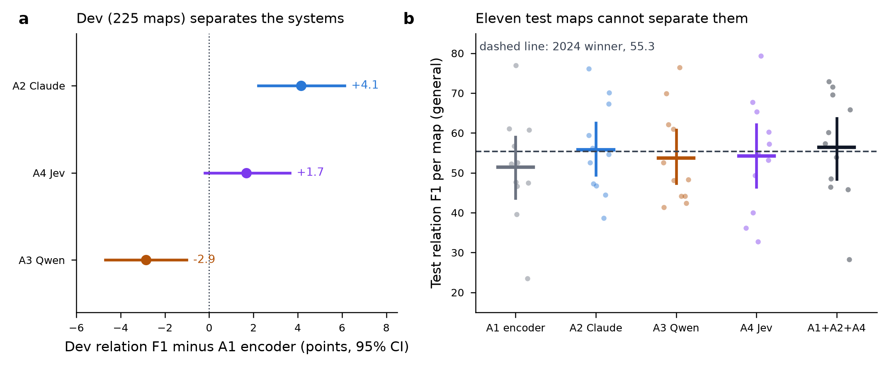
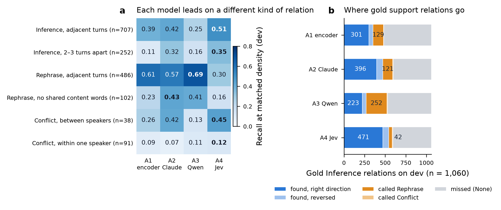
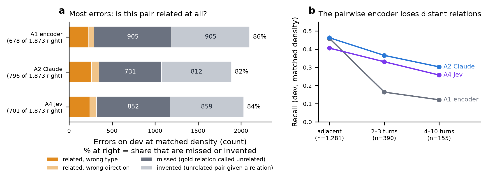
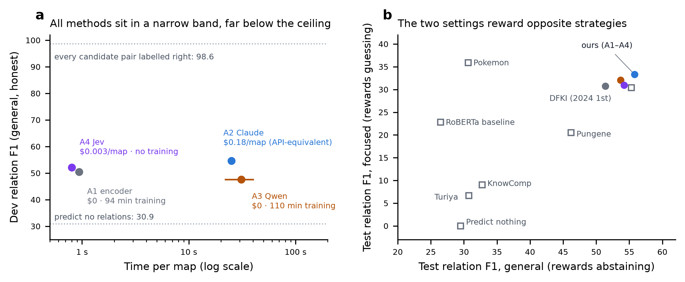

# DialAM-2024 revisited: the short report

*6 October 2026 · a condensed, critical companion to the [final report](05-final-report.md). Every number comes from a committed file under `results/` or `eda/`, from the [decision log](../decisionlog.md) (D001–D088), or from the 2024 overview paper. The per-map bootstrap intervals, pooled test counts and gain split are recomputed by `python reports/short_report_numbers.py` into [`results/short_report/derived.json`](../results/short_report/derived.json); the figures are redrawn from committed files by `python reports/short_report_figures.py`.*

---

## The project in one page

- **Goal.** Beat the best 2024 system on DialAM-2024 (Global F1 **67.05** general / **48.25** focused). Also find out *which kind* of modern method helps, and at what cost.
- **Result.** All four of our systems beat it, and the pre-registered combination scores **74.51 / 59.47**. But **93% of that margin (81% under focused scoring) comes from Task B, illocutions**, where a trained labeller scores 92.6 against 2024's best of 81.2. **On Task A, relations, we are level with 2024**: within ±8 points on 11 test maps, which cannot separate the systems.
- **Best method.** On the 225-map dev set, which *can* rank systems, **Claude reading the whole map is best at relations** (+4.1 over a trained encoder, significant). **Jev, with no training, matches the trained encoder** at $0.003 a map. **Fine-tuning a 4B open LLM was the worst trade-off.**
- **The hard truth.** Four very different methods land within 7 points of each other. They close only about **a third of the gap** between predicting nothing (30.9) and labelling every candidate pair correctly (98.6). On test, the best system gets **56 of 124 annotated relations** right and finds **2 of 13 Conflicts**.
- **Why (§6).** Not our safeguards, the pipeline or the later test debates: 82–86% of every system's errors are about *whether* two propositions are related at all, the labels follow conventions annotators only moderately agree on (CASS 0.56), and the per-map metric dilutes relation gains. An 11-map test is also too small to show the modest gain dev does.

---

## 1. The task, in 60 seconds

Debates from BBC *Question Time* arrive already cut into **turns** (what was said) and **propositions** (what it means, rewritten to stand alone). A system draws the missing arrows:

*Figure 0: the two sub-tasks. Global F1 is their plain average, so each counts for half.*

**Scoring** turns each map into a table of *pairs*, with about 95% of proposition pairs labelled "None". It computes F1 for each label present in the gold *or* the prediction, averages over those labels (macro), then averages over maps. **General** scores every pair; **focused** scores only pairs that have a real relation. One wrong rare label in a map that has none drops a perfect 100 to 73.7: the **rare-label trap**.

**Data.** QT30: 1,478 annotated maps from 30 episodes (2020–21). We split them by episode into train (1,250) and dev (228). The 11 official test maps were sealed until each system's single final run; 9 of them come from later (2022–23) debates.

## 2. What we built

One shared pipeline: the official scorer (ported, 688/688 agreement), a **trained ILO labeller**, and a tuned **decision layer** (per-type thresholds, strictest for Conflict). Four interchangeable relation scorers plug into it:

| | How it reads a map | Learns from | Training | Per map |
|---|---|---|---|---|
| **A1 · encoder** (ModernBERT-base, 150M) | one pair at a time, plus the whole dialogue | ~105k labelled pairs | 94 min, 8 GB GPU | ~1 s, $0 |
| **A2 · Claude Sonnet 5.5** | the whole map, after 4 similar solved maps; 3 answers voted | 4 examples in the prompt | none | ~25 s, $0.18 API-equivalent |
| **A3 · Qwen3-4B + QLoRA** | the whole map; 8 samples voted | 1,231 annotated maps | 110 min, 8 GB GPU | ~22–40 s, $0 |
| **A4 · Jev** (decision model) | typed questions about the whole map, per pair *and* per proposition | nothing (a one-page label guide) | none | 0.8 s, $0.003 |

**Combination:** the mean of A1, A2 and A4 pair scores. It was chosen on dev and fixed before its test run. The project took one week (29 Sep – 6 Oct) and logged 86 decisions.

---

## 3. Against 2024: a real win, but mostly on the easier half

*Figure 1: Global F1 above the 2024 winner (DFKI-MLST) on the 11 test maps, split into the part from illocutions and the part from relations (Global is their mean, so each contributes half its own gain). Light bars: relations scored below DFKI's 55.33. Sources: `results/{a1/v1,a2,a3,a4,combination}/test_global.json`; split computed in `results/short_report/derived.json`.*

| Test F1 (general / focused) | Relations (ARI) | Illocutions (ILO) | Global |
|---|---|---|---|
| 2024 winner (DFKI-MLST) | 55.33 / 30.40 | 78.78 / 66.10 | 67.05 / 48.25 |
| Best 2024 entry per column | 55.33 / 35.89 | 81.17 / 72.09 | 67.05 / 48.25 |
| A1 · A2 · A3 · A4 | 51.4 · 55.8 · 53.7 · 54.2 | 92.6 (A2: 91.6) | 72.0 · 73.7 · 73.2 · 73.4 |
| **A1+A2+A4 (pre-registered)** | **56.39 / 34.65** | **92.64 / 84.28** | **74.51 / 59.47** |

**Reading it critically:**
- **The headline win is a Task B win.** The combination's +7.46 Global splits into +6.93 from illocutions and +0.53 from relations.
- **Test ILO flatters the labeller slightly.** It scores 92.6 on test but 90.1 on dev, and per map it is bimodal: **100 on 7 maps, about 73 on maps 1, 2 and 9**. The gain over 2024's ILO (+11.5) is far larger than that noise, so it is real; its exact size is uncertain.
- **On relations, the ±8-point uncertainty swamps every difference.** On test, A3 even beat A1, the reverse of the dev ranking.
- **The pre-registered choice cost about 0.7 Global on test** (A1+A2 alone scored 75.17). On dev the two were equal (ARI 55.51 vs 55.12), so pre-registering was the right call even though it lost here.

## 4. Which method is best: only dev can tell

*Figure 2: **a**, paired bootstrap over 225 dev maps (thresholds cross-fitted by episode): difference from the A1 encoder in relation F1. **b**, per-map test relation F1 (dots) with the mean and its 95% bootstrap interval over the 11 maps; dashed line = the 2024 winner. Sources: `results/a4/robust.json`, `results/a3/v1/dev_report.json`, the test files above.*

- **Ranking on dev: A2 > A4 ≈ A1 > A3** (honest dev ARI: 54.6, 52.2, 50.5, 47.7). The combination adds about one point (55.5).
- **On test, every interval contains 55.3, the 2024 winner's ARI.** Saying "we beat 2024 on relations" would be over-reading. We cannot run DFKI on our dev set, so it isn't settled either way.
- **Lesson on sample size.** A 20-map pilot said reasoning adds about 11 points; across all 225 dev maps it added about 1. Only the full, cross-fitted dev set gave rankings that held.

---

## 5. Task A vs Task B: why one is nearly solved and the other isn't

**Task B (illocutions) is mostly a matching problem.** Each proposition is a rewritten turn: text similarity alone links 94% correctly, and 90% of illocutions are "Asserting". A trained model with one-to-one matching finds **98.3% of links at 99.6% precision** (dev ILO 90.1 / 80.6, against 76.0 for similarity alone). What remains is typing the rare kinds:
- Assertive and Rhetorical Questioning reach F1 0.40–0.51.
- Six rare types are never predicted. A gentler, longer retrain (v2) didn't change this (D039), so it is not undertraining. These types are too few, and some read like plain assertions (Default Illocuting), so a wrong guess costs more than a miss.

**Task A (relations) requires judgement.** Relations depend on what a speaker *meant*, and the labels follow conventions:

*Figure 3: **a**, recall on dev when each system predicts as many relations as gold (matched density, so threshold placement doesn't decide the comparison); bold = best per row. **b**, what each system does with the 1,060 gold support relations on dev. Sources: `results/a4/discussion.json`, `results/a3/v1/discussion.json`.*

- **Each method has a recognisable profile:**
  - **Jev (A4) reads literally.** It finds the most support relations at every distance and the most attacks between speakers. It also calls elaborations "support", where the annotators said "rephrase".
  - **The trained models (A1, A3) learn the annotators' habits.** They are best on rephrases between neighbouring turns. A3 learned the format and the annotators' density but not the support judgement: it labels 252 gold support relations as rephrases.
  - **Claude (A2) is the best all-rounder.** It is best on restatements in new words, and writing one list per map makes it invent fewer relations (812 against A1's 905 at matched density).
- **No method finds a speaker attacking their own point** (7–12% recall). Within-speaker Conflicts are 70% of all Conflicts, usually an unmarked concession ("…but we must be sustainable").
- **Errors are complementary.** Taking the better of A1 and A2 for each pair would score 66.1 on dev, against 55.1 for their average. Simple averaging captures little of that.

**What the output maps look like.** Every output is a valid IAT map, but the argument structures are skewed:
- A1 over-draws *divergent* arguments: 17% of its propositions support two or more conclusions, against 6% in gold.
- A2 under-draws them (0.7%).
- Inference direction is right 83–87% of the time on dev for every method.
- Pooled over the 11 test maps, the combination predicts 108 relations, of which 56 are right (52% precision), and recovers 56 of the 124 gold relations (45%). **An analyst would still need to fix about half of every map.**

## 6. Why relation mining barely moved since 2024

Four very different methods (a pair classifier, a frontier LLM, a fine-tuned LLM and a decision model) land within 7 points of each other on dev, about a third of the way from "predict nothing" to the pipeline's ceiling. When methods this different converge, the limit is more likely in the task than in any one method. Each candidate cause, checked against the evidence:

| Candidate cause | Verdict | Evidence |
|---|---|---|
| Our safeguards (cross-fitting, single frozen test runs, no node-ID shortcuts) | Not the cause | Cross-fitting costs A1 0.4 ARI against tuning on all of dev; the node-ID ban concerns turn–proposition links, not relations |
| The pipeline (pruning, candidates, predicted turn links) | Not the cause | Labelling every candidate pair correctly would score 98.6; turn linking is 98.3% |
| The split: later, harder test debates | Not the cause | Every system scores *higher* on test than on dev (+0.9 to +2.0; A3 +6.1) |
| The test set's size | Hides a real gain | An 11-map interval spans about ±8 points, so Claude's +4.1 dev gain over the encoder can't show |
| Training data and model scale | Contributes; not fully tested | 1,232 Conflicts in the whole training corpus; the 19 giant maps (12.8% of relations) and models beyond a 150M encoder or a 4B LLM were not tried. The untrained models still land in the same band |
| **The task itself** | **Main cause** | Below |

*Figure 4: **a**, the errors each system makes on the 1,873 dev gold relations when it predicts as many relations as gold (matched density). **b**, recall by turn distance between the two propositions. Source: `results/short_report/derived.json` (from `results/a4/discussion.json`).*

- **The hard question is whether two propositions are connected at all.** 82–86% of every system's errors are missed or invented relations; a wrong type or direction is the minority. A map has some 200 ordered pairs and about 8 relations, and the connection is often implicit: a concession with no "but" still counts as an attack.
- **Distance separates the methods.** Every system finds 41–46% of relations between adjacent turns. Two or more turns apart, the pairwise encoder falls to 16% and 12%, while Claude keeps 37% and 30%: most of Claude's advantage is long-range.
- **The labels are conventions people only moderately agree on** (QT30 agreement 0.56 CASS). An elaboration is a "rephrase" and a concession an "attack". The type confusions follow these conventions (Jev turns 169 rephrases into support; the fine-tuned Qwen turns 252 supports into rephrases), and attacks within one speaker's talk, 70% of dev Conflicts, stay at 7–12% recall.
- **The metric dilutes gains.** ARI averages the relation classes together with the near-perfect "None" class, so a 17-point gain in pooled test Inference F1 (A1 0.29 → combination 0.46), with small gains elsewhere, moves ARI by only 5.0.

**Bottom line:** the plateau sits in the task and its labels, not in our protocol, and an 11-map test is too small to show the modest real gain that dev does.

## 7. Cost, and the scoring itself

*Figure 5: **a**, honest dev relation F1 against time per map (log scale), with the two reference points: predicting no relations, and labelling every candidate pair correctly. **b**, test relation F1 under the two scoring settings for the 2024 field (squares, from the overview paper) and our systems (dots).*

- **Price and time per map differ by 30–60× across a 7-point accuracy spread.** Jev gets encoder-level accuracy for $1.70 over the whole project. Claude is best, at about 60× Jev's price per map (but $0 on a subscription). A3 costs as much training as A1 and scores lower.
- **The two scoring settings reward opposite strategies** (panel b). General is about 95% "None", so abstaining is safe. Focused ignores invented relations, but one missed gold relation adds a zero-scoring "None" class, so guessing pays. Pokemon (2024) led focused by over-predicting while scoring near "predict nothing" on general. Our thresholds, tuned for general, cost 1–5 focused points.
- **What the metric hides:**
  - *Linked* arguments (premises that work only together) score the same as separate ones.
  - Dialogue-side illocutions are never scored.
  - There is no partial credit for attaching a premise to the near-duplicate of the right proposition.
  - Each map counts equally, so an 11-proposition map weighs as much as a 35-proposition one.
- **What the task hides:** segmentation and proposition writing, the hardest parts of real argument mining, are already done by annotators. The benchmark tests *connecting* given units, not *finding* arguments.
- **The human ceiling is unknown.** QT30 annotators agree only moderately (CASS 0.56). Some "errors", such as calling an elaboration support, are readings a person could defend.

---

## 8. What it means

**For argument mining.** Relation identification remains largely unsolved. Modern methods give real but modest gains: +4 dev points for a frontier LLM over a fine-tuned encoder, not a step change. The bottleneck has moved from *model capacity* to *what the labels mean*: implicit concessions, elaboration-as-restatement, and conventions that differ from everyday reading.

**For the models.** How a judgement is posed matters as much as model size:
- **Decision model (Jev):** asking each relation two ways (per pair, and per proposition with competing targets) raised its score from 50.5 and 46.3 for either view alone to 52.2 for their average.
- **Frontier LLM (Claude):** worked examples helped it more than reasoning did.
- **Small open LLM (Qwen3-4B):** at 4B, fine-tuning taught the output format, not the judgement. Model size, 4-bit storage and the form of supervision weren't separated, so the cause stays a reasoned guess.
- **Encoders:** a 150M-parameter encoder stays within 4 points of a frontier LLM on relations, because it copies the annotators' habits directly.

**For the output.** The maps are valid and the illocution layer is essentially usable. The relation layer is a useful draft (about half right, with direction mostly right) but not a finished analysis. Conflict in particular can't be trusted to be found.

## 9. What went right, and what went wrong

| Went right | Went wrong, or stayed open |
|---|---|
| Scorer verified exactly against the official scripts; episode-grouped split; node-ID shortcut banned (D029) | Conflict: ≤ 2 of 13 found on test by any system |
| Honest dev protocol (cross-fitting, paired bootstrap) gave rankings that held | Test set too small to rank systems or to settle "beats 2024 on relations" |
| Trained ILO labeller: +14 points over similarity, the main source of the win | Rare illocution types still never predicted |
| Pre-registration and single test runs; every number traceable to a file | One seed per approach; A3/A4 ablations cut, so several "why"s are untested |
| Jev shown to be a strong no-data baseline for under $2 | Contamination not ruled out for A2/A4 (QT30 is public); routing never tried |

## 10. What would be interesting next

1. **Ask annotators to look at our errors.** Have people re-judge a sample of "wrong" predictions. This would put a human ceiling on the F1 scale and show how much of the gap is convention rather than error. It is the most informative single experiment left.
2. **Teach the conventions directly.** Concession examples for Conflict and elaboration examples for Rephrase, delivered as training data (A1) and as worked examples (A2). Jev may need the convention built into how the question is asked, since one worked example didn't help it.
3. **Exploit the complementarity.** Combine A1 and A2 with a learned router or weighting, since picking the better of the two per pair would score 66.1 against the 55.1 their plain average reaches.
4. **Evaluate on more than 11 maps.** Hold out more QT30 episodes, or use another dialogue corpus, and report pooled relation counts and both scoring settings side by side.
5. **Larger encoder, giant maps, and more than one seed.** These are the obvious untried levers for A1.
6. **Run a contamination probe for A2/A4.** For example, compare performance on public versus newly annotated debates.

---

*Details: the per-approach reports listed in the [index](README.md), the [final report](05-final-report.md), and every decision in the [decision log](../decisionlog.md).*
