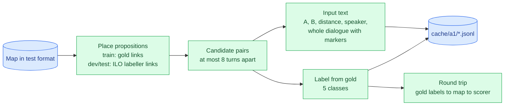

# Approach A1 — ModernBERT cross-encoder for relations (ARI): findings

> **Status:** A1.1 built; waiting for the user's call on the pruning window (k = 8 or 10, D041). A1.2–A1.7 not started.
> **Design:** [`../a1_cross_encoder/README.md`](../a1_cross_encoder/README.md). **Decisions:** D018–D022, D029, D040, D041 in [`../decisionlog.md`](../decisionlog.md).
> **Sources:** [`../results/a1/pairs.json`](../results/a1/pairs.json). One section per A1 phase, added as each closes.

## What A1 does, in one line
For every pair of nearby propositions in a map, a ModernBERT model reads both propositions **plus the whole dialogue** and outputs one of five labels:
- None;
- Inference A→B;
- Inference B→A;
- Conflict;
- Rephrase.

A decision layer then turns those probabilities into relations, and the ILO labeller (Phase 3) supplies the illocutions.

---

## A1.1 — Pair builder


*Figure 1: the pair builder. The round trip measures the best score this pair design could ever reach.*

**How each step works:**
- **Placing propositions (D040):** on training maps, gold turn links. On dev and test, the ILO labeller's *predicted* links, which is all a test map offers; `python -m ilo.predict` reproduces the saved v1 predictions exactly. Fallback: the most similar turn, else unplaced. Node IDs are never used (D029).
- **Pairs (D018):** unordered pairs at most k turns apart. A pair with an unplaced proposition is always kept. A is the earlier proposition; ties are broken by text.
- **Labels (D020):** None, Inference A→B, Inference B→A, Conflict, Rephrase. Conflict and Rephrase are later → earlier when written back to the map.
- **Input (D019, D021):**
  ```
  text_a: keeping Scotland in the union is more of the same
  text_b: we can do something different [SEP] distance: 1 turns; same speaker [SEP]
          Fiona Bruce: will you ignore that pro-independence majority | Lorna Slater: Keeping us in the union isn't different |
          [[A]] Lorna Slater: that's more of the same [[/A]] | [[B]] Lorna Slater: we can do something different [[/B]] | Anas Sarwar: …
  label:  Conflict
  ```
- **Giant maps (D022):** the 19 train and 3 dev maps with more than 40 propositions are left out of this first run.

**Results** (k = 8, as approved):

| | Train | Dev | Test (inputs only) |
|---|---|---|---|
| Maps | 1,231 | 225 | 11 |
| Pairs (share related) | 92,465 (10.5%) | 17,373 (10.6%) | 1,048 |
| Placed by link / similarity / unplaced | 17,307 / 3 / 9 | 3,184 / 7 / 20 | 182 / 1 / 1 |
| Related pairs inside the window | 97.72% | 97.76% | — |
| **Round-trip ARI ceiling** (general / focused) | 98.76 / 94.85 (300 maps) | **97.92 / 92.19** | — |
| Input tokens: median / max | 366 / 857 | 362 / 757 | 402 / 586 |

- **Labels (train):** None 82,744 · Rephrase 3,882 · Inference B→A 2,653 · Inference A→B 2,336 · **Conflict 850**.
- **Every pair fits in 1,024 tokens with the whole dialogue**, so no windowing was needed, and every assembled map validates.

**The window costs ceiling.** Dev round trip by window size:

| k | Dev pairs | Ceiling general | Ceiling focused |
|---|---|---|---|
| **8** | 17,373 | 97.92 | 92.19 |
| 9 | 18,598 | 98.39 | 93.56 |
| **10** | 19,644 (+13%) | **98.64** | **94.44** |
| 12 | 21,280 | 98.77 | 94.97 |
| none | 24,169 | 98.92 | 96.51 |

- k = 8 loses about 4.3 focused points against no window; k = 10 recovers more than half of that for 13% more pairs.
- The last ~3.5 focused points are the price of reading Conflict/Rephrase direction from dialogue order, plus pairs that carry two relations.
- **The gate (≥ 98% of relations inside the window) is just missed at k = 8:** 97.7%. The EDA's 98.2% included gold-only transition anchors, which D040 excludes.

## Open
- **D041:** keep k = 8 (as approved) or move to **k = 10 (recommended)**.

## Reproduce
```bash
python -m ilo.predict --split=dev && python -m ilo.predict --split=test   # labeller links (selected run)
python -m a1_cross_encoder.build_pairs                                     # cache/a1/*.jsonl, results/a1/pairs.json  (~2 min)
```
