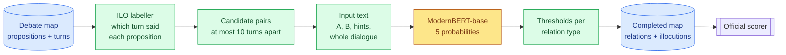
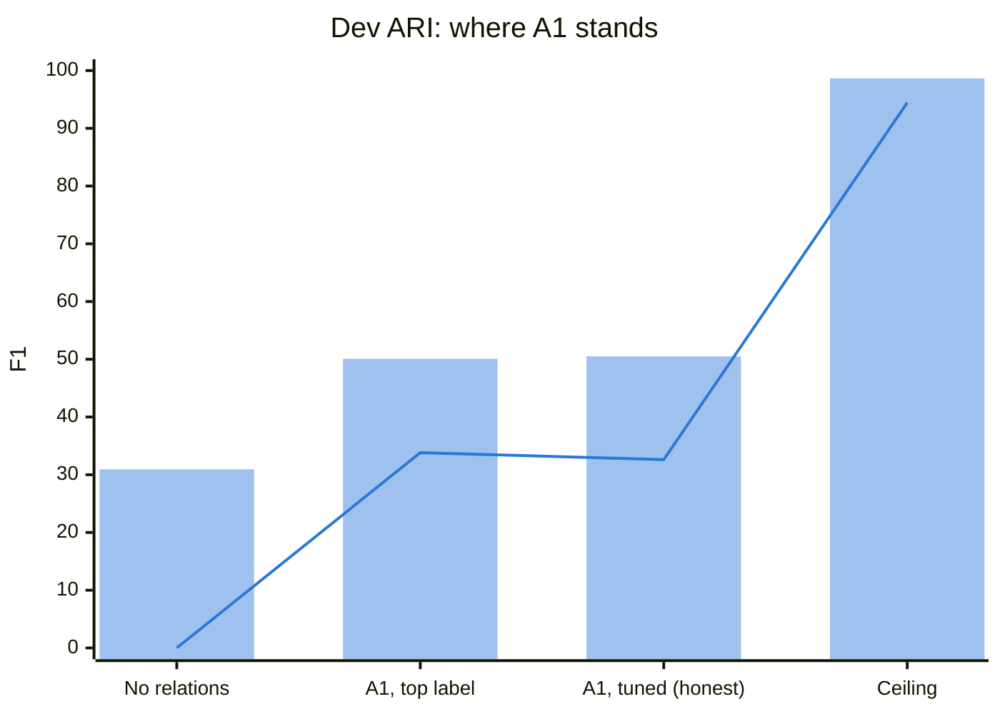
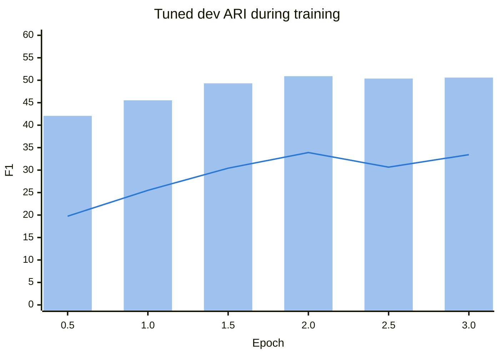
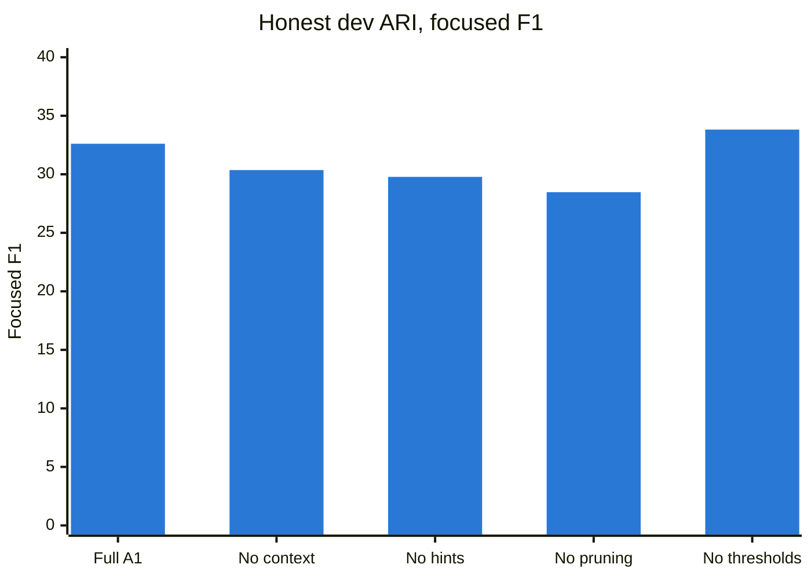

# A1 — A ModernBERT cross-encoder for argument relations

> **What this is:** the report on approach A1, from idea to dev results and ablations. It's written so a reader new to the project can follow it; terms are explained where they first appear.
> **Status:** complete on dev (2026-10-03). The single test run is deferred to the project's final run, so every approach opens the test answers once.
> **Evidence:** every number comes from a committed file in [`../results/a1/`](../results/a1/). Decisions D018–D022, D029 and D040–D048 are in [`../decisionlog.md`](../decisionlog.md).

## In one minute
- **The task.** A debate map has *propositions* (what was claimed) and *turns* (who said what, in order). We must say which propositions **support** (Inference), **attack** (Conflict) or **restate** (Rephrase) each other. That is Task A, ARI. Task B, ILO (how each turn was said), is handled by the separate ILO labeller ([Phase 3 report](03-ilo-labeller.md)).
- **What A1 is.** The approach that won in 2024 (a transformer judging one pair of propositions at a time), with three fixes: it reads **the whole debate**, it gets **structural hints** (distance, same speaker), and it decides with **tuned thresholds** rather than the top label.
- **Result on dev (honest):** ARI **50.5 general / 32.6 focused**. With the ILO labeller (90.1 / 80.6), **Global ≈ 70.3 / 56.6**. 2024's best was 67.05 / 48.25, but on the *test* maps, so this is encouraging, not yet a win.
- **What works:** valid maps every time, direction right 81% of the time, invented Conflicts cut from 34 maps to 8.
- **What doesn't:** Conflict is mostly missed (9% recall) and Inference is over-predicted (27% precision). ARI is far below the 98.6 the pipeline allows, so **the model, not the pipeline, is the limit.**
- **Ablations:** every component helps the focused score. Removing whole-map context costs −2.3, the hints −2.8 and pruning −4.1. Only whole-map context clearly helps general (−1.5 without it).

---

## 1. The problem, briefly
- A map has about 16 propositions. Every **ordered pair** of propositions is scored: *A supports B*, *A attacks B*, *A rephrases B*, or *none*. About 9 in 10 nearby pairs are "none".
- **Direction matters.** Inference points from premise to conclusion. Conflict and Rephrase point from the later statement to the earlier one (true 98% of the time in the data).
- **The metric is macro-F1 per map, averaged over maps** (F1 balances precision and recall). Every label present in a map counts equally:
  - **General** includes the "none" pairs.
  - **Focused** scores only the pairs that really are related.
- **The rare-label trap.** Predicting one Conflict in a map that has none adds a zero-scoring class and costs about a quarter of that map's score. Rare labels need confidence before they're predicted.

## 2. How A1 works


*Figure 1: A1 end to end. Blue = data, green = deterministic steps, yellow = the trained model.*

1. **Place propositions.** The ILO labeller says which turn expressed each proposition. That gives positions (and so distances) and speakers, on test maps too.
2. **Candidate pairs.** Only pairs at most 10 turns apart are scored, which keeps 98.5% of real relations. Every other pair is "none".
3. **Input.** A *cross-encoder* reads both texts together in one pass, so every word of A can look at every word of B. A1 adds the whole dialogue, with the two turns marked:
   ```
   A: the government said farmers being undercut would never happen
   B: farmers being undercut is now happening [SEP] distance: 1 turns; same speaker [SEP]
      … | Sarah Jones: for those farmers which are going to be undercut |
      [[A]] Sarah Jones: the government said would never happen [[/A]] | [[B]] Sarah Jones: is now happening [[/B]]
   ```
4. **Five labels:** none, Inference A→B, Inference B→A, Conflict, Rephrase. Direction is part of the label for Inference. For Conflict and Rephrase it comes from dialogue order.
5. **Decide.** A pair gets its most likely relation only if that probability clears a threshold for its type. The thresholds are tuned on dev (Inference 0.30, Rephrase 0.45, **Conflict 0.65**).
6. **Assemble.** The relations, the ILO labeller's illocutions and the unscored bookkeeping links make a complete map. **All 225 dev maps pass the validator.**

## 3. What we did differently from 2024, and why

| 2024 winning recipe | A1 | Why (evidence) |
|---|---|---|
| Two sentences, no dialogue | Both propositions **plus the whole dialogue**, with turn markers | Missing context was 2024's main failure. A whole map fits in 1,024 tokens (EDA §8) |
| DeBERTa-v3 (512 tokens) | **ModernBERT-base** (up to 8,192 tokens) | Needed to fit the whole dialogue |
| Every pair scored | **Pairs ≤ 10 turns apart** | 98.5% of relations are inside; the window costs 0.3 general / 2.1 focused points of ceiling (A1.1) |
| No structure given | **Distance and same-speaker written in** | Adjacent pairs are related 43% of the time against 8% overall; Inference is same-speaker 95% of the time (EDA) |
| Top label wins (argmax) | **Thresholds per type**, tuned on dev | The rare-label trap: one invented Conflict costs about 26 points in maps without one |
| Picked by loss or accuracy | **Picked by the tuned dev score**, reported by leave-one-episode-out | Avoids early or overconfident checkpoints and flattering numbers (Phase 3 lesson) |

## 4. Results on dev


*Figure 2: bars = general F1, line = focused F1. The ceiling is what A1 would score if every candidate pair were labelled correctly; it sits below 100 mainly because of the 10-turn window and the dialogue-order direction rule.*

| Dev | ARI general / focused | ILO general / focused | **Global** |
|---|---|---|---|
| A1 + ILO labeller (honest) | 50.50 / 32.61 | 90.08 / 80.64 | **≈ 70.3 / 56.6** |
| 2024, best per column, *on the test maps* (reference) | 55.33 / 35.89 | 81.17 / 72.09 | 67.05 / 48.25 |

*The 2024 row takes each column's best system, so it mixes systems; its Global is DFKI-MLST's.*

**Training** took 94 min on a consumer 8 GB GPU (RTX 5060 Ti). The best checkpoint came at epoch 2:


*Figure 3: bars = general, line = focused. Relations are learnt slowly: the score keeps rising until epoch 2, then flattens as the model starts to overfit.*

**Where the points go** (dev, pooled over pairs):

| Relation | Gold | Predicted | Precision | Recall | F1 |
|---|---|---|---|---|---|
| Inference | 1,060 | 1,542 | 0.27 | 0.39 | 0.32 |
| Conflict | 130 | 39 | 0.31 | **0.09** | 0.14 |
| Rephrase | 683 | 871 | 0.42 | 0.53 | 0.47 |

- **Direction:** when A1 finds an Inference, it gets the direction right **81%** of the time.
- **Rare-label trap:** the thresholds cut maps with an invented Conflict from **34 to 8**.
- **A missed Conflict:** *"the government said farmers being undercut would never happen"* vs *"…is now happening"*. A1 ranked Conflict first (0.52) but below the 0.65 bar. Caution costs recall.
- **A false Inference:** the host's *"the rules are pretty complex now…"* was predicted (0.87) to support the turn before. The annotators linked it to the *next* question: the right premise, the wrong conclusion. Pairs are judged one at a time, so A1 can't weigh one conclusion against another.

## 5. Ablations: what each component contributes
Each ablation retrains A1 with **one** component removed. Everything else is identical, including the pairs, except in the no-pruning run. Each is scored the same honest way.

| Variant | What's removed | Honest general (Δ) | Honest focused (Δ) | What changed |
|---|---|---|---|---|
| **Full A1** | — | **50.50** | **32.61** | — |
| No whole-map context | Dialogue cut to ±2 turns around the pair | 48.99 (**−1.5**) | 30.36 (**−2.3**) | Conflict recall halves (9% → 5%); trains twice as fast |
| No hints | The words "distance: …; same speaker" | 50.15 (−0.4) | 29.78 (**−2.8**) | Predicts a third fewer Inferences: higher precision, lower recall |
| No pruning | Every pair compared, not just ≤ 10 turns | 50.49 (±0.0) | 28.47 (**−4.1**) | Very cautious: 833 Inferences and just 6 Conflicts predicted; 22% more pairs, 28% slower to train |
| No thresholds | Top label instead (same model) | 50.08 (−0.4) | 33.82 (+1.2) | 34 maps get an invented Conflict, against 8 |


*Figure 4: focused F1 is where the components show. On general F1 all variants fall within 48.99–50.50.*

**How to read it** (one training run per variant, so treat these as indicative; differences under about 0.5 general are noise):
- **Whole-map context is the only change that helps both measures.** It confirms A1's central premise against 2024, but the gain is modest (about 1.5–2.3 points).
- **Hints and pruning mainly help the model *find* relations.** Without them it plays safe and predicts far fewer, which leaves general unchanged but hurts focused.
- **Pruning is a net win despite lowering the ceiling.** It trains faster, and the model learns better from less lopsided data than the extra reachable pairs are worth.
- **Thresholds suit the headline metric (general) and protect against invented Conflicts.** The price is about 1 point of focused.

## 6. How to read these numbers
- **Dev is not test.** Test maps come from later debates (2022–23) and were chosen to be rich in arguments. Only the final run compares A1 with 2024 on equal terms.
- **"Honest" vs "optimistic".** Thresholds tuned on all of dev and then scored on dev flatter the result a little. The honest figure tunes on 4 dev episodes and scores the 5th, in turn. Differences under about 0.5 are noise; dev has only 130 Conflicts.
- **General vs focused.** General rewards saying "none" correctly. Focused only asks whether real relations were labelled right. A1 tuned for general, which trims focused by about 1 point.
- **The ceiling (98.6 / 94.4) shows the pipeline isn't the problem.** Almost all of the gap is the model's judgement.

## 7. What went well
- **Trustworthy measurement.** Our scorer equals the official one, fast metrics are checked against it, and ceilings are measured before training. Bugs were caught before they could mislead: gold self-loops, a variable clash that would have spoiled two ablations, three memory failures.
- **Whole-debate context fits and runs cheaply:** 94 min of training on a consumer GPU, and valid maps every time.
- **The decision layer does its job:** few invented Conflicts, and stable thresholds across folds.
- **Direction**, a named 2024 failure, is right 81% of the time.
- **The ablations confirm the design.** Each component earns its place, and the one central to the 2024 critique (context) helps most consistently.

## 8. Shortcomings
- **ARI is far from its ceiling (50.5 vs 98.6).** Conflict recall (9%) and Inference precision (27%) are the main gaps.
- **Pairs are decided one at a time.** A1 can't compare competing conclusions or keep a map consistent; that's 2024's failure #4, still open.
- **Evidence so far is dev only, from one training run (one seed) per configuration.** Small differences can't be separated from noise.
- **Limits of the small card:** base model only (large didn't fit in the time and memory available), and the 19 giant training maps, which hold 19% of all Conflict examples, were left out.

## 9. Takeaways
- **Relations are the bottleneck, as in 2024.** Whole-map context helps, by about 1.5 general and 2.3 focused, and the structural hints and pruning help the model find relations. None of these closes the gap to the ceiling.
- **Measure the ceiling and an honest score before believing a result.** It turned "is the pipeline broken?" into "the model needs to judge better".
- **For a macro-F1 metric, the decision layer is cheap and matters.** It's where the rare-label trap is won or lost.
- **Next steps should add what pairwise models lack:** reasoning over the whole map at once. That's the case for A2 (a whole-map LLM) and for the planned combination, where A1 decides the confident pairs and an LLM adjudicates the rest.

## 10. What we could have done better
- **Pick checkpoints by the tuned score from the start.** The first ILO run kept a half-trained checkpoint before this lesson.
- **Budget memory from day one.** Two runs exhausted WSL's 7 GB of RAM (millions of token ids held as Python ints), and one overflowed the GPU, all for avoidable reasons.
- **Run each configuration with 2–3 seeds,** so small gains and losses can be told apart from noise.
- **Plan for the giant maps early** (chunk them), instead of setting aside a fifth of the Conflict data.

## 11. With more time
- **A larger model** (ModernBERT-large or DeBERTa-v3-large with an 8-bit optimizer, about 4–5 h per run), plus **multi-seed ensembles**.
- **More Conflict signal:** the giant maps in chunks, the transition-anchored Disagreeing examples, a focal loss.
- **Map-level decoding:** choose the relations of a map jointly, e.g. so a premise supports its single best conclusion.
- **LLM adjudication** of uncertain pairs (the planned combination phase), and the **final test run**.

---
<details><summary>Build log in brief (A1.1–A1.6)</summary>

| Phase | Outcome | Decisions |
|---|---|---|
| A1.1 Pair builder | 104,662 train / 19,644 dev pairs (k = 10); dev ceiling 98.64 / 94.44; all inputs ≤ 857 tokens | D040–D041 |
| A1.2 Training loop | Memorises 72 pairs; 24k tokens/s, 5 GB; fixed a self-loop metric bug and a RAM kill | D042 |
| A1.3 Training | Best at epoch 2: tuned 50.90 / 33.91; 94 min | D043 |
| A1.4 Decision layer | Honest 50.50 / 32.61; Conflict threshold 0.65; calibration error about 1% | D044 |
| A1.5 Full system | 225/225 maps valid; dev Global 70.53 / 57.29 (tuned on all dev) | D045 |
| Decoding tries | Per-proposition caps ±0.5; checkpoint ensembles worse | D046 |
| A1.6 Ablations | Context, hints and pruning all help focused; a variable clash and a RAM hang caught before training | D047–D048 |
</details>

**Reproduce** (WSL, repo root):
```bash
python -m ilo.predict --split=dev                        # turn links from the ILO labeller
python -m a1_cross_encoder.build_pairs                   # pairs (+ --variant=ctx2|nomark|k99 for ablations)
python -m a1_cross_encoder.train --run=v1                # ~95 min, run detached (abl-ctx2 | abl-nomark | abl-k99)
python -m a1_cross_encoder.tune --run=v1                 # thresholds, honest score, diagnostics
python -m a1_cross_encoder.predict --run=v1 --split=dev  # complete maps + dev Global
```
