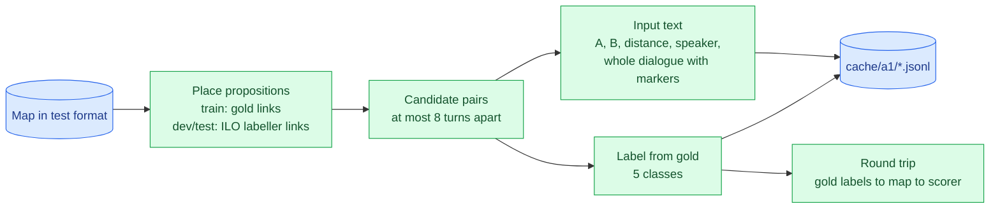

# Approach A1 — ModernBERT cross-encoder for relations (ARI): findings

> **Status:** A1.1–A1.5 done (D040–D045). Full system on dev: ARI 50.5 / 32.6 and Global about 70.3 / 56.6 (honest). Next: A1.6 ablations.
> **Design:** [`../a1_cross_encoder/README.md`](../a1_cross_encoder/README.md). **Decisions:** D018–D022, D029, D040, D041 in [`../decisionlog.md`](../decisionlog.md).
> **Sources:** [`../results/a1/pairs.json`](../results/a1/pairs.json) and [`../results/a1/v1/`](../results/a1/v1/) (training log and summary, thresholds and diagnostics, dev Global). One section per A1 phase, added as each closes.

## What A1 does, in one line
For every pair of nearby propositions in a map, a ModernBERT model reads both propositions **plus the whole dialogue** and outputs one of five labels:
- None;
- Inference A→B;
- Inference B→A;
- Conflict;
- Rephrase.

A decision layer then turns those probabilities into relations, and the ILO labeller (Phase 3) supplies the illocutions.

---

## A1.1 — Pair builder


*Figure 1: the pair builder. The round trip measures the best score this pair design could ever reach.*

**How each step works:**
- **Placing propositions (D040):** on training maps, gold turn links. On dev and test, the ILO labeller's *predicted* links, which is all a test map offers; `python -m ilo.predict` reproduces the saved v1 predictions exactly. Fallback: the most similar turn, else unplaced. Node IDs are never used (D029).
- **Pairs (D018, D041):** unordered pairs at most **k = 10** turns apart. A pair with an unplaced proposition is always kept. A is the earlier proposition; ties are broken by text.
- **Labels (D020):** None, Inference A→B, Inference B→A, Conflict, Rephrase. Conflict and Rephrase are later → earlier when written back to the map.
- **Input (D019, D021):**
  ```
  text_a: keeping Scotland in the union is more of the same
  text_b: we can do something different [SEP] distance: 1 turns; same speaker [SEP]
          Fiona Bruce: will you ignore that pro-independence majority | Lorna Slater: Keeping us in the union isn't different |
          [[A]] Lorna Slater: that's more of the same [[/A]] | [[B]] Lorna Slater: we can do something different [[/B]] | Anas Sarwar: …
  label:  Conflict
  ```
- **Giant maps (D022):** the 19 train and 3 dev maps with more than 40 propositions are left out of this first run.

**Results** (final, k = 10):

| | Train | Dev | Test (inputs only) |
|---|---|---|---|
| Maps | 1,231 | 225 | 11 |
| Pairs (share related) | 104,662 (9.4%) | 19,644 (9.4%) | 1,208 |
| Placed by link / similarity / unplaced | 17,307 / 3 / 9 | 3,184 / 7 / 20 | 182 / 1 / 1 |
| Related pairs inside the window | **98.47%** | **98.83%** | — |
| **Round-trip ARI ceiling** (general / focused) | 99.27 / 96.83 (300 maps) | **98.64 / 94.44** | — |
| Input tokens: median / max | 369 / 857 | 365 / 757 | 403 / 586 |

- **Labels (train):** None 94,866 · Rephrase 3,933 · Inference B→A 2,664 · Inference A→B 2,343 · **Conflict 856**.
- **Every pair fits in 1,024 tokens with the whole dialogue**, so no windowing was needed, and every assembled map validates.

**Choosing k: the window costs ceiling.** Dev round trip by window size (measured at the first build, k = 8):

| k | Dev pairs | Ceiling general | Ceiling focused |
|---|---|---|---|
| **8** | 17,373 | 97.92 | 92.19 |
| 9 | 18,598 | 98.39 | 93.56 |
| **10** | 19,644 (+13%) | **98.64** | **94.44** |
| 12 | 21,280 | 98.77 | 94.97 |
| none | 24,169 | 98.92 | 96.51 |

- k = 8 loses about 4.3 focused points against no window; k = 10 recovers more than half of that for 13% more pairs.
- The last ~3.5 focused points are the price of reading Conflict/Rephrase direction from dialogue order, plus pairs that carry two relations.
- **At k = 8 the gate (≥ 98% of relations inside the window) was just missed:** 97.7%, because the EDA's 98.2% included gold-only transition anchors, which D040 excludes. **The user chose k = 10 (D041), which passes: 98.5% train / 98.8% dev.**

**Lessons from A1.1:**
- Using the labeller's *predicted* links on dev costs almost nothing: dev keeps 98.8% of relations, against 98.5% on train with gold links.
- Whole-dialogue context is affordable for every test-like map: at most 857 tokens.
- A round trip on gold labels is a cheap way to price each design choice before training. The window was worth 2.3 focused points.

## A1.2 — Model and training loop

**What it is:** ModernBERT-base with a 5-way output, trained by the shared loop `common/finetune.py` (also used by the ILO labeller). Recipe `v1` in `a1_cross_encoder/train.py`:

| Setting | Value | Why |
|---|---|---|
| Input | max 1,024 tokens, whole dialogue | D019; the longest pair is 857 |
| Batch | 4,096 tokens (about 10 pairs) × 3 accumulated, about 30 pairs per update | Fits the 8 GB card (D033); accumulation keeps updates stable |
| Learning rate / epochs | 3e-5, 3 epochs, no early stop | The steadier setting from Phase 3 |
| Class weights | None 1.0 · Rephrase 4.9 · Inference 6.0–6.4 · Conflict 10.5 | Rare labels count more |
| **Checkpoint choice** | **Tuned dev ARI score** (temperature + thresholds), every evaluation's predictions kept | Phase 3's main lesson (D039) |

**The decision layer core** (`a1_cross_encoder/decide.py`): each pair's best relation is kept if its probability clears that relation type's threshold (Inference, Conflict, Rephrase). With no thresholds it falls back to the plain top label. Its **fast ARI metric equals the official scorer**: 0 mismatches over 675 map scorings, after one fix (below).

**Checks:**

| Check | Result |
|---|---|
| Gold labels through the decision layer | 98.64 / 94.44, exactly the A1.1 ceiling |
| Memorise 72 pairs (9 Conflict) | 83% after 100 steps, **100% after 300** |
| Speed (300 real optimizer steps) | **24.4k tokens/s, 5.0 GB GPU, 3.6 GB RAM**; about 27 min per epoch |
| Dev prediction | 129 pairs/s, about 2.5 min per evaluation |

**What we learnt (all fixed):**
- **Gold has self-loops.** A few maps relate a proposition to itself. The official scorer never sees them, but a fast metric must skip them too: they caused 13 of 675 scores to differ.
- **Long inputs exhaust RAM before VRAM.** 104k inputs of about 374 tokens became about 40M Python integers (3+ GB), and WSL's 7 GB limit killed the run. Compact int32 arrays, built in chunks, cut the peak to 3.6 GB. The ILO pipeline uses the same code.
- **Longer inputs need more steps to fit.** The memorisation check needed 300 steps, against ILO's 100. That's no bug, just a harder task.
- **Base, not large.** Large is about 3× slower and at the GPU memory limit, so a 3-epoch large run is out of reach on this card.

## A1.3 — Training run (D043)

Run `v1`, launched detached. Every half epoch, dev is scored with the simple decode and with tuned thresholds; the tuned score picks the checkpoint.

| Epoch | 0.5 | 1.0 | 1.5 | **2.0** | 2.5 | 3.0 |
|---|---|---|---|---|---|---|
| Tuned dev ARI (general / focused) | 42.07 / 19.75 | 45.53 / 25.50 | 49.31 / 30.43 | **50.90 / 33.91** | 50.37 / 30.65 | 50.59 / 33.44 |
| Simple decode | 37.69 / 11.95 | 41.87 / 15.85 | 48.78 / 31.29 | 50.08 / 33.82 | 49.45 / 30.84 | 49.79 / 31.41 |
| Temperature | 0.70 | 0.95 | 0.95 | 0.90 | 1.30 | 1.35 |

**Cost:** 94 min (31.5 min per epoch with dev evaluations), 20.7k tokens/s, 5.0 GB GPU.

**Learnt:** relations are learnt far more slowly than illocutions. ILO peaked at half an epoch; ARI keeps improving until 2 epochs, then flattens as the model grows overconfident (temperature above 1). With ILO's early stopping (Phase 3, v1) this run would have kept a much worse checkpoint, so tuned-score selection paid off here.

## A1.4 — Decision layer (D044)

Thresholds per relation type, fitted on dev and scored honestly by leaving one dev episode out at a time:

| Dev ARI | General | Focused |
|---|---|---|
| Simple decode (most probable label) | 50.08 | 33.82 |
| Tuned on all of dev (optimistic) | 50.90 | 33.91 |
| **Cross-fitted (honest)** | **50.50** | **32.61** |

- **Thresholds:** Inference 0.30, Conflict **0.65**, Rephrase 0.45, stable across folds. Conflict needs the most confidence.
- **They tame the rare-label trap:** maps where Conflict is predicted but absent from gold drop from **34 to 8**. Because they're tuned for the *general* metric, they trade a little focused (−1.2) for general (+0.4).
- **Calibration:** top-label calibration error is 0.9% before the temperature step and 1.1% after. A1 is already well calibrated, so the temperature is neutral here and the thresholds do the work.

**Where the points go** (pooled over dev, tuned):

| Relation | Gold | Predicted | Precision | Recall | F1 |
|---|---|---|---|---|---|
| Inference | 1,060 | 1,542 | 0.27 | 0.39 | 0.32 |
| Conflict | 130 | 39 | 0.31 | **0.09** | 0.14 |
| Rephrase | 683 | 871 | 0.42 | 0.53 | 0.47 |

- **Direction:** among Inference pairs it finds, the model gets the **direction right 81%** of the time.
- **Weak spots:** Conflict is mostly missed (9% recall), and Inference is over-predicted (precision 0.27).

## A1.5 — Complete maps and the first full-system dev score (D045)

Each dev map = the test-format input + A1's relations + the ILO labeller's illocution links + unscored transition illocutions (Arguing / Restating / Disagreeing, D024). **All 225 maps pass the strict validator**, and the official scorer on the assembled maps reproduces each component's numbers exactly.

| Dev (thresholds tuned on all of dev) | General P / R / F1 | Focused P / R / F1 |
|---|---|---|
| ARI (A1) | 50.21 / 57.03 / **50.90** | 45.08 / 30.56 / **33.91** |
| ILO (labeller v1) | 90.39 / 90.26 / **90.16** | 81.01 / 80.79 / **80.67** |
| **Global** | 70.30 / 73.64 / **70.53** | 63.05 / 55.67 / **57.29** |

**Honest estimate** (cross-fitted components): Global about **70.3 / 56.6**.

**Reference only:** 2024's best was 67.05 / 48.25, but on the 11 test maps, which come from later (2022–23) debates and were chosen to be rich in arguments. Dev and test aren't directly comparable; only the final run decides.

## Lessons so far
- **ILO is strong (90 / 81) and ARI is the bottleneck (50.5 / 32.6).** That's where further work should go, as in 2024.
- **Within ARI, Conflict recall (9%) and Inference precision (0.27) are the weakest parts.** Direction, a known 2024 failure, is right 81% of the time once a pair is found.
- **Choosing checkpoints by the tuned score matters more for slow learners.** ARI's best was at epoch 2.
- **Thresholds, not temperature, are A1's useful decision lever.**

## Reproduce
```bash
python -m ilo.predict --split=dev && python -m ilo.predict --split=test   # labeller links (selected run)
python -m a1_cross_encoder.build_pairs                                     # cache/a1/*.jsonl, results/a1/pairs.json  (~2 min)
python -m a1_cross_encoder.train --run=v1 --overfit --steps=300            # memorisation check
python -m a1_cross_encoder.train --run=v1 --bench                          # speed and memory
python -m a1_cross_encoder.train --run=v1                                  # A1.3 full run (~95 min, run detached)
python -m a1_cross_encoder.tune --run=v1                                   # A1.4 thresholds + diagnostics
python -m a1_cross_encoder.predict --run=v1 --split=dev                    # A1.5 complete maps + dev Global
```
