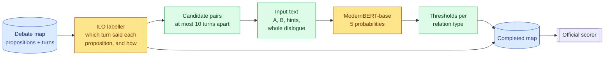
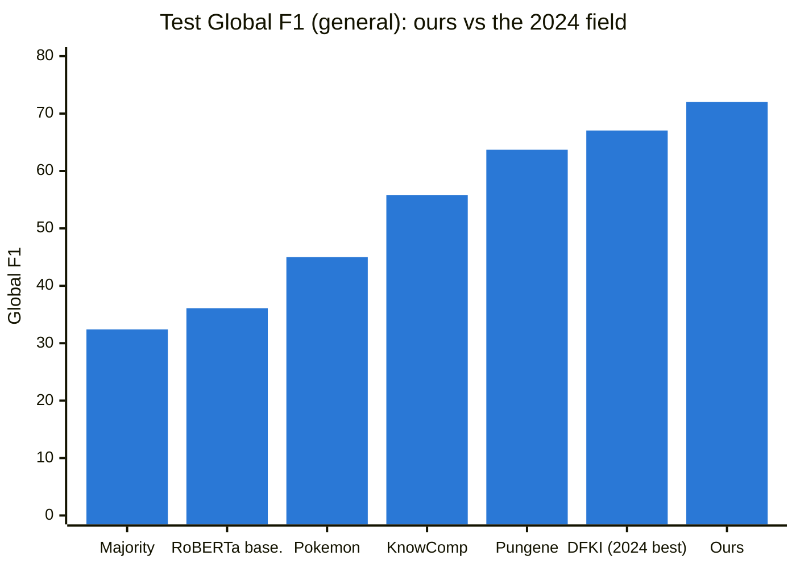
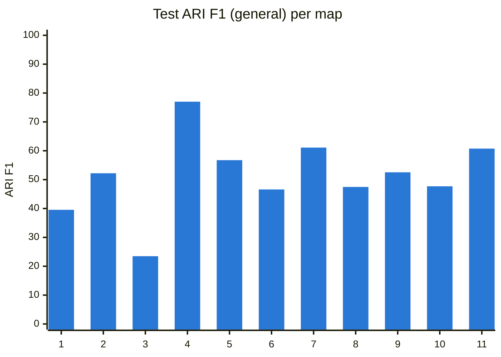
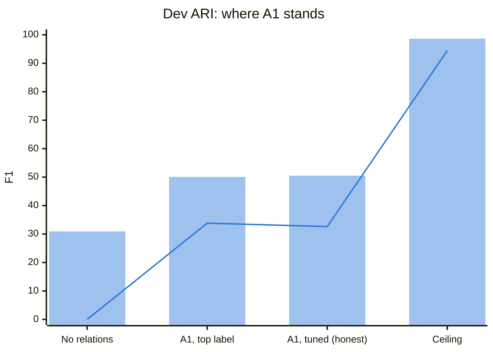
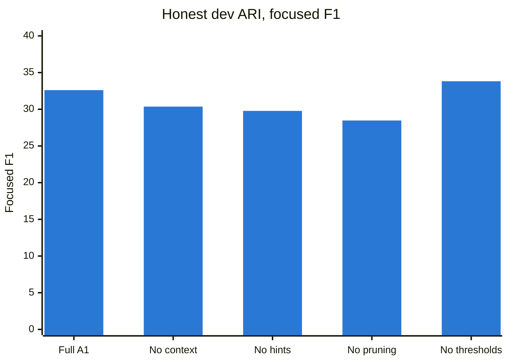

# A1 — A ModernBERT cross-encoder for argument relations

> **What this is:** the report on approach A1, from idea to final test result. It's written for readers new to the project; terms are explained where they first appear.
> **Status:** final (2026-10-03). The test set was scored once, with nothing tuned afterwards (D049).
> **What came after:** A2 (Claude reading the whole map) beat A1's relations on dev by +4.1 (significant), and A4 (Jev) matched them with no training. A1 is part of the best pre-registered system, the averaged A1 + A2 + A4 (test Global 74.51 / 59.47). See [`04-comparison.md`](04-comparison.md) and the project's [final report](05-final-report.md).
> **Evidence:** every number comes from a committed file in [`../results/a1/`](../results/a1/); the test predictions are in [`../results/a1/v1/test_predictions/`](../results/a1/v1/test_predictions/). Decisions D018–D050 are in [`../decisionlog.md`](../decisionlog.md).

## In one minute
- **The task.** A debate map has *propositions* (claims) and *turns* (who said what, in order). The system must say which propositions **support** (Inference), **attack** (Conflict) or **restate** (Rephrase) each other. That is Task A, ARI. It must also say *how* each turn was said (asserting, questioning, …). That is Task B, ILO.
- **Our system** is two trained models:
  - **A1** (this report) handles ARI. It's the 2024 winning recipe (a transformer judging one pair of propositions at a time), fixed to read **the whole debate**, given **structural hints**, and deciding with **tuned thresholds**.
  - **The ILO labeller** ([Phase 3](03-ilo-labeller.md)) handles ILO.
- **Final test result:** Global **72.01 general / 57.53 focused**, against 2024's best of 67.05 / 48.25. That **ranks first on both measures** against the 2024 field.
- **Where the win comes from:** ILO (92.6 / 84.3, about +12 over 2024's best). **ARI is about 2024 level** (51.4 / 30.8): 2nd among 2024 entries, below the winner on general.
- **Main lesson:** whole-debate context helps relations only modestly (+1.5 / +2.3 in ablations). Relations remain the bottleneck: Conflict is mostly missed, and pairs are judged in isolation.

---

## 1. The problem and the metric
- A map has about 16 propositions; every **ordered pair** gets a label: *A supports B*, *A attacks B*, *A rephrases B*, or *none*. About 9 in 10 nearby pairs are "none".
- **Direction matters.** Inference points premise → conclusion. Conflict and Rephrase point from the later to the earlier statement (98% of the time).
- **The metric is macro-F1 per map, averaged over maps** (F1 balances precision and recall). Every label in a map counts equally:
  - **General** includes the "none" pairs.
  - **Focused** scores only the truly related pairs.
  - **Global** is the average of ARI and ILO.
- **The rare-label trap.** One invented Conflict in a map without any adds a zero-scoring class, costing about a quarter of that map's score. Rare labels need confidence.

## 2. How the system works


*Figure 1: the two trained models (yellow) and the deterministic steps between them (green).*

1. **Place propositions.** The ILO labeller links each turn to the proposition it expresses (98% of links found). That gives every proposition a position and a speaker, and gives ILO its answer.
2. **Candidate pairs.** Only pairs at most 10 turns apart are scored, which keeps 98.5% of real relations. The rest are "none".
3. **Input.** A *cross-encoder* reads both texts in one pass, so each word of A can look at each word of B. A1 adds the whole dialogue, with the two turns marked:
   ```
   A: the government said farmers being undercut would never happen
   B: farmers being undercut is now happening [SEP] distance: 1 turns; same speaker [SEP]
      … | [[A]] Sarah Jones: the government said would never happen [[/A]] | [[B]] Sarah Jones: is now happening [[/B]]
   ```
4. **Five labels:** none, Inference A→B, Inference B→A, Conflict, Rephrase. Conflict and Rephrase direction comes from dialogue order.
5. **Decide.** A pair gets its likeliest relation only if it clears that type's threshold, tuned on dev: Inference 0.30, Rephrase 0.45, **Conflict 0.65**.
6. **Assemble.** Relations and illocutions form a complete, valid map (225/225 dev, 11/11 test).

## 3. What we did differently from 2024, and why

| 2024 winning recipe | A1 | Why |
|---|---|---|
| Two sentences, no dialogue | Both propositions **plus the whole dialogue** | Missing context was 2024's main failure; a whole map fits in 1,024 tokens |
| DeBERTa-v3 (reads 512 tokens) | **ModernBERT-base** (8,192 tokens) | Needed to fit the whole dialogue |
| Every pair scored | **Pairs ≤ 10 turns apart** | Keeps 98.5% of relations and cuts the "none" flood |
| No structure given | **Distance and same-speaker written in** | Neighbouring pairs are related 43% of the time against 8% overall |
| Top label wins | **Thresholds per type**, tuned on dev | Guards against the rare-label trap |
| Picked by loss or accuracy | **Picked by the tuned dev score**, reported honestly (below) | Avoids early or overconfident checkpoints and flattering numbers |
| Pairwise ILO classifiers / similarity linking | **A trained ILO labeller** with one-to-one linking (Phase 3) | Surface cues are weak ("?" is absent); rare types weigh heavily |

## 4. Final test result (11 maps, scored once)


*Figure 2: Global F1 on the 11 test maps. 2024 values are from the shared-task overview paper; ours comes from the same official scoring logic.*

| Test, F1 general / focused | **Ours** | Best 2024 | Rank among 2024 entries |
|---|---|---|---|
| ARI (A1) | 51.38 / 30.77 | 55.33 (DFKI) / 35.89 (Pokemon) | 2nd / 2nd |
| ILO (labeller) | **92.64 / 84.28** | 81.17 (Pungene) / 72.09 (RoBERTa baseline) | 1st / 1st |
| **Global** | **72.01 / 57.53** | 67.05 / 48.25 (DFKI) | **1st / 1st** |

**How to read it:**
- **The win comes from ILO.** ARI is about 2024 level: below DFKI on general, level with it on focused (30.77 vs 30.40).
- **Dev predicted test well:** ARI 50.5 → 51.4 and ILO 90.1 → 92.6. The honest dev protocol (thresholds tuned on 4 dev episodes and scored on the 5th) was sound.
- **11 maps is a small test, so treat it as a sample, not a measurement.** Per-map ARI ranges from 23 to 77, and each map moves the average by about 9%:


*Figure 3: per-map ARI on test. ILO, by contrast, is perfect (100 / 100) on 7 of the 11 maps.*

**The 2024 failures, revisited** (from the overview paper):

| 2024 failure | A1's answer | Outcome |
|---|---|---|
| Relations lack context | Whole-dialogue input | **Partly:** +1.5 / +2.3 in ablation (dev), but test ARI is still at 2024 level |
| Conflict missed or invented | Strict Conflict threshold (0.65) | **Half:** no invented Conflict in any test map, but only 2 of 13 found |
| Direction errors | Direction in the label, plus an order rule | **Mostly:** direction right for 78% (test) / 81% (dev) of Inferences found |
| No global consistency | — (pairs judged one at a time) | **Not addressed by A1.** A2's single list per map later cut invented relations (697 against A1's 1,278 on dev) |

**Relations on test** (pooled): Inference F1 0.29 (precision 0.31, recall 0.28); Conflict 0.25 (2 of 13 found, 2 of 3 predictions right); Rephrase 0.53 (precision 0.46, recall 0.63).

**Cost:** 94 min to train A1 and 20 min for the ILO labeller, on one consumer 8 GB GPU (RTX 5060 Ti). Inference is about 1.2 s per map for both models together. No API spend.

## 5. Dev results: what limits A1


*Figure 4: bars = general F1, line = focused F1 (225 dev maps). The ceiling is A1's score if every candidate pair were labelled right: the pipeline allows 98.6, the model reaches 50.5. **The limit is the model's judgement, not the pipeline.***

| Dev relation | Gold | Predicted | Precision | Recall | F1 |
|---|---|---|---|---|---|
| Inference | 1,060 | 1,542 | 0.27 | 0.39 | 0.32 |
| Conflict | 130 | 39 | 0.31 | **0.09** | 0.14 |
| Rephrase | 683 | 871 | 0.42 | 0.53 | 0.47 |

- **Training:** the best checkpoint came at epoch 2 of 3. Relations are learnt slowly (ILO peaked at half an epoch) and then start to overfit.
- **Thresholds:** they cut the maps with an invented Conflict on dev from **34 to 8**. The cost is recall: Conflict is often ranked first but below the 0.65 bar. In *"the government said farmers would never be undercut"* vs *"…is now happening"*, A1 gave Conflict 0.52.
- **Isolated pairs:** the host's *"the rules are pretty complex now…"* was predicted (0.87) to support the turn before; annotators linked it to the *next* question. The premise was right and the conclusion wrong. A1 can't compare conclusions.
- **Decoding tweaks were tried and failed** (D046): capping one relation per proposition gave ±0.5, and averaging checkpoints made things worse.

## 6. Ablations: what each component contributes (dev)
Each run is identical to A1 except for **one** removed component, and is scored the same honest way. One run per variant, so treat these as indicative; differences under about 0.5 general are noise.

| Removed | Honest general (Δ) | Honest focused (Δ) | What changed |
|---|---|---|---|
| — (full A1) | **50.50** | **32.61** | — |
| Whole-dialogue context (±2 turns only) | 48.99 (**−1.5**) | 30.36 (**−2.3**) | Conflict recall halves; trains twice as fast |
| Distance / speaker hints | 50.15 (−0.4) | 29.78 (**−2.8**) | A third fewer Inferences predicted |
| Pruning (every pair) | 50.49 (±0.0) | 28.47 (**−4.1**) | Very cautious: just 6 Conflicts predicted; 28% slower |
| Thresholds (top label instead) | 50.08 (−0.4) | 33.82 (+1.2) | 34 maps get an invented Conflict, against 8 |


*Figure 5: focused F1 is where components show; on general all variants fall within 49.0–50.5.*

- **Context is the only component that helps both measures.** It confirms the premise, but modestly.
- **Hints and pruning help the model *find* relations.** Without them it plays safe and predicts fewer.
- **Thresholds trade about 1 point of focused** for general and for protection against invented Conflicts.

## 7. Assessment
**What went well**
- **Beat 2024 overall** (72.0 / 57.5 against 67.05 / 48.25), with every output map valid.
- **Measurement we can trust:**
  - the scorer equals the official one;
  - every fast metric is checked against it;
  - ceilings are measured before training;
  - honest dev estimates matched test.
- **Bugs caught before they could mislead:**
  - gold self-loops in the metric;
  - a variable clash that would have spoiled two ablations;
  - three memory failures.
- **Cheap:** every model trains on one consumer GPU in about 2 hours or less.

**Shortcomings**
- **ARI didn't improve on 2024** (−4 general against the winner). Conflict recall is 9–15%, and Inference precision is about 0.3.
- **Pairs are judged one at a time**, so A1 can't keep a map consistent or pick between competing conclusions.
- **Small evidence:**
  - one seed per configuration;
  - ablations on dev only;
  - 11 test maps with wide per-map spread.
- **Hardware limits:** base model only (150M parameters). The 19 giant training maps, holding 19% of Conflict examples, were left out.

**Takeaways**
- **On this task, illocutions are where a careful trained pipeline pays off most;** relations remain the bottleneck.
- **More context helps a pairwise model only a little.** The missing piece is reasoning across the map: comparing conclusions, staying consistent, spotting implicit conflict. A2 (a whole-map LLM) later supplied the first two and beat A1 on dev; neither it nor any other approach solved implicit conflict.
- **With macro-F1, decisions matter as much as models.** Thresholds and honest tuning prevented the rare-label trap and flattering numbers.

**What we'd do differently**
- **Pick checkpoints by the tuned score from day one.**
- **Budget memory in the data pipeline early.** Three runs hit avoidable memory problems.
- **Run 2–3 seeds per configuration,** to separate real effects from noise.

**With more time**
- **A larger encoder** (large models with an 8-bit optimizer, about 4–5 h per run) and seed ensembles.
- **More Conflict signal:** the chunked giant maps, transition-anchored Disagreeing examples, a focal loss.
- **Map-level decoding:** choose a map's relations jointly.
- **LLM adjudication** of uncertain pairs. The combination phase averaged A1's and the LLMs' pair scores instead (D083–D084); routing only the uncertain pairs was not run.

---
<details><summary>Build log (A1.1–A1.7)</summary>

| Phase | Outcome | Decisions |
|---|---|---|
| A1.1 Pair builder | 104,662 train / 19,644 dev / 1,208 test pairs (k = 10); dev ceiling 98.64 / 94.44 | D040–D041 |
| A1.2 Training loop | Memorises 72 pairs; 24k tokens/s, 5 GB; fixed a self-loop metric bug and a RAM kill | D042 |
| A1.3 Training | Best at epoch 2: tuned 50.90 / 33.91; 94 min | D043 |
| A1.4 Decision layer | Honest 50.50 / 32.61; Conflict threshold 0.65; calibration error about 1% | D044 |
| A1.5 Full system | 225/225 valid; dev Global 70.53 / 57.29 (tuned on all dev) | D045 |
| Decoding tries | Caps ±0.5; checkpoint ensembles worse | D046 |
| A1.6 Ablations | Context, hints and pruning each help focused | D047–D048 |
| A1.7 Test | Global 72.01 / 57.53; ARI 51.38 / 30.77; ILO 92.64 / 84.28 | D049–D050 |
</details>

**Reproduce** (WSL, repo root): `python -m ilo.predict --split=test` → `python -m a1_cross_encoder.build_pairs` → `python -m a1_cross_encoder.train --run=v1` (~95 min, run detached) → `python -m a1_cross_encoder.tune --run=v1` → `python -m a1_cross_encoder.predict --run=v1 --split=test`.
