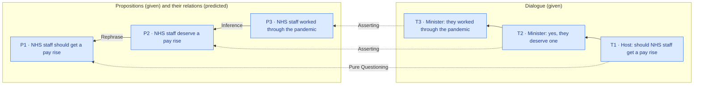
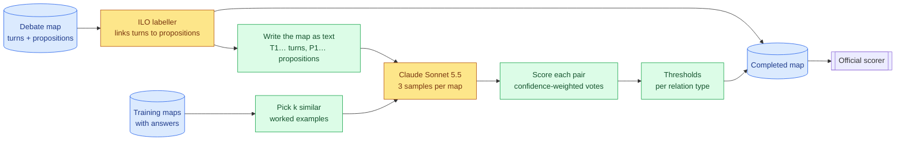

# A2 — A whole-map language model for argument relations

> **What this is:** the report on approach A2, written for readers new to the project. Terms are explained where they first appear, and §3 collects them. It starts as the plan and the reasons behind it, and results are added as each phase finishes.
> **Status:** A2.1 (setup) passed 2026-10-04 (§9). Next: A2.2 (prompt development), on the user's go.
> **Evidence (as phases finish):** [`../results/a2/`](../results/a2/). Decisions D051–D054 are in [`../decisionlog.md`](../decisionlog.md).

## In one minute
- **The task.** A televised debate is turned into a *map*: **propositions** (claims, each a cleaned-up version of something said) and **turns** (who said what, in order). A system must say which propositions **support** (Inference), **attack** (Conflict) or **restate** (Rephrase) which others. It must also say *how* each turn was said (asserting, questioning, …).
- **Why A2.** Our first system (A1, a fine-tuned classifier) judges one pair of propositions at a time. It wins overall, but at finding relations it is no better than the best 2024 systems. It misses most attacks, and it can't weigh competing conclusions against each other.
- **The idea.** Give a strong language model, **Claude Sonnet 5.5**, the *whole* map and have it list every relation at once, reasoning across the map. Ask it 3 times. How often, and how confidently, a relation is listed becomes its score, and tuned thresholds turn scores into decisions.
- **Cost: $0.** Calls run on an existing Claude Pro subscription through Claude Code's scripted mode. The price is speed, because the subscription has usage limits. The cost on the paid API is still measured and reported.
- **Plan.** Five gated phases: setup → prompt development on training maps → full dev run → assembly and ablations → one test run.

---

## 1. The problem

### 1.1 Debate maps
Maps come from BBC *Question Time* and follow Inference Anchoring Theory (IAT), which keeps *what was said* apart from *what it means*:


*Figure 1: a three-turn map. Blue boxes are the input. The arrows between propositions (Task A) and the dotted arrows from turns (Task B) are what a system must predict.*

- **Input:** the turns in order, with speakers, and the propositions, unconnected.
- **Task A, relations (ARI):** for every pair of propositions, the relation and its direction.
  - *Inference* points premise → conclusion. Its direction varies: 53% point back to something said earlier, 47% forward.
  - *Conflict* and *Rephrase* point from the later statement to the earlier one in 98% of cases.
  - An answer to a question counts as a *Rephrase* of the question.
- **Task B, illocutions (ILO):** which turn expresses which proposition, and how (Asserting, Pure / Assertive / Rhetorical Questioning, Agreeing, …).
- **Data:** 1,478 annotated maps from 30 episodes (2020–21), with about 16 propositions each, plus 11 test maps (2020–23) whose answers stay sealed until a final run. The training maps are split **by episode** into train (1,250) and dev (228, from 5 episodes), so the same debate never sits on both sides.

### 1.2 How it is scored
- **Pairs, not graphs.** Every ordered pair of propositions (about 240 per map) gets one label: Inference, Conflict, Rephrase or None. The official scorer compares labels pair by pair, computes **macro-F1 per map** (every label present counts equally), then averages over maps.
- **General** F1 includes the None pairs. **Focused** F1 counts only pairs that have a true relation. **Global** is the mean of the Task A and Task B scores.
- **The rare-label trap.** Conflict is absent from 57% of maps. In such a map, one invented Conflict adds a label that scores 0 and cuts that map's score from 100 to about 74. So rare labels may only be predicted with confidence.

### 1.3 What came before

| Test F1, general / focused | Task A (ARI) | Task B (ILO) | Global |
|---|---|---|---|
| Best 2024 entries | 55.3 / 35.9 | 81.2 / 72.1 | 67.05 / 48.25 |
| Ours so far: A1 + ILO labeller | 51.4 / 30.8 | **92.6 / 84.3** | **72.01 / 57.53** |

- **A trained ILO labeller** already links turns to propositions, finding 98.3% of links at 99.6% precision on dev, and types them well. A2 reuses its links.
- **A1** is a fine-tuned ModernBERT that reads one pair plus the whole dialogue. On dev it finds 9% of Conflicts, and only 27% of the Inferences it predicts are right. Its limit is structural: it never sees its other decisions, so it can't compare candidate conclusions or keep a map consistent.
- **The 2024 LLM entries** lost to fine-tuned encoders. They used weaker models and short contexts, and their free-text answers had to be parsed.

**A2's question:** does a current model that reasons over the whole map find relations, especially attacks and directions, better than a pairwise classifier?

---

## 2. The approach


*Figure 2: the A2 pipeline. Yellow = models, green = deterministic steps, blue = data.*

1. **Write the map as text.** Turns become T1, T2, … in dialogue order. Each turn shows its speaker, its words and the proposition(s) the ILO labeller linked to it. Propositions are renumbered P1, P2, … so the original node IDs, which leak the answer, never appear.
2. **Prompt.** A fixed *system prompt* (the rules) plus a *user message* holding k worked examples (similar training maps with their answers) and then the target map.
3. **Call the model 3 times** with the same prompt. Each answer is JSON forced to match a schema: a list of relations, each with a confidence, and a type for each linked turn.
4. **Score each pair:** the average over the 3 answers of the stated confidence (high 1, medium ⅔, low ⅓, absent 0).
5. **Decide:** a pair keeps its best-scoring relation only if that score clears its type's threshold, tuned on dev. Conflict and Rephrase direction comes from dialogue order (later → earlier).
6. **Assemble** a complete, valid map and score it with the official logic.

**What the model sees and returns** (a shortened example):
```text
T1  Host: should NHS staff get a pay rise
    [P1] NHS staff should get a pay rise
T2  Minister: yes, they deserve one
    [P2] NHS staff deserve a pay rise
T3  Minister: they worked through the pandemic
    [P3] NHS staff worked through the pandemic
```
```json
{"relations":   [{"type": "Rephrase",  "from": "P2", "to": "P1", "confidence": "high"},
                 {"type": "Inference", "from": "P3", "to": "P2", "confidence": "high"}],
 "illocutions": [{"turn": "T1", "proposition": "P1", "type": "Pure Questioning"}, …]}
```

---

## 3. Concepts used

| Term | Meaning here |
|---|---|
| **Language model (LLM)** | A model that reads text and writes text. Sonnet 5.5 is Anthropic's mid-size current model; it can reason internally before answering. |
| **System prompt / user message** | The fixed instructions (same for every map) vs. the per-map content (examples + the map). |
| **Worked examples** ("few-shot") | Solved maps shown before the target, so the model copies the annotators' style rather than its own idea of "argument". |
| **Retrieval** | Choosing the k examples most similar to the target: TF-IDF word vectors of each map's text, compared by cosine similarity. |
| **Structured output** | The answer is forced to match a JSON Schema. Allowed proposition IDs are listed per map (an *enum*), so an invalid ID can't be written. |
| **Reasoning effort** | How much the model thinks before answering: `low`, `medium` or `high` (the higher levels exist but cost more). Sonnet 5.5 can't switch thinking off entirely in our setup; `low` is the minimum. |
| **Sampling / self-consistency** | Asking the same prompt several times. Answers differ slightly, and agreement between them measures confidence. Sonnet 5.5 doesn't accept a temperature or seed, so its built-in randomness provides the variation. |
| **Confidence-weighted vote** | A relation's score = the average of its stated confidence over the 3 samples (0 when a sample doesn't list it). |
| **Decision layer / thresholds** | Per-type minimum scores (Inference, Conflict, Rephrase) chosen to maximise the per-map metric; the guard against the rare-label trap. |
| **Cross-fitting** | Honest tuning: thresholds are tuned on 4 dev episodes and scored on the 5th, rotating, so the reported number isn't flattered by tuning on the same maps. |
| **Claude Code scripted mode** | `claude -p`, Anthropic's coding tool run as a command. With all tools switched off and our own system prompt, it is a plain model call on the user's subscription. |
| **Usage limits** | A Claude Pro subscription allows a certain amount of use per 5-hour window and per week, shared with the user's own Claude use. |
| **Prompt caching** | Repeated prompt beginnings are stored on the server and re-read cheaply. The 3 samples of a map share one prefix. |
| **Contamination** | The model may have seen the corpus, or the published 2024 test answers, during its training. |
| **Ablation** | Switching off one component, re-scoring, and reading off what it contributed. |

---

## 4. Design choices and why

| Choice | Alternatives considered | Why |
|---|---|---|
| **Claude Sonnet 5.5 via a Claude Pro subscription** (Claude Code scripted mode) | Paid API; other providers' free tiers (Gemini, GitHub Models, OpenRouter, Groq); a local open model | $0, and it's the chosen model. Claude Code is already installed and logged in. Free tiers would mean a different, changing model; a local 8 GB model is far weaker and overlaps approach A3. Cost: speed (usage limits). |
| **The whole map in one call** | One call per pair | The model can compare conclusions and stay consistent, which is exactly A1's blind spot. One call per map instead of ~240. |
| **The labeller's turn links are given** | The model links turns itself | The labeller is already 98.3% / 99.6% accurate. Giving the links keeps A2's measurement on relations and shortens the prompt. |
| **Structured output, per-map ID enums** | Free text, parsed afterwards | Unparseable output sank the 2024 LLM entries. Here every answer is valid by construction. |
| **Retrieved worked examples**, k chosen in the pilot | No examples; fixed examples | The official annotation guide is 2 pages, too thin to define the annotation style. Examples carry the conventions, and similar maps carry the most relevant ones. |
| **3 samples of the same prompt**, confidence-weighted | 1 sample; rotating examples per sample | Thresholds need graded scores to avoid the rare-label trap. The same prompt is cached, so samples 2–3 are cheap. Fewer samples can be tested for free by subsampling. |
| **A1's decision layer, cross-fitted** | Plain majority vote | The same protection and the same honest estimate as A1, so the two are directly comparable. Majority vote is tested for free. |
| **Prompt developed on training maps** (a 50-map pilot) | Developing on dev | A2 never trains, so training maps are as unseen to it as dev. Dev stays clean for thresholds and the comparison with A1. |
| **Direction rule for Conflict / Rephrase** (later → earlier) | The model's own direction | Right 98% of the time and the same as A1. The model's own direction is a free ablation. |
| **The LLM also types each turn**, adopted only if better | A separate call; ARI only | Turn typing is where Task B's remaining gap is (dev 90 → 97 if every type were right). It costs a few output tokens. |
| **Raw responses committed** (gzipped) | Kept local | Without a seed, no run can be regenerated exactly. The saved answers are the evidence behind every number. |
| **The runner pauses at a usage limit** | Auto-resume | The subscription is shared with the user's own work. The user restarts the run, and nothing is lost or re-sent. |

---

## 5. Phased implementation plan
Each phase ends with a **gate** that must pass before the next starts. Code goes in `a2_llm/`; the map-to-text step goes in the shared `common/`, because approaches A3 and A4 use the same text.

| Phase | Builds | Gate | Model calls |
|---|---|---|---|
| **A2.1 Setup** | Serialiser, schema, Claude Code caller, resumable runner, parser | Lossless round trip; 5 live calls verified | ~5 |
| **A2.2 Prompt development** | Pilot set, example retrieval, system prompt; settings sweeps | Prompt and settings frozen from a pilot table | ≤ 400 |
| **A2.3 Dev run** | 3 samples × 225 dev maps; thresholds; diagnostics | Honest dev ARI next to A1 | 675 |
| **A2.4 Assembly + ablations** | Complete maps, illocution types, ablations | 225/225 valid maps; ablation table | 225 |
| **A2.5 Test run + report** | One run on the 11 test maps | Scored once | 33 |

### A2.1 Setup
**Goal:** every step between a map and a score works and is verified before any real run.
**Prerequisites:** a Claude Pro (or Max) subscription, and Claude Code ≥ 2.1.275 logged in with it (`claude auth status` shows `"authMethod": "claude.ai"`). Here that's Claude Code 2.1.283 on Windows, called from the WSL pipeline through Windows interop. No API key is needed.

1. **`common/serialise.py`:** `serialise(aif, name, links) → (text, ids)`.
   - Turns are T1…Tn in dialogue order, written `Speaker: words`.
   - Under each turn come its linked propositions, `[P3] text`. Propositions are numbered in dialogue order, ties broken by text. Propositions with no turn are listed last.
   - Links are gold on training maps and the labeller's on dev and test maps.
   - It also returns the P → node and T → node lookups.
2. **`a2_llm/schema.py`:** the per-map JSON Schema.
   - `relations`: a list of {`type` ∈ Inference / Conflict / Rephrase, `from`, `to` ∈ this map's P-ids, `confidence` ∈ low / medium / high}.
   - `illocutions`: a list of {`turn`, `proposition` ∈ this map's linked pairs, `type` ∈ 7 types: Asserting, Pure / Assertive / Rhetorical Questioning, Default Illocuting, Agreeing, Challenging}.
   - No extra fields are allowed anywhere.
3. **`a2_llm/claude_cli.py`:** one model call:
   `claude.exe -p --model claude-sonnet-5-5 --effort <E> --safe-mode --tools "" --disallowedTools "mcp__*" --permission-prompts none --no-session-persistence --system-prompt-file <S> --json-schema <J> --output-format json`
   - The user message goes in on stdin. The call runs from an empty folder outside the repo.
   - *Why these flags:*
     - `--safe-mode` skips project files, hooks, plugins and memory. (`--bare` would too, but it can't use a subscription login.)
     - `--tools ""` and the MCP deny make it a pure text task.
     - `--system-prompt-file` replaces Claude Code's coding-assistant prompt entirely.
     - `--no-session-persistence` keeps the calls out of the user's session history.
   - **Reads** from the result JSON: `structured_output`, token `usage`, `modelUsage` (which model answered), `total_cost_usd` (the API-equivalent price), `duration_ms`, `num_turns` and `is_error`.
   - **Failure handling:**
     - a usage limit stops the run;
     - a missing or invalid answer is retried up to 2 times;
     - an answer from any model other than Sonnet 5.5 is discarded and queued again.
4. **`a2_llm/runner.py`:** runs a named *run*: a queue of (map, sample) jobs with fixed settings.
   - Each finished answer is saved as one file under `cache/a2/<run>/`, keyed by a hash of (model, effort, prompts, schema, sample number). A saved job is never sent again, so stopping and restarting resumes exactly.
   - At a usage limit it prints the reset time and exits; the user restarts it.
   - It logs time and tokens to `results/timing.csv`.
   - `--export` writes `results/a2/<run>/responses.jsonl.gz`, which is committed.
5. **`a2_llm/parse.py`:** turns answers into three things:
   - (a) relations per sample, mapped back to node IDs (self-loops dropped; a pair listed twice keeps its most confident entry);
   - (b) **pair scores in A1's format**: one row per unordered pair (A = the earlier proposition) with five scores [None, Inference A→B, Inference B→A, Conflict, Rephrase], so A1's decision code and the later combination with A1 work unchanged;
   - (c) type votes per turn link.
6. **`a2_llm/check.py`:** the gate checks below, with no model calls.
7. **Smoke test:** about 5 live calls on 3 training maps.

**Gate**
- **Lossless round trip:** dev gold relations, written as if the model had answered, go through parse → assembly → official scorer and must give the pipeline ceiling, **98.92 / 96.51**. The small loss comes from the direction rule and the few pairs that carry two relations. This proves the IDs, parser and assembly lose nothing.
- **Readable inputs:** 3 serialised maps are saved to `results/a2/samples/` and read by eye, including one with an unlinked proposition and one with a two-proposition turn.
- **Prompt sizes:** estimated tokens for every dev and test map at k = 0, 4 and 8 examples.
- **Smoke test:**
  - every answer is valid;
  - `modelUsage` shows Sonnet 5.5 only;
  - input tokens match our prompt, so nothing hidden is added;
  - a repeated prompt shows cache reads;
  - re-running sends 0 new calls;
  - seconds, tokens and API-equivalent $ per call are recorded.

### A2.2 Prompt development (pilot)
**Goal:** fix the prompt and settings on training maps, leaving dev untouched.
1. **Pilot set:** 3 training episodes picked by a fixed seed, giving about 50 maps (at most 40 propositions, fully annotated), stratified by size. They're saved to `results/a2/pilot_maps.json`, and their episodes are removed from the example pool.
2. **Examples (`a2_llm/examples.py`):** the pool is the other training maps with their gold answers. Each map gets a TF-IDF vector (scikit-learn) of its turns and propositions, and the k most similar maps become the worked examples. The choice is deterministic.
3. **System prompt v1 (`a2_llm/prompts/system_v1.md`):**
   - the task, the relation definitions and direction rules, and linked / convergent / divergent arguments;
   - answers rephrase questions;
   - one-line definitions of the 7 turn types;
   - measured conventions: most relations join neighbouring turns, 94.5% of Inferences stay within one speaker, Conflict appears in only 43% of maps, and a map has about 0.5 relations per proposition;
   - how to use the confidence levels;
   - "list a relation only if an annotator would".
   - *Sources:* the 2-page annotation guide, the data-format spec and the project's exploratory analysis.
4. **Sweep A, examples:** k ∈ {0, 2, 4, 8}, effort medium, 1 sample per map: 200 calls.
5. **Sweep B, effort:** the best k at effort low and high: 100 calls.
6. **Read the errors and revise:**
   - sort 10 pilot maps' errors by kind (missed Conflict, wrong direction, Inference vs Rephrase, over-linking, …) and revise the prompt;
   - at most 2 rounds, each re-running the pilot once: ≤ 100 calls;
   - then **freeze** the prompt. Capping the rounds limits overfitting to 50 maps.
7. **Choose** by pilot ARI, general and focused (1 sample; every listed relation counts). When two settings are within about 3 points, which is within pilot noise, the cheaper one wins.

**Gate**
- A pilot table: for each setting, ARI general / focused, turn-typing accuracy on gold links, and tokens and seconds per call.
- The frozen prompt and settings are committed.
- Measured calls per usage window give a projected timeline. If it exceeds about 3 weeks, the dev ablation shrinks to 2 episodes first, and the user is asked before anything else is cut.

### A2.3 Dev run and decision layer
**Goal:** the honest dev score, directly comparable to A1.
1. **The run:** all 225 dev maps in test-input format (no answers; the labeller's links), 3 samples each, frozen settings: 675 calls.
2. **Pair scores** as in A2.1 step 5.
3. **Thresholds** for Inference, Conflict and Rephrase, by coordinate ascent on mean per-map ARI general F1. This reuses A1's code (`a1_cross_encoder/decide.py`). Each pair keeps its best label if that clears its type's threshold.
4. **Honest score:** leave-one-episode-out cross-fitting over the 5 dev episodes. The thresholds fitted on all of dev are kept for the test run.
5. **Diagnostics:**
   - precision, recall and F1 per type;
   - Inference direction accuracy;
   - maps with an invented Conflict;
   - relations per map against gold (8.3);
   - propositions that are the source of 2+ relations;
   - convergent and divergent structures found;
   - turn distances of the predicted relations.
6. **Run-to-run spread:** each of the 3 samples is scored alone, giving a mean ± sd.
7. **Overlap with A1:**
   - pairs A2 gets right where A1 is wrong, and the reverse;
   - the score if an oracle picked the better system for each pair.
   - This is the input for the later combination of approaches.

**Gate:** honest dev ARI next to A1's 50.50 / 32.61, with everything in `results/a2/v1/dev_report.json`.

### A2.4 Assembly and ablations
1. **Turn types:** for each labeller link, the LLM's type vote can replace the labeller's type when it clears a per-type threshold (cross-fitted). This is **adopted only if** honest dev ILO beats the labeller alone (90.08).
2. **Complete maps:** relations, links and types, plus the unscored transition anchors that keep a map valid. This reuses A1's `build_map`. All 225 must pass the validator, and the official scorer gives dev ARI / ILO / Global next to A1.
3. **Ablations:** see §6.

**Gate:** 225/225 valid maps, and the ablation table.

### A2.5 Test run and report
1. **The run, on the user's go:** the 11 test inputs plus the labeller's links, 3 samples each (33 calls), with the thresholds from all of dev.
2. **Scoring:** the maps are assembled, validated and saved **before** the answers are read. They are scored once with the official logic, and nothing is tuned afterwards.
3. **Contamination check (free):** compare A2's dev → test change with A1's (+0.9 ARI). A much larger jump for A2 would suggest the model has seen the published test answers.
4. **Report:** results, failure analysis against 2024's known failures, cost and time, and how to reproduce.

---

## 6. Ablations
Each one switches off a single component and re-scores on dev. The first six only re-score answers that are already saved. Two more come from the pilot sweeps. Only the last needs new model calls.

| Ablation | What changes | Question it answers | New calls |
|---|---|---|---|
| Samples 1 / 2 / 3 | Subsample the 3 saved samples | Does asking several times help? | 0 |
| Votes vs stated confidence | Score = vote share, or one sample's confidence, vs both | Which confidence signal works? | 0 |
| Thresholds vs majority vote | Keep relations listed in ≥ 2 of 3 samples | Does the tuned decision layer help? | 0 |
| Direction rule vs the model's | Conflict / Rephrase direction from the model | Is the order rule still needed? | 0 |
| Whole-map reach | Drop relations more than 10 turns apart | Do the long-range relations the LLM finds count? | 0 |
| LLM vs labeller turn types | Task B with and without the LLM's types | Does the LLM type turns better? | 0 |
| Worked examples k = 0 / 2 / 4 / 8 | Pilot sweep | How much do examples help? | in pilot |
| Effort low / medium / high | Pilot sweep | How much reasoning pays? | in pilot |
| **Minimal reasoning (dev)** | Effort `low` on all of dev, 1 sample, compared with sample 1 of the main run | **Does reasoning fix direction and Conflict?** The core A2 question | 225 (90 if quota is tight) |

*Not run (user decision, 2026-10-04):* removing the written definitions, random instead of retrieved examples, and a memorisation probe for contamination. The free dev → test check in A2.5 stands in for the last.

## 7. Budget and time
- **Spend: $0.** Every call uses the Claude Pro subscription.
- **Model calls:** about 1,350 in total (~5 setup, ≤ 400 pilot, 675 dev, 225 ablation, 33 test).
- **API-equivalent cost:** an estimated $0.03–0.08 per call at Sonnet 5.5's API prices ($2 / $10 per million input / output tokens), so roughly $40–110 for all of A2. It is measured from each call's `total_cost_usd` and reported, so A2 can be compared with paid approaches.
- **Time:** unknown until measured. Calls are estimated at 30–90 s, so 11–34 h of running in total, spread over the subscription's usage windows: likely 1–3 weeks of calendar time. A2.1 and A2.2 measure it.

## 8. Risks

| Risk | Mitigation |
|---|---|
| Usage limits make A2 too slow | Measured in the pilot; the dev ablation shrinks first; the user decides anything beyond that |
| Claude Code adds hidden context, or answers with another model | Checked on every answer: token counts against our prompt, and `modelUsage`. Answers from another model are discarded |
| The schema flag misbehaves in scripted mode | Verified in the A2.1 smoke test. Fallback: JSON in the reply text, validated locally, retried on failure |
| The 3 samples barely differ | Stated confidence still grades the relations; the free ablation shows which signal works |
| The pilot is noisy (50 maps) | Differences under about 3 points are treated as ties, and the cheaper setting wins |
| The prompt overfits the pilot | At most 2 revision rounds, and dev stays unseen until A2.3 |
| Contamination | Stated as a caveat; the dev → test shift is compared with A1's |
| Runs can't be repeated exactly (no seed) | Every raw answer is committed; every number is recomputed from them |

## 9. Results

### A2.1 Setup — passed (2026-10-04)
Evidence: [`../results/a2/check.json`](../results/a2/check.json), [`../results/a2/samples/`](../results/a2/samples/) and `results/a2/smoke*/` (summaries and raw answers).

| Gate item | Result |
|---|---|
| Lossless round trip (225 dev maps) | **98.92 / 96.51**, exactly the pipeline ceiling; 0 invalid maps; every gold answer passes the schema |
| Readable inputs | 3 maps in `results/a2/samples/` (an unlinked proposition, a two-proposition turn, a median map) |
| Prompt size (dev / test, median) | k = 0: 5.5k / 6.0k characters · k = 4: 21.5k / 21.5k · k = 8: 37.6k / 39.3k. At about 2 characters per token, that's at most ~20k tokens |
| Valid answers | 12 calls, 8 answers, all valid against the schema |
| Only Sonnet 5.5 answers | Yes, after one fix: Claude Code made a side request to Haiku 4.5 that names the session (~4k tokens in, ~15 out). `CLAUDE_CODE_DISABLE_TERMINAL_TITLE=1` removes it, and the verification call shows Sonnet 5.5 only |
| No hidden context | Yes. A repeated prompt reads ~1.9–2.2k tokens from cache: our system prompt plus the schema tool, and no Claude Code prompt |
| Resume without re-sending | A re-run sends 0 calls; saved answers are re-judged when the rules change |
| Cost and time per answer | 4–9 s; 6–8k input and 0.4–1.3k output tokens (k = 2); **$0.02–0.04 API-equivalent**; spend $0 |

**What the smoke test taught us**
- **Sonnet 5.5 didn't think.** Thinking tokens were 0 at effort `medium` and at `high`: the model answered straight into the schema. On Sonnet 5.5 thinking can't be forced on or off, because the model decides per step. A2.2 therefore first checks what makes it reason before the effort sweep can mean anything: a think-first instruction in the system prompt, Claude Code's `ultrathink` keyword, and effort `xhigh`.
- **The samples vary.** Two samples of one map listed 19 and 21 relations, and the medium and high answers for another map differed in most relations. So self-consistency has variation to work with.
- **It over-links.** It listed 13 and 19–21 relations where the annotators drew 11 and 12. The thresholds exist for this.
- **Calls are fast.** 4–9 s instead of the 30–90 s estimated, so the whole plan is a few hours of calls. Pro's usage limits are the only bottleneck.
- **Prompt caching is partial.** Claude Code caches only the system prompt and schema, not the user message, so repeated samples re-read most of the input.
- **A mistake, fixed.** The first version also retried an answer that failed the strict "Sonnet only" check. That failure was certain to repeat, so 6 of the 12 calls were wasted. Retries now cover only transient failures, and acceptance is judged from the saved answer.

---
<details><summary>Decisions and build log</summary>

| Phase | Outcome | Decisions |
|---|---|---|
| Plan | Whole-map Sonnet 5.5 on a Claude Pro subscription, $0; 3 samples; cross-fitted thresholds; one paid ablation | D051–D054 |
| A2.1 Setup | Round trip 98.92 / 96.51; Sonnet-only after disabling the title request; 4–9 s and ~$0.03 per answer; no thinking by default | D055 |
</details>

**Reproduce:** *added when A2 is complete.*
