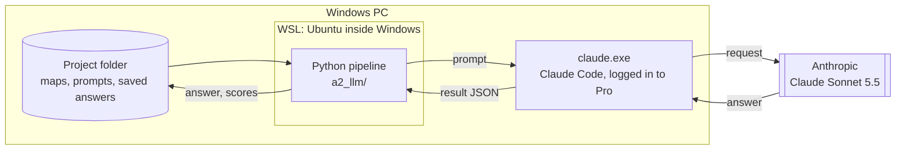

# A2 — A whole-map language model for argument relations

> **What this is:** the report on approach A2, written for readers new to the project. Terms are explained where they first appear, and §3 collects them.
> **Status:** final (2026-10-05). The test set was scored once, with nothing changed afterwards: **Global 73.67 / 58.27**, against A1's 72.01 / 57.53 and the 2024 best of 67.05 / 48.25.
> **Evidence:** [`../results/a2/`](../results/a2/) (summaries, scores and every raw model answer). Decisions D051–D059 are in [`../decisionlog.md`](../decisionlog.md).

## In one minute
- **The task.** A televised debate is turned into a *map*: **propositions** (claims) and **turns** (who said what, in order). A system must say which propositions **support** (Inference), **attack** (Conflict) or **restate** (Rephrase) which others, and *how* each turn was said (asserting, questioning, …).
- **Why A2.** Our first system, A1, judges one pair of propositions at a time. It wins overall, but at finding relations it is no better than the best 2024 systems. It misses most attacks, and it can't weigh competing conclusions against each other.
- **The idea.** Give **Claude Sonnet 5.5** the *whole* map and have it list every relation at once. Ask 3 times. How often, and how confidently, a relation is listed becomes its score, and tuned thresholds turn scores into decisions.
- **Cost: $0.** Calls go through Claude Code on an existing Claude Pro subscription. At API prices the whole approach would have cost $57 (1,194 calls).
- **Test result (11 maps, scored once): Global 73.67 / 58.27**, above A1 (72.01 / 57.53) and the 2024 best (67.05 / 48.25).
  - Relations (ARI) score 55.77 / 33.34: +4.4 general over A1, and the best general ARI against the 2024 field (DFKI 55.33).
- **What we learned:**
  - **Reading the whole map beats judging pairs** for relations: better precision on every relation type, on dev and test. The gain is mostly in Inference.
  - **Reasoning helped less than it first seemed:** +11 focused on a 20-map pilot, but only about +1 on dev, and it doesn't fix direction or Conflict. **Worked examples** (+4–5) and **an error-driven prompt revision** mattered more.
  - **Conflict is still mostly missed:** 2 of 13 on test.
  - **The LLM's turn types**, adopted on a thin dev gain, hurt on test: 3 changes, all wrong, −1.1 ILO.
  - **A1 and A2 get different pairs right:** picking the right one per pair would score 66.1 / 46.0 on dev. That's the case for combining them.
---

## 1. The problem

### 1.1 Debate maps
Maps come from BBC *Question Time*. They follow Inference Anchoring Theory (IAT), which keeps *what was said* apart from *what it means*:


*Figure 1: a three-turn map (illustrative). Blue boxes are the input. The arrows between propositions (Task A) and the dotted arrows from turns (Task B) are what a system must predict.*

- **Task A, relations (ARI):** for every pair of propositions, the relation and its direction.
  - *Inference* points premise → conclusion, either way in time (53% back, 47% forward).
  - *Conflict* and *Rephrase* point from the later statement to the earlier one (98%).
  - An answer counts as a *Rephrase* of its question.
- **Task B, illocutions (ILO):** which turn expresses which proposition, and how (Asserting, Pure / Assertive / Rhetorical Questioning, Agreeing, …).
- **Data:** 1,478 annotated maps from 30 episodes (2020–21), about 16 propositions each. They're split **by episode** into train (1,250) and dev (228), so no debate sits on both sides. There are also 11 test maps whose answers stay sealed until a single final run.

### 1.2 How it is scored
- **Pairs, not graphs.** Every ordered pair of propositions (about 240 per map) gets one label: Inference, Conflict, Rephrase or None. The official scorer computes **macro-F1 per map** (every label present counts equally), then averages over maps.
- **General** F1 includes None pairs. **Focused** F1 counts only pairs with a true relation. **Global** is the mean of Tasks A and B.
- **The rare-label trap.** 57% of maps have no Conflict. One invented Conflict there adds a zero-scoring label and cuts the map from 100 to about 74. Rare labels need confidence.

### 1.3 What came before

| Test F1, general / focused | Task A (ARI) | Task B (ILO) | Global |
|---|---|---|---|
| Best 2024 entries | 55.3 / 35.9 | 81.2 / 72.1 | 67.05 / 48.25 |
| Ours so far: A1 + ILO labeller | 51.4 / 30.8 | **92.6 / 84.3** | **72.01 / 57.53** |

- **The ILO labeller** (a trained ModernBERT) links turns to propositions: 98.3% of links found at 99.6% precision on dev. A2 reuses these links.
- **A1** (a fine-tuned ModernBERT, one pair at a time) finds 9% of dev Conflicts, and only 27% of its Inferences are right. It never sees its other decisions.
- **The 2024 LLM entries** lost to fine-tuned encoders: weaker models, short contexts, and free-text answers that had to be parsed.

**A2's question:** does a current model that reasons over the whole map find relations, especially attacks and directions, better than a pairwise classifier?

---

## 2. How A2 works

### 2.1 The pipeline


*Figure 2: the A2 pipeline. Yellow = models, green = deterministic steps, blue = data.*

### 2.2 One model call: what goes in, what comes out
**In** (about 10k tokens), as two parts:
1. **The system prompt** ([`system_v1.md`](../a2_llm/prompts/system_v1.md), 3.6k characters, the same for every map). It holds the task, definitions of the 3 relations and 7 turn types, the direction rules, the annotators' habits as measured on 1,250 maps, and what each confidence level means.
2. **The user message**: 4 worked examples, then the map to annotate. Every map is written the same way (shown with the illustrative map of Figure 1):

```text
# Example 1 … # Example 4      ← similar training maps, each followed by "Answer:" and the annotators' JSON

# Map to annotate
T1  Host: should NHS staff get a pay rise          ← turn, in dialogue order: "Speaker: words"
    [P1] NHS staff should get a pay rise           ← the proposition this turn expresses (link from the ILO labeller)
T2  Minister: yes, they deserve one
    [P2] NHS staff deserve a pay rise
T3  Minister: they worked through the pandemic
    [P3] NHS staff worked through the pandemic

Links to type: T1-P1, T2-P2, T3-P3                 ← the turn–proposition pairs whose type is asked for
```

**Out** (about 1.7k tokens, of which ~1k is unseen reasoning; ~13 s): JSON that must match a per-map *schema*, so only this map's IDs and the allowed labels can appear:
```json
{"illocutions": [{"link": "T1-P1", "type": "Pure Questioning"}, {"link": "T2-P2", "type": "Asserting"}, …],
 "relations":   [{"type": "Rephrase",  "from": "P2", "to": "P1", "confidence": "high"},
                 {"type": "Inference", "from": "P3", "to": "P2", "confidence": "medium"}]}
```

**Then, in Python:**
1. **Check the answer:** Sonnet 5.5 wrote it, and it fits the schema.
2. **Save it** as one file.
3. **Map the P / T labels back** to the original node IDs.
4. **Score each pair:** high = 1, medium = ⅔, low = ⅓, averaged over the 3 answers.
5. **Apply the thresholds** and build the completed map.

### 2.3 Where it runs, and why


*Figure 3: one call's path. Everything except the model itself runs on the local PC.*

- **Why WSL.** The project's Python runs inside WSL (Ubuntu running inside Windows), because Windows Smart App Control blocks PyTorch's unsigned libraries. A2 itself needs no GPU, but it reuses the project's loader, scorer and A1's decision and map-assembly code, which live in that environment.
- **Why Claude Code.** Calling the model through Claude Code (`claude -p`, its scripted mode) uses the user's Claude Pro subscription instead of paid API credit.
  - With all tools switched off (`--tools ""`), our own system prompt (`--system-prompt-file`) and project files ignored (`--safe-mode`), it is a plain model call.
  - `--json-schema` enforces the answer format.
  - `--effort` sets the reasoning level.
- **How Python reaches it.** WSL can start Windows programs directly. Python launches `claude.exe` once per call, passes the user message on its input and reads one JSON result back. That result holds the answer, token counts, timing and the model that answered.
  - Two settings go along as environment variables. One switches off a side request in which Claude Code asks a smaller model to title the session; the other pins the effort level. Variables only cross from WSL to Windows when listed in `WSLENV` with `/w`.
- **Saving and resuming.** Each answer is saved as one file named by a fingerprint (hash) of the exact request. A request already answered is never sent again, so a stopped run restarts where it left off. If the subscription's usage limit is reached, the run stops and waits for the user. Each run's answers are also exported to `results/a2/<run>/responses.jsonl.gz` and committed: without a seed, they are the only exact record.

### 2.4 Which data feeds which step

| Data | Used as | Does the model see its answers? |
|---|---|---|
| Training maps (1,231 usable) | **Worked examples**, with their answers | Yes: that's what examples are for |
| Pilot: maps from 3 training episodes | **Targets** for prompt development (§5, A2.2) | No; answers are only used to score. Their debates and speakers are removed from the example pool |
| Dev maps (225) | **Targets** for the honest score and thresholds (A2.3) | No; turn links come from the ILO labeller, as on test |
| Test inputs (11) | **Targets**, once (A2.5) | No |

---

## 3. Concepts used

| Term | Meaning here |
|---|---|
| **LLM** | A model that reads and writes text. Sonnet 5.5 is Anthropic's mid-size current model and can reason internally before answering. |
| **System prompt / user message** | The fixed rules (same for every map) vs. the per-map content (examples + the map). |
| **Worked examples** ("few-shot") | Solved maps shown before the target, so the model copies the annotators' style rather than its own idea of "argument". |
| **Retrieval (TF-IDF)** | Choosing the examples most similar to the target: each map becomes a vector of weighted word counts, compared by cosine similarity. |
| **Structured output / schema** | A JSON format the answer must match. Allowed IDs are listed per map, so an invalid ID can't be written. |
| **Reasoning effort** | How much the model may think before answering (`low` … `max`). Sonnet 5.5 decides for itself. On this task it reasoned only at `xhigh`. |
| **Sampling / self-consistency** | Asking the same prompt several times. Answers differ, and agreement measures confidence. No temperature or seed can be set. |
| **Confidence-weighted vote** | A relation's score: its stated confidence (high 1, medium ⅔, low ⅓) averaged over the 3 answers, with 0 when an answer omits it. |
| **Thresholds / decision layer** | Minimum scores per relation type, tuned to maximise the per-map metric; the guard against the rare-label trap. |
| **Cross-fitting** | Honest tuning: tune on 4 dev episodes, score the 5th, rotate. |
| **WSL / interop** | Windows Subsystem for Linux, which runs Ubuntu inside Windows. *Interop* lets a Linux program start a Windows program. |
| **Claude Code scripted mode** | `claude -p`: Anthropic's coding tool run as a command. With tools off and our own prompt, a plain model call on a subscription. |
| **Usage limits** | A Pro subscription allows a certain amount of use per 5 hours and per week, shared with the user's own Claude use. |
| **Prompt caching** | Repeated prompt beginnings are re-read cheaply. In practice Claude Code cached only the system prompt and schema (~2k tokens). |
| **Pilot** | A small set of training maps used to choose settings and revise the prompt, so dev stays untouched. |
| **Contamination** | The model may have seen the corpus, or the published 2024 test answers, in training. |
| **Ablation** | Switching off one component, re-scoring, and reading off what it contributed. |

---

## 4. Design choices and why

| Choice | Alternatives considered | Why |
|---|---|---|
| **Sonnet 5.5 via Claude Pro** (Claude Code) | Paid API; free tiers of other providers; a local open model | $0, and it's the user's chosen model. Free tiers mean a different, changing model; a local 8 GB model is far weaker and overlaps approach A3. Cost: speed. |
| **The whole map in one call** | One call per pair | The model can compare conclusions and stay consistent, which is A1's blind spot. One call per map instead of ~240. |
| **The labeller's turn links are given** | The model links turns itself | They're already 98.3% / 99.6% accurate. Giving them keeps A2's measurement on relations. |
| **Structured output, per-map IDs** | Free text, parsed afterwards | Unparseable output sank the 2024 LLM entries. Here every answer is valid by construction. |
| **4 retrieved worked examples** | 0, 2 or 8; fixed examples | The official guide is 2 pages, too thin to define the style. 4 is within noise of 8 at 40% fewer tokens (A2.2). |
| **Effort `xhigh`** | medium, high | Only `xhigh` makes Sonnet reason. +11 focused on the pilot but only about +1 on dev (A2.4); kept for test as decided before dev was seen. |
| **3 answers per map**, confidence-weighted | 1 answer; 5 answers | Thresholds need graded scores. 3 is the user's speed / quality trade-off (5 was planned). |
| **A1's decision layer, cross-fitted** | Plain majority vote | The same protection and honest estimate as A1, so the two compare directly. Majority vote is tested for free. |
| **Prompt developed on training maps** | Developing on dev | A2 never trains, so training maps are as unseen as dev. Dev stays clean. |
| **Direction rule for Conflict / Rephrase** | The model's own direction | Right 98% of the time and the same as A1. The model's own direction is a free ablation. |
| **The LLM also types each turn**, adopted only if better | ARI only | Turn typing holds Task B's remaining gap. The pilot shows 19/25 rare types right, where the labeller gets none. |
| **Raw answers committed; pause at usage limits** | Local only; auto-resume | No seed means no exact rerun, so the answers are the evidence. The subscription is shared with the user. |

---

## 5. Phase by phase

| Phase | What | Status | Model calls |
|---|---|---|---|
| **A2.1 Setup** | Build and verify everything between a map and a score | **Done** | 12 |
| **A2.2 Prompt development** | Choose examples and effort, and revise the prompt, on a pilot | **Done**: prompt v1, k = 4, `xhigh` | 249 |
| **A2.3 Dev run** | 3 answers × 225 dev maps; thresholds; honest score next to A1 | **Done**: 54.63 / 34.12 against A1's 50.50 / 32.61 | 675 |
| **A2.4 Assembly + ablations** | Complete maps, turn types, ablations | **Done**: honest dev Global 72.53 / 57.63 | 225 |
| **A2.5 Test run** | The 11 test maps, once | **Done**: Global 73.67 / 58.27 | 33 |

### A2.1 Setup — done
**Built:**
- `common/serialise.py` writes a map as text. It's shared with A3 and A4.
- In `a2_llm/`:
  - `schema.py`: the per-map answer format;
  - `prompt.py`: the prompts and example retrieval;
  - `claude_cli.py`: one call through Claude Code;
  - `runner.py`: runs a list of calls, saves and resumes;
  - `parse.py`: turns answers into pair scores in A1's format;
  - `check.py`: the gate checks.

| Check | Result |
|---|---|
| **Lossless:** the 225 dev maps' gold answers, fed through as if the model had written them | Score exactly the pipeline ceiling, **98.92 / 96.51**, with 0 invalid maps |
| Readable input | 3 written-out maps in [`results/a2/samples/`](../results/a2/samples/) |
| Prompt size (median) | 5.5k characters with no examples, 21.5k with 4, 37.6k with 8 |
| Valid answers, Sonnet only | Yes, after switching off Claude Code's side request (a session title from a smaller model) |
| Nothing hidden added | Yes: the cached prefix is only our system prompt plus the schema (~2k tokens) |
| Restart sends nothing twice | Yes |

*Lessons:*
- Sonnet didn't reason at effort medium or high: 0 thinking tokens, answering straight into the schema.
- Calls are fast (4–9 s).
- A first version retried a failure that was certain to repeat, wasting 6 calls. Fixed.

### A2.2 Prompt development (the pilot) — done
**What the pilot is.** Maps from 3 training episodes, picked by a fixed seed and stratified by size: 50 maps, cut to 20 after the first sweep to save time. Each pilot call is one map, sent exactly as in §2.2:
- **Input:** the map, with its turn links taken from the annotation (they stand in for the ILO labeller's links), plus 4 worked examples from *other* debates.
- **Output:** one answer (1 sample).
- **Scoring:** the answer is compared with the map's own annotation using the official per-map metric, in two ways:
  - keeping every relation the model listed;
  - keeping only those it marked medium or high.
- **Also recorded:** Inference direction, turn types, tokens and seconds.
- Only one thing changes between runs (examples, effort or prompt), so differences come from that setting. Differences under about 3 points (50 maps) or 5 points (20 maps) count as ties, and the cheaper setting wins.

**1. What makes Sonnet reason?** (3 maps, 9 calls)

| Lever | Maps where it reasoned |
|---|---|
| "Think it through first" in the system prompt | 0 / 3 |
| Claude Code's `ultrathink` keyword | 1 / 3 |
| **Effort `xhigh`** | **3 / 3** (~1k thinking tokens) |

**2. How many worked examples?** (50 maps, effort medium, prompt v0)

| Examples | ARI, all listed | ARI, medium + high | Input tokens |
|---|---|---|---|
| 0 | 45.0 / 26.4 | 48.5 / 24.3 | 3.6k |
| 2 | 47.6 / 30.5 | 50.8 / 29.2 | 6.8k |
| **4** | **49.5 / 30.6** | **51.2 / 29.1** | 10.1k |
| 8 | 50.7 / 31.5 | 52.2 / 30.3 | 16.5k |

**3. Reasoning, then the prompt revision** (20 maps, 4 examples)

| Setting | ARI, all listed | ARI, medium + high | Inference direction | Seconds |
|---|---|---|---|---|
| Effort medium (no reasoning), prompt v0 | 50.5 / 32.5 | 52.7 / 30.4 | 79% | 5 |
| Effort `xhigh` (reasons), prompt v0 | 55.0 / 44.0 | 58.9 / 39.5 | 88% | 13 |
| **Effort `xhigh`, prompt v1** | **57.2 / 42.8** | **61.9 / 42.0** | 88% | 14 |

*ARI is general / focused F1.*

**Findings**
- **Reasoning is the biggest lever on the pilot:** +4.5 general and **+11.5 focused**, and direction rises from 79% to 88%. *On dev, with the revised prompt, the gain shrank to about +1 (A2.4).*
- **Examples help with shrinking returns:** 4 is within noise of 8 at 40% fewer tokens.
- **Prompt v1 came from reading the errors** ([`pilot_errors_pilot-k4.md`](../results/a2/pilot_errors_pilot-k4.md)):
  - the model called 47 of the annotators' restatements "Inference", so Rephrase now explicitly covers repeating, narrowing or sharpening the same point, and Inference needs a *different* point as reason;
  - it invented more Inferences than it found, while in the annotation about half of all propositions start no relation (5% start two or more); that fact is now in the prompt.
  - Invented Inferences fell from 64 to 52. One revision was enough: the remaining gaps were within the noise of 20 maps.
- **Turn types:** 97% right overall, and 19 of 25 rare (non-Asserting) types, which the ILO labeller misses entirely.
- **Caveat:** these are training maps with annotated turn links and 1 answer each, so they compare settings. They aren't comparable with A1's dev score. A2.3 gives that.

### A2.3 Dev run — done
Evidence: [`../results/a2/dev-v1/dev_report.json`](../results/a2/dev-v1/dev_report.json) and `summary.json` (raw answers in `responses.jsonl.gz`).

**What ran.**
- 225 dev maps × 3 answers = 675 calls, at the frozen settings and in test conditions: each map's own answers hidden, turn links from the ILO labeller.
- 675 / 675 answers were valid, all from Sonnet 5.5, at 13.7 s per call. The cost was $35.61 API-equivalent; $0 was spent.
- The run spanned 3 Pro sessions: a full session holds about 450 calls at this effort. The runner slept through each reset by itself.

**How it was scored.**
1. Each pair's score is the stated confidence averaged over the 3 answers.
2. Per-type thresholds are tuned to maximise general ARI (A1's code).
3. The honest score is cross-fitted: tune on 4 dev episodes, score the 5th, rotate.

| Dev ARI, general / focused | General | Focused |
|---|---|---|
| A1 (honest) | 50.50 | 32.61 |
| A2, every listed relation kept (no thresholds) | 52.07 | **39.41** |
| **A2, thresholds (honest)** | **54.63** | 34.12 |

The thresholds are Inference 0.35, Conflict 0.50 and Rephrase 0.25, identical in 4 of 5 folds (one fold picks Conflict 0.35).

| Per relation (pooled), precision / recall / F1 | A1 | A2 |
|---|---|---|
| Inference | 0.27 / 0.39 / 0.32 | **0.39 / 0.35 / 0.37** |
| Conflict | 0.31 / 0.09 / 0.14 | **0.43 / 0.12 / 0.19** |
| Rephrase | 0.42 / 0.53 / 0.47 | **0.48 / 0.55 / 0.51** |

**Findings**
- **A2 beats A1 on honest dev ARI** (+4.1 general, +1.5 focused), with better precision and F1 on every relation type. Inference direction is right for 85% of the Inferences found (A1: 81%).
- **The over-linking is gone after thresholds:** 7.9 relations per map against 8.3 in gold (A1: 10.9). The rare-label trap is held as well as A1 holds it (8 maps with an invented Conflict for both).
- **What it still misses:**
  - Conflict recall is only 12%;
  - only 0.7% of propositions start two or more relations, against 5.7% in gold, so it under-draws divergent arguments.
- **Thresholds trade focused for general.** Keeping every listed relation gives the best focused score (39.4); tuning for general gives the best general score. As with A1, the decision layer optimises general.
- **Three answers help a little:** a single answer scores 52.1–53.0 general; averaging three and thresholding adds about 2 points.
- **A1 and A2 get different pairs right.** Among pairs where gold or either system has a relation:
  - both right: 509;
  - only A2 right: 1,173;
  - only A1 right: 622;
  - both wrong: 1,186.
  - Picking the right system per pair would score **66.1 / 46.0**. That's an upper bound, but a large one, for the combination phase.
- *Not yet:* turn types (Task B) and complete maps come in A2.4. Test comes in A2.5.

### A2.4 Complete maps, turn types and ablations — done
Evidence: [`../results/a2/dev-v1/a24_report.json`](../results/a2/dev-v1/a24_report.json) and `results/a2/dev-medium/` (the 225 answers of the reasoning ablation).

**Turn types (Task B).** The ILO labeller's links stay. The LLM's most-voted type replaces the labeller's only where its vote share clears a per-type threshold (tuned, cross-fitted).

| Dev ILO, general / focused | |
|---|---|
| Labeller alone | 90.16 / 80.67 |
| **Labeller + LLM types (honest)** | **90.43 / 81.13** |

- Only two kinds of override survived tuning: Asserting → Pure Questioning (9 right, 3 wrong) and a single Default Illocuting.
- The rare types that looked good on the pilot (Agreeing, Rhetorical and Assertive Questioning) were too noisy on dev to clear any threshold.
- It's a small gain, and it's adopted under the pre-set rule (it beats the labeller alone).

**Complete maps.** 225/225 pass the validator.

| Dev, honest, general / focused | ARI | ILO | Global |
|---|---|---|---|
| A1 + labeller | 50.50 / 32.61 | 90.08 / 80.64 | 70.29 / 56.63 |
| **A2 + labeller + LLM types** | **54.63 / 34.12** | **90.43 / 81.13** | **72.53 / 57.63** |

**Ablations** (dev ARI, general / focused):

| Setting | ARI | Change |
|---|---|---|
| **Main:** 3 answers, confidence-weighted, tuned thresholds (honest) | **54.63 / 34.12** | — |
| 1 answer | 53.53 / 33.03 | −1.1 / −1.1 |
| 2 answers | 53.34 / 34.69 | −1.3 / +0.6 |
| Plain votes, confidence ignored (tuned) | 53.60 / 35.57 | −1.0 / +1.5 |
| Majority vote, ≥ 2 of 3, no tuning | 53.34 / 36.14 | −1.3 / +2.0 |
| The model's own Conflict / Rephrase direction, instead of the order rule* | 54.83 / 34.18 | ±0.0 |
| Relations more than 10 turns apart dropped* | 54.76 / 34.05 | −0.1 (11 such relations, 4 right) |

*\* Compared with the main setting tuned on all of dev (54.81 / 34.16), since only the decoding changes.*

**Reasoning on / off on dev** (1 answer each, same prompt and examples):

| Effort | ARI (honest) | ARI, no thresholds | Inference direction | Conflict F1 | Rephrase recall | Maps with an invented Conflict | Seconds per call | API-equivalent per call |
|---|---|---|---|---|---|---|---|---|
| `xhigh` (reasons, ~1.1k thinking tokens) | 53.53 / 33.03 | 52.09 / 35.24 | 85% | 0.21 | 0.57 | 12 | 13.7 | $0.053 |
| medium (no reasoning) | 52.72 / 32.00 | 52.05 / 33.54 | 85% | 0.22 | 0.45 | 17 | 5.1 | $0.042 |

**Findings**
- **Reasoning adds only about 1 point on dev,** far below the pilot's +4.5 / +11.5.
  - It doesn't fix Inference direction or Conflict. It mainly finds more Rephrases and invents fewer Conflicts.
  - Why the pilot overstated it:
    - the pilot compared reasoning under the old prompt (v0), and v1's clearer Rephrase / Inference rules recover much of what reasoning was compensating for;
    - 20 maps make focused F1 noisy;
    - the pilot used annotated turn links.
  - **Lesson:** confirm a pilot effect's *size* on the larger set before relying on it.
- **Each part of the decision layer adds about 1 general point and costs 1–2 focused:** 3 answers, the confidence weights and the tuned thresholds. They make A2 more cautious, which the general metric rewards.
- **The direction rule isn't needed:** the model gets Conflict and Rephrase direction right by itself.
- **Long-range relations rarely matter:** A2 links nearby propositions, as the annotators do.
- **For the test run** the frozen settings stay, including `xhigh`, as decided before dev was seen. Medium would be 2.7× faster for nearly the same score, which is worth knowing for the combination phase.

### A2.5 Test run — done
Evidence: [`../results/a2/test_global.json`](../results/a2/test_global.json), [`../results/a2/test_predictions/`](../results/a2/test_predictions/) (the 11 submitted maps), `results/a2/test-v1/` (raw answers) and [`../results/a2/test_posthoc.json`](../results/a2/test_posthoc.json).

**Protocol.**
- 11 test inputs × 3 answers = 33 calls, all valid and from Sonnet 5.5 ($1.93 API-equivalent).
- The settings, thresholds and turn-type rule were all fixed on dev.
- All 11 maps were assembled, validated and saved **before** the gold was read. They were scored once, and nothing was changed afterwards.

| Test F1, general / focused | ARI | ILO | Global |
|---|---|---|---|
| Best 2024 entry per column | 55.33 / 35.89 | 81.17 / 72.09 | 67.05 / 48.25 |
| A1 + labeller | 51.38 / 30.77 | **92.64 / 84.28** | 72.01 / 57.53 |
| **A2 + labeller + LLM types** | **55.77** / 33.34 | 91.56 / 83.20 | **73.67 / 58.27** |

*The best 2024 entries are different systems per column. ARI: DFKI (general) and POKEMON (focused). ILO: PUNGENE and the RoBERTa baseline. Global: DFKI.*

| Test relations (pooled), precision / recall / F1 | A1 | A2 |
|---|---|---|
| Inference | 0.31 / 0.28 / 0.29 | **0.48 / 0.40 / 0.44** |
| Conflict | 0.67 / 0.15 / 0.25 | 0.50 / 0.15 / 0.24 |
| Rephrase | 0.46 / 0.63 / 0.53 | 0.46 / 0.54 / 0.50 |

**Findings**
- **First on Global against the 2024 field, and above A1** (+1.7 / +0.7).
  - ARI general (55.77) is the best against the 2024 field; ARI focused (33.34) is second.
- **The gain is in Inference:**
  - precision rises from 0.31 to 0.48 and F1 from 0.29 to 0.44;
  - direction is right for 90% of the Inferences found (A1: 78%).
  - Conflict stays at 2 of 13, and no map gets an invented relation type.
- **Per map:**
  - A2 is better on 7 of 11 maps, with gains of +12 to +15 on maps 3, 7 and 8;
  - it's worse on maps 4 (−7) and 2 (−5).
  - Per-map ARI ranges from 38.7 to 76.1, so 11 maps are a small sample.
- **The LLM's turn types hurt on test.**
  - It made 3 changes, all Asserting → Pure Questioning, and all wrong.
  - In maps 1 and 2 they added a type that doesn't appear in gold (the rare-label trap), costing 1.1 ILO.
  - *Post-hoc, not submitted:* with the labeller's types restored, Global is 74.20 / 58.81.
  - **Lesson:** a +0.3 dev gain resting on about 12 changes is too thin to adopt.
- **No sign of contamination:** A2's dev → test ARI change (+1.1) matches A1's (+0.9).
---

## 6. Ablations
Each ablation switches off one component and re-scores.

| Ablation | Question | New calls | Status |
|---|---|---|---|
| Worked examples 0 / 2 / 4 / 8 | How much do examples help? | in pilot | **Done**: +4.5 general from 0 to 4 |
| Effort medium vs `xhigh` (pilot) | How much does reasoning pay? | in pilot | **Done**: +4.5 / +11.5 on 20 pilot maps |
| **Reasoning on / off (dev)** | Does reasoning fix direction and Conflict, on dev? | 225 | **Done**: +0.8 / +1.0 only; direction and Conflict unchanged |
| 1 / 2 / 3 answers | Does asking several times help? | 0 | **Done**: 3 answers +1.1 general over 1 |
| Votes vs stated confidence | Which confidence signal works? | 0 | **Done**: confidence +1.0 general, −1.5 focused |
| Thresholds vs majority vote (≥ 2 of 3) | Does the tuned decision layer help? | 0 | **Done**: thresholds +1.3 general, −2.0 focused |
| Direction rule vs the model's own | Is the order rule still needed? | 0 | **Done**: no difference |
| Relations > 10 turns apart dropped | Do the long-range relations count? | 0 | **Done**: −0.1 (11 relations) |
| LLM vs labeller turn types | Does the LLM type turns better? | 0 | **Done**: +0.3 / +0.5 ILO, adopted |

*Not run (user decision):* no written definitions, random examples, and a memorisation probe.

## 7. Budget and time
- **Spent: $0.** 1,194 calls, about 3.5 hours of model time, **$57.08 API-equivalent** (computed from token counts at Sonnet 5.5 list prices).
- **Per call at the frozen settings:** ~13 s and ~$0.05 API-equivalent.
- **Where it went:** setup 12 calls, pilot 249, dev 675, reasoning ablation 225, test 33.
- **Per test map:** 3 answers in about 25 s with 2 at a time; ~$0.18 API-equivalent.
- **Usage limits:** a full Pro session holds about 450 calls at effort `xhigh`. The dev run spanned 3 sessions, and the runner sleeps through each reset by itself (D060–D061).

## 8. Risks

| Risk | Status |
|---|---|
| Usage limits make it slow | Hit twice in the dev run; the runner slept through the resets by itself, by the wall clock (D060–D061) |
| Claude Code adds hidden context or another model | Checked on every answer; resolved in A2.1 |
| The samples barely differ | They differ (e.g. 19 vs 21 relations on one map) |
| Pilot noise / prompt overfitting | Ties go to the cheaper setting; one revision only; dev unseen until A2.3 |
| Over-linking | Solved by the thresholds on dev: 7.9 relations per map against 8.3 in gold. It now under-draws divergent arguments instead |
| Contamination | No sign: A2's dev → test ARI change (+1.1) matches A1's (+0.9) |
| No exact reruns (no seed) | Every raw answer committed; every number recomputed from them |


## 9. Assessment
**What worked**
- **A general model reading the whole map beats a fine-tuned pairwise classifier on relations,** at no marginal cost (a Pro subscription). The keys were 4 similar worked examples, a strict per-map answer schema, and a prompt revised from real errors.
- **Measurement we can trust:**
  - the pipeline was checked lossless before any call;
  - prompts were developed on training maps;
  - thresholds were cross-fitted;
  - test maps were saved before the gold was read, and post-hoc checks are kept separate.
- **Running reliably on a subscription:** 1,194 calls with none lost. Answers are cached by request, re-judged when rules change, and runs resume across usage limits.

**Shortcomings**
- **Conflict** is still mostly missed (12–15% recall), as in 2024 and A1.
- **The pilot misled twice.** Its reasoning gain didn't hold on dev, and the turn types that looked good there hurt on test. 20 maps and a changing prompt were too thin a basis.
- **Small evidence:** one model and one prompt family; 11 test maps with a wide spread; no seed, so no exact reruns (the raw answers are committed instead).

**For the combination phase**
- **A1 and A2 get different pairs right** (dev oracle 66.1 / 46.0), so combining them is the clear next step.
- **Use effort medium** for further LLM passes: nearly the same quality at 2.7× the speed.
- **Keep the ILO labeller's turn types.**

---
<details><summary>Decisions and build log</summary>

| Phase | Outcome | Decisions |
|---|---|---|
| Plan | Sonnet 5.5 on Claude Pro, $0; 3 answers; cross-fitted thresholds; one paid ablation | D051–D054 |
| A2.1 Setup | Lossless (98.92 / 96.51); Sonnet-only; ~$0.03 and 4–9 s per answer; no reasoning by default | D055 |
| A2.2 Prompt | Only `xhigh` reasons (+11.5 focused); 4 examples; prompt v1; pilot 50 → 20 maps | D056–D059 |
| A2.3 Dev run | Honest dev ARI 54.63 / 34.12 (A1: 50.50 / 32.61); 675 calls, $35.61 API-equivalent; ~450 calls per Pro session | D060–D062 |
| A2.4 Maps + ablations | Honest dev Global 72.53 / 57.63 (A1: 70.29 / 56.63); LLM turn types +0.3 ILO; reasoning only +1 on dev | D063 |
| A2.5 Test | Global 73.67 / 58.27 (A1: 72.01 / 57.53); ARI 55.77 / 33.34; LLM turn types −1.1 ILO on test | D064 |
</details>

**Reproduce** (in WSL, from the repo root; needs Claude Code logged in to a Claude subscription):
`python -m a2_llm.check` (gate checks, no calls) → `python -m a2_llm.pilot --choose` → `python -m a2_llm.runner --run=<name> --export` (e.g. `pilot-k4`, `pilot20-k4-xhigh-v1`) → `python -m a2_llm.pilot --score=<runs>` and `--errors=<run>` → dev: `python -m a2_llm.runner --run=dev-v1 --export --workers=2 --until-done` → `python -m a2_llm.tune --run=dev-v1` → `python -m a2_llm.runner --run=dev-medium --export --workers=2 --until-done` → `python -m a2_llm.evaluate` → test: `python -m a2_llm.runner --run=test-v1 --export --workers=2` → `python -m a2_llm.predict` → `python -m a2_llm.posthoc_test`.
