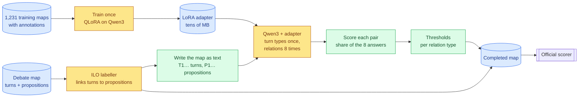

# A3 — A fine-tuned open language model for argument relations

> **What this is:** the report on approach A3, written for readers new to the project. Terms are explained where they first appear, and §3 collects them. It starts as the plan and the reasons behind it; results are added as each phase finishes.
> **Status:** plan approved 2026-10-05 after an independent review (§12). **A3.1–A3.3 passed** (§11). The model is Qwen3-4B-Instruct-2507, because Qwen3-8B doesn't fit the 8 GB card. Trained on 1,231 maps, its best checkpoint (epoch 2) scores a greedy dev ARI of 49.46 / 31.19 before votes and thresholds. Next: A3.4 (the dev run).
> **Evidence (as phases finish):** `../results/a3/`. Decisions start at D065 in [`../decisionlog.md`](../decisionlog.md).
> **Background:** [A1](A1-cross-encoder.md) (the trained pairwise encoder), [A2](A2-whole-map-llm.md) (Claude reading the whole map) and [the A2 discussion](A2-discussion.md) (why each wins where it does).

## In one minute
- **The task.** A televised debate is turned into a *map*: **propositions** (claims) and **turns** (who said what, in order). A system must say which propositions **support** (Inference), **attack** (Conflict) or **restate** (Rephrase) which others, and *how* each turn was said (asserting, questioning, …).
- **Why A3.** The A2 discussion found that **the encoder (A1) learns the annotators, while the LLM (A2) applies the definition.**
  - The LLM invents half as many relations and reads direction better.
  - The encoder finds more of the loose support between neighbouring turns, and types turns better.
  - Neither finds the Conflicts that sit within one speaker's own talk (70% of all Conflicts).
- **The idea.** Teach an open LLM the annotators' habits **through its weights**: train it on 1,231 annotated maps to write the whole map's relation list. It keeps the LLM's whole-map view and learns the encoder's habits.
- **How, on an 8 GB GPU.** **Qwen3-4B-Instruct-2507** stored in 4-bit, with small trainable add-ons (**QLoRA**). Qwen3-8B was the first choice, but the A3.1 memory probe showed it can't train on this card, so the rule fixed in the plan chose the 4B (§11). Everything runs locally: **$0**.
- **Decisions** reuse A1's and A2's code: the same text format, decision layer, map assembly and scorer, so the three systems compare directly.
- **Plan.** Six gated phases: setup → training loop → training → dev run → assembly and ablations → one test run.

---

## 1. The problem in brief
The full description is in [A2 §1](A2-whole-map-llm.md#1-the-problem). In short:
- **Input:** the turns in order, with speakers, and the propositions, unconnected. The trained ILO labeller links each turn to its proposition (98.3% of links found, 99.6% precise on dev).
- **Task A, relations (ARI):** every ordered pair of propositions gets Inference, Conflict, Rephrase or None. Inference points premise → conclusion (53% back in time, 47% forward). Conflict and Rephrase point later → earlier (98%).
- **Task B, illocutions (ILO):** how each turn expresses its proposition (Asserting, Pure / Assertive / Rhetorical Questioning, …).
- **Scoring:** macro-F1 per map, averaged over maps. *General* counts every pair; *focused* only pairs with a true relation; *Global* is the mean of Tasks A and B.
- **The rare-label trap:** in a map without Conflict, one invented Conflict cuts that map's score from 100 to about 74.

**Where we stand** (test F1, general / focused):

| | ARI | ILO | Global |
|---|---|---|---|
| Best 2024 entries | 55.3 / 35.9 | 81.2 / 72.1 | 67.05 / 48.25 |
| A1 + labeller | 51.38 / 30.77 | **92.64 / 84.28** | 72.01 / 57.53 |
| A2 + labeller + LLM types | **55.77** / 33.34 | 91.56 / 83.20 | **73.67 / 58.27** |

**Honest dev ARI** (the number A3 is compared on): A1 **50.50 / 32.61**, A2 **54.63 / 34.12**.

**A3's question:** can an LLM that *learns the annotators* keep the LLM's precision and direction, and gain the encoder's recall and turn types?

---

## 2. The approach


*Figure 1: training (top) happens once; prediction (bottom) runs per map. Yellow = models, green = deterministic steps, blue = data.*

**One training example** is a map written exactly as A2 wrote it, followed by the annotators' answer. The model learns to write the answer:
```text
<instruction: one short paragraph, the same for every map>
T1  Host: should NHS staff get a pay rise
    [P1] NHS staff should get a pay rise
T2  Minister: yes, they deserve one
    [P2] NHS staff deserve a pay rise
T3  Minister: they worked through the pandemic
    [P3] NHS staff worked through the pandemic

Links to type: T1-P1, T2-P2, T3-P3
```
```json
{"illocutions":[{"link":"T1-P1","type":"Pure Questioning"},{"link":"T2-P2","type":"Asserting"},{"link":"T3-P3","type":"Asserting"}],"relations":[{"type":"Rephrase","from":"P2","to":"P1"},{"type":"Inference","from":"P3","to":"P2"}]}
```
- **The answer** is A2's format **without the confidence field** (the annotators state none), written compactly with exactly these separators, and with relations in a fixed order (by P number), so the model never has to guess an ordering.
- **Sizes (measured):** a training example is 3.5k characters at the median and 8.2k at most; the answer alone is 0.9k at the median. A whole map is at most 1,392 tokens (EDA §8), so an example is roughly 1–3k tokens.
- **No worked examples and no reasoning:** the conventions live in the weights. A2's reasoning added only about 1 point on dev (D063).

**Prediction, per map:**
1. **Turn types once:** the model writes the `illocutions` part greedily (its single most likely answer). The probability it gave each type is kept.
2. **Relations 8 times:** with that part fixed as the start of the answer, the model samples the `relations` part 8 times with different seeds. Fixing the shared start halves the sampled text, since turn types are about half of an answer.
3. **Pair scores:** a relation's score is the share of the 8 answers that list it, in A1's 5-label pair format. A1's thresholds decide, and A1's `build_map` assembles a valid map.

---

## 3. Concepts used

| Term | Meaning here |
|---|---|
| **Open LLM** | A language model whose weights can be downloaded and run locally. Here a Qwen3 model (Apache 2.0 licence). |
| **Fine-tuning (SFT)** | Continuing a model's training on our own examples (map → answer), so it learns this task's conventions. *Supervised fine-tuning* = learning from correct answers. |
| **Answer-only loss** | The model is only corrected on the answer tokens, not on the map it was given. |
| **LoRA** | *Low-rank adaptation.* The original weights stay frozen; small extra matrices are trained beside each layer (about 0.5% of the parameters). The result is an **adapter** of tens of MB, switched on over the base model. |
| **QLoRA** | LoRA with the frozen layers stored in **4-bit** (the NF4 format) instead of 16-bit, which cuts their memory by about 4×. The adapters still train in 16-bit. The embedding tables stay 16-bit. |
| **Epoch / checkpoint** | One pass over the training maps / a saved copy of the adapter partway through training. |
| **Memory savers** | *Gradient checkpointing* recomputes intermediate values instead of storing them. *Gradient accumulation* adds up several small batches before each update. A *fused loss* computes the error over the 152k-word vocabulary in chunks instead of all at once. |
| **Greedy vs sampling; temperature; seed** | *Greedy* takes the most likely next token every time. *Sampling* draws it at random from the model's probabilities (temperature 1 = as the model learned them). A fixed seed makes the draw repeatable on the same setup. |
| **Vote share** | A relation's score = the share of the 8 sampled answers that list it (0, ⅛, …, 1). |
| **Constrained decoding** | At each step, tokens that would break this map's answer format (an unknown P-id or label, extra spaces) are blocked, so every answer is valid. |
| **Decision layer, thresholds, cross-fitting** | As in A1 / A2: per-type minimum scores tuned on dev for the per-map metric; tuned on 4 dev episodes and scored on the 5th, in rotation, for an honest number. |
| **Paired bootstrap** | Resampling the 225 dev maps many times to see whether one system's per-map advantage over another is larger than chance. |
| **Giant maps** | 19 training maps with more than 40 propositions. They hold 19% of the Conflict examples but have no turn links, so 528 of their 2,592 propositions can't be placed in the dialogue (D022, D030). |
| **Ablation** | Switching off one component, re-scoring, and reading off what it contributed. |

---

## 4. Design choices and why

| Choice | Alternatives considered | Why |
|---|---|---|
| **Generate the whole map's answer** | An LLM with a classifier head judging pairs | Writing one list per map is what gave A2 its precision (A2 discussion, Q1). A pair classifier is A1 with a bigger encoder. |
| **QLoRA** (4-bit layers + LoRA) | Full fine-tuning; 16-bit LoRA; DoRA; prompt tuning; GaLore | On 8 GB, full fine-tuning fits only under ~0.5B (A1's class), and 16-bit LoRA only up to ~2–3B. DoRA changes nothing that fits; prompt tuning is weaker at structured output; GaLore still needs all 16-bit weights. |
| **Qwen3-8B if it fits, else Qwen3-4B-Instruct-2507** (both Apache 2.0) | Qwen3.5-2B / 4B / 9B; Gemma 4 E2B / E4B; Llama 3.1 8B; 12B+ and mixture-of-experts models | Qwen3 is a standard transformer with a well-trodden QLoRA path, and its 4B and 8B share a tokenizer. **8B is borderline:** its two untied 16-bit embedding tables alone take ~2.5 GB, so its weights are ~6.2 GB before training memory; the 4B's are ~2.7 GB. Qwen3.5 is advised against for 4-bit training; Gemma 4 E4B needs 10 GB; Llama 3.1 is older and gated; larger models don't fit (D065). **Outcome (A3.1):** 8B crashed or spilled into system memory well short of the longest example, so the rule chose the 4B (D066). |
| **Thinking mode off** | Train with reasoning traces | We have no annotator reasoning to train on, and A2's reasoning added ~1 point. Qwen3's chat template switches thinking off. |
| **Train on the 1,231 test-like maps only**; giant maps as an ablation | Giant maps in the main run | A1 and A2 never used them, so leaving them out keeps the comparison clean. A fifth of their propositions can't be placed, and they come from a re-annotation batch without turn types. Their effect on Conflict is tested by a retrain (§8). |
| **Gold links in training, labeller links on dev / test** | Labeller links in training | As A2's examples. The labeller is 98.3% / 99.6% accurate, and it can't give honest links on its own training maps. |
| **Turn types greedy once, relations sampled 8 times** | 8 full samples; 1 greedy answer | Thresholds need graded scores (A2's 3 answers × 3 levels was coarse). Sampling only the relations halves the generated text. |
| **Vote shares, with token probabilities kept** | Token probabilities only | Votes are the simple, proven route (A2). The model's own probabilities cost nothing to record and become a free ablation, and the fallback if the votes turn out all-or-nothing (rule in A3.3). |
| **Constrained decoding** with a per-map grammar | Free text, parsed | Every answer valid by construction, with no runaway spaces. Turning it off is an ablation. |
| **A1's decision layer, cross-fitted** | Majority vote | Same protection and same honest estimate as A1 and A2. Majority vote is a free ablation. |
| **Checkpoint chosen by greedy dev ARI at every half epoch** | Dev loss; a slice of train | As A1 (6 half-epoch checkpoints, D043): choose by the real metric. *Caveat:* the deployed system uses votes and thresholds, not one greedy answer, and A2 picked nothing on dev. That's one reason the success bar needs a margin (§7). |
| **LLM turn types under a stricter rule** | A2's rule (beat the labeller at all) | A2's +0.3 dev gain from ~12 changes cost 1.1 on test. A3's types replace the labeller's only if they gain ≥ 0.5 honest ILO **and** win in ≥ 4 of 5 dev folds. |
| **Separate Python environment** | Add to A1's environment | LLM libraries pin their own torch / transformers versions; A1, A2 and the ILO labeller must keep working. |

---

## 5. Tools

| Job | Tool | Notes |
|---|---|---|
| Where it runs | WSL2 Ubuntu, RTX 5060 Ti (8 GB), new venv `~/.venvs/a3` (Python 3.12) | Keeps `~/.venvs/dialam` untouched |
| Model weights | Hugging Face: **`Qwen/Qwen3-4B-Instruct-2507`** (`Qwen/Qwen3-8B` probed and rejected, D066) | Apache 2.0, ungated; quantized to 4-bit on load (WSL's 7 GB RAM was enough) |
| 4-bit storage | `bitsandbytes` (NF4, double quantization, bf16 compute) | Support for this GPU generation (Blackwell) is checked first |
| Adapters | `peft`: LoRA r = 16, α = 32, dropout 0.05, all linear layers | The model is wrapped by us before training, so the 16-bit embeddings aren't copied to 32-bit |
| Training loop and memory | **Our own small loop** (`a3_finetune/model.py`): PEFT wrapping without the 32-bit upcast, hidden states at answer positions only, `liger-kernel`'s fused cross-entropy | Chosen in A3.1 (D066): the current Unsloth pins an older torch / transformers, and the 4B fits without it. Paged 8-bit AdamW, batch 1 with accumulation to 16 maps, lr 2e-4, 3 epochs |
| Constrained decoding | `xgrammar` as a logits processor for `transformers` `generate`, with a per-map grammar (no extra whitespace, exact separators) and a cap on answer length | `outlines` as fallback |
| Generation | `transformers` `generate`: batched, seeded sampling; token probabilities kept | Answers cached on disk by a hash of (full prompt, adapter, settings, grammar, seed); exported gzipped and committed |
| Reused project code | `common/serialise.py`, `a2_llm/prompt.gold_answer`, A1's `decide.py` and `build_map`, ILO links in `cache/ilo/`, `common/score.py`, `validate.py`, `timing.py`, `a2_llm/discuss.py` | Same scorer, decision layer and assembly as A1 / A2 |
| Adapted A2 code | `a3_finetune/schema.py` and `parse.py`: A2's versions without the confidence field | A2's versions require it |
| New code | `a3_finetune/`: `data.py`, `check.py`, `train.py`, `generate.py`, `tune.py`, `evaluate.py`, `predict.py` | Results in `results/a3/<run>/`; adapters in `checkpoints/a3/` (git-ignored) |

---

## 6. Phased implementation plan
Each phase follows the project loop: explain it → check it against `PLAN.md` → your go → execute → verify the gate → log the decision → next phase. GPU times are estimates for 8B; the 4B is about twice as fast.

| Phase | Builds | Gate | GPU time |
|---|---|---|---|
| **A3.1 Setup + feasibility** | venv, data builder, gate checks, memory and speed probes | Lossless round trip; every gold answer passes its grammar; model chosen by the fixed rule | ~1–2 h |
| **A3.2 Training loop** | Trainer; generator with cache | Memorises 32 maps; loss masking verified | ~1 h |
| **A3.3 Training run** | The adapter | Dev curves; best checkpoint chosen; sample diversity checked | ~5–9 h |
| **A3.4 Dev run** | Turn types + 8 relation samples × 225 dev maps; thresholds | Honest dev ARI next to A1 and A2, with the success test (§7) | ~2–4 h |
| **A3.5 Assembly + ablations** | Complete maps, turn types, ablations | 225/225 valid; ablation table | ~3–12 h |
| **A3.6 Test run + report** | The 11 test maps | Scored once | < 30 min |

### A3.1 Setup and feasibility
**Goal:** every step between a map and a score works, and the model is chosen by measurement, before any real training.
1. **Environment:** create `~/.venvs/a3`. Install torch (CUDA 13), transformers, peft, bitsandbytes, accelerate, xgrammar, and Unsloth or trl + liger-kernel. Pin everything in `requirements-a3.txt`.
2. **`a3_finetune/data.py`:** every test-like training map → (instruction + serialised map, compact gold answer), using `serialise` and `gold_answer`. Token counts per split with the real tokenizer. The giant-map chunks for the ablation are built too: windows of consecutive turns holding ≤ 35 propositions (the largest test map).
3. **`a3_finetune/check.py`, no model:**
   - **Lossless round trip:** dev gold answers in the compact format → A3's parser → A1's decision code → `build_map` → official scorer must give the pipeline ceiling **98.92 / 96.51** (as A2.1), all maps valid.
   - **Grammar:** every training map's tokenised gold answer is accepted by that map's grammar.
   - **No leakage:** no dev or test map in the training data.
   - **Giant chunks:** relations lost to unplaced propositions and to window edges are counted; 3 chunks are read by eye.
4. **Memory probe:** 20 training steps on the longest training example, with the full memory path, for Qwen3-8B, then Qwen3-4B-Instruct-2507: peak VRAM and tokens per second.
5. **Generation probe:** turn types plus 8 relation samples for 5 maps, with constrained decoding: the batch size that fits, and answers per minute.

**Model rule (fixed now):** **Qwen3-8B if its peak at the longest training example is ≤ 7.5 GiB, at ≥ 200 training tokens per second, and generation fits a batch of ≥ 2; otherwise Qwen3-4B-Instruct-2507.** No examples are capped or dropped to make 8B fit, because the longest maps are the most test-like.

**Gate**
- The round trip gives 98.92 / 96.51; every gold answer passes its grammar; no leakage.
- The model is chosen by the rule, with peak VRAM and speeds recorded.
- The untrained model returns valid constrained answers.
- A timeline is projected from the measured speeds.

### A3.2 Training loop
1. **`train.py`:** QLoRA with answer-only loss; an adapter every half epoch; loss to a JSON-lines log; time and peak VRAM to `results/timing.csv`.
2. **`generate.py`:** greedy turn types, then seeded relation samples, constrained, with token probabilities, an on-disk cache and resume.
3. **Overfit test:** train on 32 training maps until the loss is near 0.

**Gate**
- Greedy decoding reproduces the 32 maps' gold answers (≥ 95% of relations exact).
- Loss masking checked by inspection: only answer tokens carry labels.
- Epoch time and peak VRAM measured for the full run.

### A3.3 Training run
1. **Data:** the 1,231 test-like training maps. Dev is never trained on.
2. **Train** 3 epochs (about 230 updates at 16 maps per update); an adapter at every half epoch.
3. **At each half epoch:** dev loss, and greedy ARI on all 225 dev maps (6 checkpoints, as A1).
4. **Sample diversity** on the chosen adapter, using 20 dev maps with 8 samples each.

**Gate**
- Curves recorded; the adapter with the best greedy dev ARI (general) is chosen, ties going to the earlier one.
- **Diversity rule (fixed now):** if fewer than 10% of the listed relations get a vote share strictly between 0 and 1, the votes are all-or-nothing. In that case **token probability becomes the main score**, decided before the full dev run.

### A3.4 Dev run and decision layer
1. **The run:** all 225 dev maps in test-input format (labeller links). Turn types once, plus 8 seeded relation samples each, with the chosen adapter.
2. **Pair scores:** vote shares (or token probabilities, by the A3.3 rule) in A1's 5-label format.
3. **Thresholds:** A1's per-type thresholds, fitted on all of dev (kept for test) and cross-fitted by dev episode (the honest number).
4. **Diagnostics:** A2.3's set (per-type precision / recall / F1, Inference direction, maps with an invented Conflict, relations per map, fan-out), the hypothesis measures (§7), and a paired per-map bootstrap against A1 and A2.

**Gate:** honest dev ARI next to A1 (50.50 / 32.61) and A2 (54.63 / 34.12), with the success test applied; `results/a3/<run>/dev_report.json`.

### A3.5 Assembly and ablations
1. **Turn types:** the LLM's types (their greedy-pass probabilities thresholded per type, cross-fitted) replace the labeller's only under the strict rule (§4).
2. **Complete maps:** `build_map`, validator, official scorer → dev ARI / ILO / Global next to A1 and A2.
3. **Combination preview:** average the pair scores of A1 + A2, and of A1 + A2 + A3, each with cross-fitted thresholds (success test 2, §7).
4. **Ablations:** §8.

**Gate:** 225/225 valid maps, the combination preview, and the ablation table.

### A3.6 Test run and report
1. **On your go:** the 11 test inputs with the labeller's links, with the dev-fitted thresholds and turn-type rule.
2. Maps are assembled, validated and saved **before** the gold is read, then scored once, with nothing changed afterwards.
3. **Contamination check (free):** A3's dev → test change against A1's (+0.9) and A2's (+1.1).
4. This report is finished: results, failure analysis, cost and time, how to reproduce.

---

## 7. What A3 tests, with the decision rules (fixed before any run)

**Success tests** (honest dev, 225 maps):
1. **Better than A2:** A3's ARI general beats A2's (54.63), and a paired per-map bootstrap puts the difference's 95% interval above zero. Focused is reported beside it. The same test is run against A1.
2. **Adds something A1 and A2 don't:** a cross-fitted average of A1 + A2 + A3 pair scores beats A1 + A2 alone by **≥ 1.0 general ARI**. Unlike the per-pair oracle, this combination can actually be built.

A3 is a success if either test holds. Test 1 needs a margin because A3, like A1 and unlike A2, chooses its checkpoint on dev.

**Hypotheses.** H1 and H2 are measured at a **matched density**: each system's thresholds are set so it predicts gold's 8.3 relations per map. Otherwise each system's threshold, rather than the model, would decide them.

| | Hypothesis | Measure | A1 | A2 | Holds if |
|---|---|---|---|---|---|
| H1 | It learns the annotators' loose neighbour support | Recall, Inferences between neighbouring turns (707) | 0.51 | 0.40 | ≥ A2 + 0.05 at matched density |
| H2 | …without the encoder's over-linking | Unrelated pairs given a relation | 1,278 | 697 | ≤ 90% of A1's at matched density |
| H3 | It keeps the LLM's direction | Inference direction right | 81% | 85% | ≥ 85% |
| H4 | It learns concessive Conflict within one speaker | Recall, within-speaker Conflicts (91) | 5% | 3% | ≥ 15% (≥ 14 found) |
| H5 | It learns the cautious turn-type prior | Honest dev ILO vs the labeller (90.16 / 80.67) | — | 90.43 | The strict rule (§4) passes |
| H6 | Training matters, not just the model | ARI, fine-tuned vs the same model untrained | | | ≥ +5 general |

*The A1 / A2 columns are the A2 discussion's figures at their own thresholds; they are recomputed at matched density with the same code.*

---

## 8. Ablations

| Ablation | Question | Cost |
|---|---|---|
| Samples 1 / 2 / 4 / 8 | Do more answers help? | Free (subsample) |
| Votes vs token probabilities | Which confidence signal works? | Free |
| Greedy answer vs votes | Do sampled votes beat one best answer? | Free (greedy pass from A3.3) |
| Thresholds vs majority vote (≥ 5 of 8) | Does the tuned decision layer help? | Free |
| Score per half epoch | How long to train? | Free (from A3.3) |
| Direction rule vs the model's own | Is the order rule needed? | Free |
| LLM vs labeller turn types | Does it type turns better? | Free |
| **Untrained model, zero-shot** (A2's system prompt, no examples) | Is it the training or the model? (H6) | 225 answers |
| No constrained decoding | How often does the trained model break format? | 225 greedy answers |
| ***Retrain:* with the giant-map chunks** | Do their Conflict examples help? (H4) | One training run + dev pass. **Recommended** |
| ~~*Retrain:* 4B vs 8B~~ | Does size matter once trained? | **Dropped (D066):** 8B can't train on this card |

The untrained baseline runs without worked examples: A2's ~10k-token prompt with 4 examples wouldn't fit in 8 GB alongside the model.

---

## 9. Budget and time
- **Spend: $0.** Local GPU only; no API calls.
- **Training (measured in A3.1, Qwen3-4B):** 789 tokens per second at the longest examples; an epoch is about 1.5M tokens, so ≈ 33 min, and 3 epochs ≈ 1.7 h plus dev checks.
- **Generation (measured, untrained model):** greedy ~22 tokens/s per map; 8 samples in one batch ~63 tokens/s. The dev run (225 greedy answers plus 1,800 relation samples) is projected at ≈ 2 h. Greedy scoring of checkpoints is batched across maps (A3.2) to keep it under ~20 min each.
- **In all:** roughly 10–20 GPU hours with the giant-map retrain, run detached (overnight when long).
- Every run logs wall-clock, tokens per second and peak VRAM to `results/timing.csv` (PLAN Principle 4).

## 10. Risks

| Risk | Mitigation |
|---|---|
| `bitsandbytes` / xgrammar don't support our GPU (Blackwell) on CUDA 13 | **Resolved in A3.1:** 4-bit training and constrained generation both work |
| 8B doesn't fit | **Happened (A3.1):** the rule switched to the 4B; no maps were capped |
| WSL's 7 GB of RAM can't load and quantize 8B | Pre-quantized 4-bit weights, or raise WSL memory in `.wslconfig` |
| 1,231 maps are too few, and it overfits | Small adapters; half-epoch checkpoints chosen on dev; at most 3 epochs |
| It copies the annotators' over-linking (A1's weakness) | H2, at matched density; the thresholds still apply |
| The votes are all-or-nothing (an overconfident model) | The A3.3 diversity rule switches to token probabilities |
| Constrained sampling runs away (endless whitespace or lists) | Grammar without free whitespace; a cap on answer length |
| Generation is too slow | Measured in A3.1; fall back to 4 samples |
| Reruns differ slightly | Seeds repeat only with the same batches and library versions, so the raw answers are committed (as A2) |
| Contamination (QT30 has been public since 2022) | The dev → test change is compared with A1's and A2's |
| Small test set (11 maps) | Decisions rest on dev; test is a sample, reported with its per-map spread |

---

## 11. Results

### A3.1 Setup and feasibility — passed (2026-10-05)
Evidence: [`../results/a3/check.json`](../results/a3/check.json), [`probe_qwen3-4b.json`](../results/a3/probe_qwen3-4b.json), [`probe_qwen3-8b.json`](../results/a3/probe_qwen3-8b.json), [`samples/`](../results/a3/samples/); environment pinned in [`../requirements-a3.txt`](../requirements-a3.txt). Decision D066.

| Gate item | Result |
|---|---|
| Lossless round trip (225 dev maps) | **98.92 / 96.51**, exactly the pipeline ceiling; 0 invalid maps |
| Every gold answer passes its map's grammar | **Yes:** 1,231 train, 225 dev, 67 giant chunks; 0 rejected |
| No leakage | No dev or test map (by name or identical text) among the training maps |
| Lengths (Qwen tokens, prompt + answer) | Train: median 1,182, max 2,634. Answers: median 301, max 809. Test prompts: at most 1,712 |
| Model by the fixed rule | **Qwen3-4B-Instruct-2507** (Qwen3-8B fails; below) |
| Untrained model gives valid constrained answers | 55 / 55 |

**Why 8B was ruled out.** The Windows desktop already holds ~1.1 GiB of the 7.93 GiB card.

| | Qwen3-8B | Qwen3-4B-Instruct-2507 |
|---|---|---|
| Memory once loaded (PyTorch / whole card) | 5.82 / 7.32 GiB | 2.59 / 3.79 GiB |
| Training at the longest examples (~2.6k tokens) | **Doesn't run:** the card is full by 1,200 tokens, and it crashes at 1,797 (or spills into system memory, at ~15 tokens/s) | **4.25 GiB peak, 789 tokens/s** |

- **Generation** with the untrained 4B: greedy ~22 tokens/s; 8 samples in one batch ~63 tokens/s, peaking at 5.67 GiB. The untrained model writes empty lists for 3 of 5 maps: the task has to be learned.
- **Giant maps:** chunking keeps only 49% of their relations (719 of 1,453). 493 are lost because a fifth of their propositions can't be placed in the dialogue, and 241 at window edges. That weakens the giant-map ablation; it stays, with the loss reported.
- **Choices made in this phase (D066):**
  - our own training loop, written around the memory path, instead of TRL;
  - no Unsloth (its current release needs an older torch);
  - greedy decoding to be batched across maps in A3.2, so checkpoints can be scored on all of dev in reasonable time.
- **Consequences for the plan:** the 4B vs 8B ablation is dropped. H6 now tests only "fine-tuned vs untrained".

### A3.2 Training loop — passed (2026-10-05)
Evidence: [`../results/a3/overfit/`](../results/a3/overfit/) (`train_log.jsonl`, `overfit_report.json`, the greedy answers). Decision D067.

**What was built**
- **`train.py`:**
  - one map per forward pass; gradients accumulated with every answer token weighted equally;
  - paged 8-bit AdamW, linear warm-up and decay;
  - an adapter every half epoch, with the dev answer loss;
  - before training, a check that only the answer (plus the end-of-turn token) is trained on.
- **`runner.py`:**
  - generation with an on-disk cache keyed by everything that determines an answer, including a hash of the adapter weights;
  - greedy decoding batched across maps;
  - exports of the raw answers.
- **`evaluate.py`:** the overfit gate, plus greedy dev ARI per adapter for A3.3.

**The overfit test.** Can the loop teach the model 32 training maps by heart, and can generation read them back?

| Gate item | Result |
|---|---|
| Training: 32 maps, 10 epochs, 320 updates | Loss 0.41 → 0.0003 in 8.6 min; peak 3.83 GiB; ~720 tokens/s |
| Greedy answers vs gold | **32 / 32 identical**: 206 / 206 relations, every turn type right, all valid |
| Loss masking | Verified on every example: 8,323 answer tokens trained on, 24,555 prompt tokens masked |
| Greedy speed | ≈ 5.5 s per map in batches of 8, against ≈ 14 s one at a time |

**Projection for A3.3:**
- **Training:** an epoch is 1.48M tokens, ≈ 34 min. 3 epochs plus the dev-loss checks take ≈ 2 h.
- **Checkpoint scoring:** greedy on the 225 dev maps takes ≈ 21 min per adapter, so ≈ 2 h for all 6.

### A3.3 Training run — passed (2026-10-06)
Evidence: [`../results/a3/v1/`](../results/a3/v1/) (`train_log.jsonl`, `greedy_dev.json`, `diversity.json`, the greedy answers of every adapter, the 20-map samples). Decisions D068–D069.

**Training.** The 1,231 test-like training maps, 3 epochs, 231 updates of 16 maps each.
- 110 min in total (36.6 min per epoch, including the dev-loss checks); 674 tokens/s; peak 4.92 GiB.
- The loss mask was verified on every map.

**Choosing the checkpoint.** Every half epoch, the saved adapter wrote one greedy answer per dev map (labeller links, test-input format), scored with all its relations kept:

| Adapter (epoch) | 0.5 | 1.0 | 1.5 | **2.0** | 2.5 | 3.0 |
|---|---|---|---|---|---|---|
| Dev answer loss | 0.0888 | 0.0804 | 0.0765 | 0.0753 | 0.0757 | 0.0747 |
| Greedy dev ARI, general / focused | 35.91 / 12.34 | 43.94 / 21.90 | 47.49 / 27.93 | **49.46 / 31.19** | 46.21 / 25.41 | 47.01 / 26.81 |
| Relations per map (gold: 8.3) | 11.5 | 8.36 | 9.76 | 9.60 | 9.15 | 9.37 |

- **ep2.0 is chosen** by the fixed rule. As with A1, the score peaks at 2 epochs while the loss keeps edging down: the loss rewards every answer token, while the metric only rewards the relations.
- *Reference only:* one greedy answer with no thresholds is not comparable with A1's honest 50.50 / 32.61 or A2's 54.63 / 34.12. Votes and thresholds come in A3.4.

**Are the votes graded or all-or-nothing?** ep2.0 sampled 8 answers for each of the first 20 dev maps (160 / 160 valid):

| Samples listing a relation | 1 / 8 | 2 / 8 | 3 / 8 | 4 / 8 | 5 / 8 | 6 / 8 | 7 / 8 | 8 / 8 |
|---|---|---|---|---|---|---|---|---|
| Distinct relations | 720 | 192 | 90 | 30 | 39 | 17 | 9 | 2 |

- **99.8% of the listed relations get a share strictly between 0 and 1**, far above the 10% bar, so **vote shares stay the main score** (D065's rule).
- The samples disagree a lot. A sample lists 11.7 relations on average, against 9.6 for greedy, and only 2 relations appear in all 8. The thresholds will sit low; token probabilities remain a free ablation.

**Memory, and what was changed (D068).** Twice, Claude Code stopped the scoring job because Windows ran out of memory.
- *Cause:* WSL kept ~5 GB of file cache from reading the 8 GB original weights at every model load.
- *Fixes:*
  - WSL now returns its cache to Windows (`autoMemoryReclaim=dropcache` in `.wslconfig`, with your approval);
  - the 4-bit model is saved once (2.47 GB) and loaded from there, with all 1,659 tensors verified bit-identical;
  - a map's 8 samples are split under the same token budget as greedy batches, after one long map overflowed the GPU.
- Nothing was lost: every answer was cached, and the restarts resumed.

---

## 12. Plan review (2026-10-05)
An independent reviewer agent, not involved in writing the plan, read it against the A1 / A2 reports, the decision log and the code, and checked the tool claims on the web. Its verdict was "approve with changes"; all of the changes below were adopted.

| Finding | Change |
|---|---|
| The memory case for 8B rested on Unsloth's minimum figures. Qwen3-8B's untied 16-bit embeddings (~2.5 GB), TRL's 32-bit upcast and full-vocabulary logits make it borderline | The memory path is built in (our own PEFT wrapping, fused loss), and the 8B / 4B choice follows a fixed rule. Capping long maps is no longer a mitigation |
| Generation memory and time were underestimated; the untrained ablation with 4 examples wouldn't fit; vLLM can't help on 8 GB | Batch probed in A3.1; turn types generated once and relations sampled (half the text); zero-shot baseline; vLLM dropped |
| The success criterion couldn't fail (a 3-way oracle always beats a 2-way one) | A bootstrap test against A2, and a buildable combination test with a 1.0 margin |
| The hypotheses had no decision rules; H1 / H2 depend on thresholds | Matched-density comparison and a "holds if" rule for each |
| The Qwen3.5-2B ablation changed four things at once and needed a new software stack | Dropped; size compared as 4B vs 8B, only if 8B fits |
| A2's schema and parser require the confidence field; free whitespace could run away | A3 versions without it; a strict grammar; a gate that every gold answer passes its grammar |
| The votes may be all-or-nothing after training | Token probabilities kept, with a fixed switching rule |
| The giant maps confound the comparison with A1 / A2 | Left out of the main run; a recommended retrain ablation |
| Several numbers were inconsistent with the source files | Corrected (chunk size, token lengths, the checkpoint protocol, fallback naming, cache key, seeds) |
