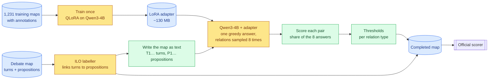

# A3 — A fine-tuned open language model for argument relations

> **What this is:** the report on approach A3, for readers new to the project. Terms are explained where they first appear and collected in §3. Each phase reads as its plan until it runs, then as its result.
> **Status (2026-10-06):** A3.1–A3.4 done. **On dev, A3 trails both A1 and A2, and both pre-registered success tests fail** (honest ARI 47.65 / 27.23). Next: A3.5 (assembly and ablations), then the test run.
> **Evidence:** [`../results/a3/`](../results/a3/). Decisions D065–D070 in [`../decisionlog.md`](../decisionlog.md).
> **Background:** [A1](A1-cross-encoder.md) (a trained pairwise encoder), [A2](A2-whole-map-llm.md) (Claude reading the whole map) and [the A2 discussion](A2-discussion.md) (why each wins where it does).

## In one minute
- **The task.** A televised debate becomes a *map*: **propositions** (claims) and **turns** (who said what, in order). A system must say which propositions **support** (Inference), **attack** (Conflict) or **restate** (Rephrase) which others, and *how* each turn was said.
- **Why A3.** The A2 discussion found that **the encoder (A1) learns the annotators, while the LLM (A2) applies the definition.**
  - The LLM invents fewer relations and reads direction better.
  - The encoder finds more of the loose support between neighbouring turns, and types turns better.
  - Neither finds the Conflicts within one speaker's own talk (70% of all Conflicts).
- **The idea.** Teach an open LLM the annotators' habits **through its weights**: train it on 1,231 annotated maps to write each map's whole relation list. It keeps the LLM's whole-map view and learns what the encoder learned.
- **How.** **Qwen3-4B-Instruct-2507**, stored in 4-bit with small trainable add-ons (**QLoRA**), on the local 8 GB GPU: **$0**. The text format, decision layer, map assembly and scorer are A1's and A2's, so the three systems compare directly.
- **Result on dev.** Training takes 110 min, and the model learns the answer format: 3,300+ answers, all valid but one.
  - **It doesn't beat A1 or A2.** With 8 sampled answers and tuned thresholds (the pre-registered score) it reaches **47.65 / 27.23**, against A1's 50.50 / 32.61 and A2's 54.63 / 34.12. Its single greedy answer does a little better (49.46 / 31.19), but is still below both.
  - **What it learned:** the annotators' density, with A2-level precision; at the same number of relations it invents no more than A2.
  - **What it didn't learn:** the encoder's habit of loose support between neighbouring turns. It finds far fewer true Inferences (recall 0.25 against A1 0.39 and A2 0.42), and Conflict stays mostly missed.

---

## 1. The problem in brief
Full description: [A2 §1](A2-whole-map-llm.md#1-the-problem).
- **Input:** the turns in order, with speakers, and the propositions, unconnected. The trained ILO labeller links each turn to its proposition (98.3% found, 99.6% precise on dev).
- **Task A, relations (ARI):** every ordered pair of propositions gets Inference, Conflict, Rephrase or None.
  - Inference points premise → conclusion: 53% back in time, 47% forward.
  - Conflict and Rephrase point later → earlier (98%).
- **Task B, illocutions (ILO):** how each turn expresses its proposition (Asserting, Pure / Assertive / Rhetorical Questioning, …).
- **Scoring:** macro-F1 per map, averaged over maps.
  - *General* counts every pair; *focused* only pairs with a true relation.
  - *Global* is the mean of Tasks A and B.
  - **The rare-label trap:** in a map without Conflict, one invented Conflict cuts the map's score from 100 to about 74.

| Test F1, general / focused | ARI | ILO | Global |
|---|---|---|---|
| Best 2024 entries | 55.3 / 35.9 | 81.2 / 72.1 | 67.05 / 48.25 |
| A1 + labeller | 51.38 / 30.77 | **92.64 / 84.28** | 72.01 / 57.53 |
| A2 + labeller + LLM types | **55.77** / 33.34 | 91.56 / 83.20 | **73.67 / 58.27** |

**A3 is compared on honest dev ARI:** A1 **50.50 / 32.61**, A2 **54.63 / 34.12**.

---

## 2. How A3 works


*Figure 1: training (top) happens once; prediction (bottom) runs per map. Yellow = models, green = deterministic steps, blue = data.*

**A training example** is a map written exactly as A2 wrote it, then the annotators' answer:
```text
<instruction: one short paragraph, the same for every map>
T1  Host: should NHS staff get a pay rise
    [P1] NHS staff should get a pay rise
T2  Minister: yes, they deserve one
    [P2] NHS staff deserve a pay rise
T3  Minister: they worked through the pandemic
    [P3] NHS staff worked through the pandemic

Links to type: T1-P1, T2-P2, T3-P3
```
```json
{"illocutions":[{"link":"T1-P1","type":"Pure Questioning"},{"link":"T2-P2","type":"Asserting"},{"link":"T3-P3","type":"Asserting"}],"relations":[{"type":"Rephrase","from":"P2","to":"P1"},{"type":"Inference","from":"P3","to":"P2"}]}
```
- **The answer** is A2's format without the confidence field, written compactly, with relations in a fixed order (by P number).
- **Size:** an example is 1,182 tokens at the median and 2,634 at most; the answer alone is 301 tokens at the median.
- **No worked examples and no reasoning:** the conventions live in the weights. (A2's reasoning added only ~1 point on dev, D063.)

**Prediction, per map:**
1. **One greedy answer** (the most likely token at every step). Its turn types are A3's turn types.
2. **Eight relation samples.** The greedy answer is cut just before `"relations"`, and the relations are sampled 8 times from there at temperature 1, with fixed seeds.
3. **Pair scores:** a relation's score is the share of the 8 samples that list it. A1's thresholds decide, and A1's `build_map` assembles a valid map.

A per-map grammar blocks any token that would break the answer format, so every answer is valid.

---

## 3. Concepts used

| Term | Meaning here |
|---|---|
| **Open LLM** | A language model whose weights can be downloaded and run locally; here Qwen3-4B-Instruct-2507 (Apache 2.0). |
| **Fine-tuning** | Continuing a model's training on our own examples (map → answer), so it learns this task's conventions. |
| **Answer-only loss** | The model is corrected only on the answer, not on the map it was given. |
| **LoRA / adapter** | The original weights stay frozen; small extra matrices beside each layer are trained (33M parameters, ~1% of the model). They are saved as an *adapter* (~130 MB). |
| **QLoRA** | LoRA with the frozen layers stored in **4-bit** (the NF4 format), about 4× smaller. Adapters train in 32-bit; the embedding tables stay 16-bit. |
| **Epoch / checkpoint** | One pass over the training maps / a saved adapter partway through. |
| **Greedy vs sampling** | *Greedy* takes the most likely next token every time. *Sampling* draws it from the model's probabilities (temperature 1 = as learned). A seed makes a draw repeatable on the same setup. |
| **Vote share** | A relation's score: the share of the 8 sampled answers that list it. |
| **Constrained decoding** | Tokens that would break this map's answer format (an unknown P-id or label, extra spaces) are blocked at every step. |
| **Thresholds, cross-fitting** | As in A1 / A2: per-type minimum scores, tuned for the per-map metric on 4 dev episodes and scored on the 5th, in rotation, for an honest number. |
| **Matched density** | Comparing systems at one threshold per system, set so that each predicts as many relations as gold. Otherwise a system's threshold, not its model, drives its recall and precision. |
| **Paired bootstrap** | Resampling the 225 dev maps many times, to see whether one system's per-map advantage over another is larger than chance. |
| **Giant maps** | 19 training maps with more than 40 propositions. They hold 19% of the Conflict examples but have no turn links: 545 of their 2,592 propositions can't be placed in the dialogue. |

---

## 4. Design choices and why

| Choice | Alternatives considered | Why |
|---|---|---|
| **Generate the whole map's answer** | An LLM with a classifier head judging pairs | One list per map is what gave A2 its precision (A2 discussion, Q1). A pair classifier would be A1 with a bigger encoder. |
| **QLoRA** | Full fine-tuning; 16-bit LoRA; DoRA; prompt tuning; GaLore | On 8 GB, full fine-tuning fits only under ~0.5B (A1's size) and 16-bit LoRA only up to ~2–3B. The rest either change nothing that fits or are weaker at structured output. |
| **Qwen3-4B-Instruct-2507**, by a rule fixed in the plan | Qwen3-8B; Qwen3.5; Gemma 4; Llama 3.1 8B; larger and mixture-of-experts models | **8B first**, if it trained at the longest example within 7.5 GiB. It didn't: its untied 16-bit embeddings alone take ~2.5 GB, and it crashed at 1,797 tokens (D066). Qwen3.5 is advised against for 4-bit training; Gemma 4 E4B needs 10 GB; Llama 3.1 is older and gated (D065). |
| **Thinking off, no worked examples** | Reasoning traces; examples in the prompt | No annotator reasoning exists to train on, and A2's reasoning added ~1 point. The weights carry the conventions. |
| **Train on the 1,231 test-like maps**; giant maps as an ablation | Giant maps in the main run | A1 and A2 never used them. A fifth of their propositions can't be placed, and chunking keeps only 49% of their relations. |
| **Gold links in training, labeller links on dev / test** | Labeller links in training | As A2. The labeller can't give honest links on its own training maps. |
| **One greedy answer + 8 relation samples** | 8 full samples; greedy only | Thresholds need graded scores (A2's 3 answers × 3 levels was coarse). Sampling only the relations halves the generated text. |
| **Vote shares; token probabilities kept** | Token probabilities only | Votes are proven (A2). The model's own probabilities are recorded for free and were the fallback had votes been all-or-nothing (they weren't, D069). |
| **A1's decision layer, cross-fitted** | Majority vote | Same protection against the rare-label trap, same honest estimate as A1 and A2. |
| **Checkpoint by greedy dev ARI, every half epoch** | Dev loss | As A1: choose by the real metric. *Caveat:* A2 chose nothing on dev, so the success test needs a margin (§6). |
| **LLM turn types under a stricter rule** | A2's rule (beat the labeller at all) | A2's +0.3 dev gain cost 1.1 on test. A3's types are adopted only with ≥ 0.5 honest ILO gain **and** a win in ≥ 4 of 5 dev folds. |
| **Separate Python environment** | A1's environment | LLM libraries pin their own versions; A1, A2 and the labeller must keep working. |

**Tools and code.**
- **Environment:** WSL2 venv `~/.venvs/a3`, pinned in [`requirements-a3.txt`](../requirements-a3.txt): torch 2.14 (CUDA 13), transformers 5.18, peft, bitsandbytes (NF4), liger-kernel (fused loss) and xgrammar (constrained decoding).
- **`a3_finetune/`:**
  - `data.py`: maps → examples;
  - `schema.py` / `parse.py`: A2's answer format without confidence → A1's pair format;
  - `grammar.py`, `generate.py`, `runner.py`: constrained generation, with an on-disk cache;
  - `model.py`: 4-bit loading and the answer-only loss;
  - `train.py`; `evaluate.py`; `tune.py`: the decision layer and A3.4's analysis;
  - `check.py` / `probe.py`: A3.1's gates.
- **Reused:** the serialiser, A1's decision layer and `build_map`, the scorer, the validator, and the labeller's links.

---

## 5. Phase by phase

| Phase | What | Status | GPU time |
|---|---|---|---|
| **A3.1 Setup + feasibility** | Environment, data, gate checks, memory and speed probes | **Passed**: lossless; 8B fails the memory rule → 4B | ~1 h |
| **A3.2 Training loop** | Trainer, cached generator, overfit test | **Passed**: 32 / 32 maps reproduced exactly | ~0.5 h |
| **A3.3 Training run** | 3 epochs; checkpoint choice; vote diversity | **Passed**: ep2.0, greedy dev ARI 49.46 / 31.19 | ~4 h |
| **A3.4 Dev run** | 8 samples × 225 dev maps; thresholds; success tests | **Done**: honest 47.65 / 27.23; both success tests fail | ~2.5 h |
| **A3.5 Assembly + ablations** | Complete maps, turn types, combination, ablations | Planned | ~3–6 h |
| **A3.6 Test run** | The 11 test maps, once | Planned | < 0.5 h |

### A3.1 Setup and feasibility — passed (2026-10-05)
Evidence: [`check.json`](../results/a3/check.json), [`probe_qwen3-4b.json`](../results/a3/probe_qwen3-4b.json), [`probe_qwen3-8b.json`](../results/a3/probe_qwen3-8b.json), [`samples/`](../results/a3/samples/). Decision D066.

| Gate item | Result |
|---|---|
| Lossless round trip: dev gold answers → parser → A1's decision code → `build_map` → scorer | **98.92 / 96.51**, exactly the pipeline ceiling; 0 invalid maps |
| Every gold answer accepted by its map's grammar | 1,231 train, 225 dev, 67 giant chunks: 0 rejected |
| No leakage | No dev or test map, by name or identical text, in training |
| Model, by the rule fixed in the plan | **Qwen3-4B-Instruct-2507** (below) |
| Untrained model gives valid constrained answers | 55 / 55, but empty lists for 3 of 5 maps: the task must be learned |

**Why 8B was ruled out.** The Windows desktop already holds ~1.1 GiB of the 7.93 GiB card.

| | Qwen3-8B | Qwen3-4B-Instruct-2507 |
|---|---|---|
| Loaded (PyTorch / whole card) | 5.82 / 7.32 GiB | 2.59 / 3.79 GiB |
| Training at the longest example (~2.6k tokens) | **Doesn't run:** card full by 1,200 tokens; crashes at 1,797 | **4.25 GiB, 789 tokens/s** |

As a result, the 4B vs 8B ablation is dropped. The current Unsloth pins an older torch, so we wrote a small training loop of our own around the memory savings.

### A3.2 Training loop — passed (2026-10-05)
Evidence: [`overfit/`](../results/a3/overfit/). Decision D067.

**The overfit test.** Can the loop teach 32 training maps by heart, and can generation read them back?

| Gate item | Result |
|---|---|
| Training: 32 maps, 10 epochs | Loss 0.41 → 0.0003 in 8.6 min; 3.83 GiB |
| Greedy answers vs gold | **32 / 32 identical**: 206 / 206 relations, every turn type |
| Loss mask | Verified on every example: only the answer and the end-of-turn token are trained on |
| Greedy speed | ≈ 5.5 s per map when batched across maps, against ≈ 14 s one at a time |

### A3.3 Training run — passed (2026-10-06)
Evidence: [`v1/`](../results/a3/v1/) (`train_log.jsonl`, `greedy_dev.json`, `diversity.json`, all greedy answers). Decisions D068–D069.

**Training:** the 1,231 maps, 3 epochs, 231 updates of 16 maps. 110 min (36.6 per epoch, with the dev-loss checks), 674 tokens/s, 4.92 GiB peak.

**Choosing the checkpoint.** Each half-epoch adapter wrote one greedy answer per dev map (labeller links, test-input format), scored with every relation it listed:

| Epoch | 0.5 | 1.0 | 1.5 | **2.0** | 2.5 | 3.0 |
|---|---|---|---|---|---|---|
| Dev answer loss | 0.0888 | 0.0804 | 0.0765 | 0.0753 | 0.0757 | 0.0747 |
| Greedy dev ARI, general / focused | 35.91 / 12.34 | 43.94 / 21.90 | 47.49 / 27.93 | **49.46 / 31.19** | 46.21 / 25.41 | 47.01 / 26.81 |
| Relations per map (gold 8.3) | 11.5 | 8.36 | 9.76 | 9.60 | 9.15 | 9.37 |

- **ep2.0 is chosen.** As with A1, the metric peaks at 2 epochs while the loss keeps edging down: the loss rewards every answer token, the metric only the relations.
- One greedy answer, with no thresholds, isn't comparable with A1's or A2's honest numbers; A3.4 adds votes and thresholds.

**Are the votes graded?** The chosen checkpoint sampled 8 answers for each of 20 dev maps (160 / 160 valid). The table counts distinct relations by how many of the 8 samples list them:

| Samples listing it | 1 | 2 | 3 | 4 | 5 | 6 | 7 | 8 |
|---|---|---|---|---|---|---|---|---|
| Distinct relations | 720 | 192 | 90 | 30 | 39 | 17 | 9 | 2 |

- **99.8% get a share strictly between 0 and 1**, so vote shares stay the main score (the rule's bar was 10%).
- The samples disagree a lot: a sample lists 11.7 relations, greedy 9.6, and only 2 relations appear in all 8.

**Memory (D068).** Twice, Claude Code stopped a long job because Windows ran out of memory: WSL kept ~5 GB of file cache from reading the 8 GB original weights at each load.
- WSL now returns its cache to Windows (`autoMemoryReclaim=dropcache`, user-approved).
- The 4-bit model is saved once and loaded from that copy: 2.47 GB, with all 1,659 tensors verified bit-identical.
- A map's samples are split under the same token budget as greedy batches.
- Nothing was lost; every answer was cached.

### A3.4 Dev run and decision layer — done (2026-10-06)
Evidence: [`v1/dev_report.json`](../results/a3/v1/dev_report.json), [`v1/thresholds.json`](../results/a3/v1/thresholds.json), the 1,800 samples. Decision D070.

**What ran.** The 225 dev maps (test-input format, labeller links), 8 seeded relation samples each from ep2.0: 1,800 / 1,800 valid, ≈ 2.5 h.
- Vote shares become A1's 5-label pair scores.
- Thresholds are fitted on all of dev (Inference 0.15, Conflict 0.5, Rephrase 0.3) and cross-fitted by episode for the honest number.
- A1 and A2 are re-scored on the same rows by the same code, which reproduces their honest scores exactly.

| Dev ARI, general / focused | |
|---|---|
| A1, honest | 50.50 / 32.61 |
| A2, honest | **54.63 / 34.12** |
| **A3, 8 votes + thresholds, honest (pre-registered)** | **47.65 / 27.23** |
| A3, one greedy answer, every relation kept (nothing tuned) | 49.46 / 31.19 |
| A3, token-probability score, honest | 47.86 / 25.89 |
| A3, one sample at temperature 1 (range over the 8) | 37.1–42.0 / 18.4–22.2 |

| Per type (pooled), precision / recall / F1 | A1 | A2 | A3 |
|---|---|---|---|
| Inference | 0.27 / 0.39 / 0.32 | **0.39 / 0.35 / 0.37** | 0.26 / 0.27 / 0.26 |
| Conflict | 0.31 / 0.09 / 0.14 | **0.43 / 0.12 / 0.19** | 0.29 / 0.06 / 0.10 |
| Rephrase | 0.42 / 0.53 / 0.47 | **0.48 / 0.55 / 0.51** | 0.37 / 0.52 / 0.43 |

**Success tests (§6): both fail.**
1. **A3 − A2 = −6.99 general**, 95% interval [−8.9, −5.2]; A2 is better on 153 maps, A3 on 69. Against A1: −2.85 [−4.7, −1.0].
2. **Adding A3 to an A1 + A2 average lowers it:** 55.12 → 54.24 general. *For the Combination phase:* the plain A1 + A2 average already beats A2 alone (55.12 / 36.18).

**Findings**
- **Learned:** the format (every answer valid) and the annotators' density. At matched density it invents no more relations than A2 (H2 holds).
- **Not learned:** the encoder's neighbour habit (H1 fails badly) or concessive Conflict (H4). Every relation type is below both A1 and A2, Inference most of all.
- **Sampling hurts.** A temperature-1 sample scores 37–42, far below the greedy answer's 49.5. Eight votes recover most of the gap, but the greedy answer stays A3's best configuration on dev.
- *Reading:* on 1,231 maps, a 4B model trained on whole-map answers doesn't match a 150M encoder trained on pairs, or a much larger model applying definitions. Learning the convention through the weights didn't pay off at this size and data volume.

### A3.5 Assembly and ablations — planned
- Complete maps (`build_map`, validator, official scorer) → dev ARI / ILO / Global next to A1 and A2.
- The LLM's turn types under the strict rule.
- The ablations in §7.

### A3.6 Test run — planned
- On your go: the 11 test inputs, with dev-fitted thresholds.
- Maps are saved before the gold is read, then scored once.
- **Contamination check:** A3's dev → test change against A1's (+0.9) and A2's (+1.1).

---

## 6. What A3 tests, with the decision rules (fixed before any run)

**Success** (honest dev, 225 maps). A3 succeeds if either holds:
1. **It beats A2.** A3's ARI general is above 54.63, *and* a paired per-map bootstrap puts the A3 − A2 difference's 95% interval above zero. Focused is reported beside it.
2. **It adds something A1 and A2 don't.** A cross-fitted average of A1 + A2 + A3 pair scores beats A1 + A2 alone by **≥ 1.0 general**.

Test 1 needs a margin because A3, unlike A2, chose its checkpoint on dev.

**Hypotheses.** H1 to H4 are compared at matched density (§3). The table shows A1 and A2 both at matched density and, in brackets, at their own tuned thresholds.

| | Hypothesis | Measure | A1 | A2 | **A3** | Holds if | Result |
|---|---|---|---|---|---|---|---|
| H1 | It learns the annotators' loose neighbour support | Recall, Inferences between neighbouring turns (707) | 0.39 (0.51) | 0.42 (0.40) | **0.25** (0.32) | ≥ A2 + 0.05 | **Fails** |
| H2 | …without the encoder's over-linking | Unrelated pairs given a relation | 905 (1,278) | 812 (697) | **805** (965) | ≤ 90% of A1's | **Holds** |
| H3 | It keeps the LLM's direction | Inference direction right | 86% (81%) | 84% (85%) | **83%** (76%) | ≥ 85% | **Fails** (all close) |
| H4 | It learns concessive Conflict within one speaker | Recall, within-speaker Conflicts (91) | 9% (5%) | 7% (3%) | **11%** (7%) | ≥ 15% | **Fails** |
| H5 | It learns the cautious turn-type prior | Honest dev ILO vs the labeller (90.16 / 80.67) | — | 90.43 | A3.5 | The strict rule (§4) passes | — |
| H6 | Training matters, not just the model | ARI, fine-tuned vs the same model untrained | | | A3.5 | ≥ +5 general | — |

*Notes:*
- At matched density (8.32 relations per map for all three), A1 and A2 are much closer than at their own thresholds. Much of the contrast in the A2 discussion came from where each system's thresholds sat.
- A3's vote shares come in steps of ⅛, so its ties are broken by token probability for this measure only.

---

## 7. Ablations

| Ablation | Question | Cost |
|---|---|---|
| Samples 1 / 2 / 4 / 8 | Do more samples help? | Free |
| Votes vs token probabilities | Which confidence signal works? | Free |
| Greedy answer vs votes | Do votes beat one best answer? | Free |
| Thresholds vs majority vote (≥ 5 of 8) | Does the tuned decision layer help? | Free |
| Score per half epoch | How long to train? | Done (A3.3) |
| Direction rule vs the model's own | Is the order rule needed? | Free |
| LLM vs labeller turn types | Does it type turns better? | Free |
| **Untrained model, zero-shot** (A2's system prompt, no examples) | Is it the training or the model? (H6) | 225 answers |
| No constrained decoding | How often does the trained model break format? | 225 answers |
| ***Retrain* with the giant-map chunks** | Do their Conflict examples help? (H4) | ~2 h training + dev pass |
| ~~Retrain 4B vs 8B~~ | | Dropped: 8B can't train here (D066) |

---

## 8. Budget and time
- **Spend: $0.** Local GPU only; no API calls.
- **Measured so far:**
  - **training:** 110 min;
  - **checkpoint scoring:** ≈ 15 min per adapter (6 adapters);
  - **dev sampling:** ≈ 40 s per map for 8 samples, ≈ 2.5 h in all;
  - **A3.4 analysis:** 4 min on the CPU.
- Every run logs wall-clock, tokens/s and peak memory to `results/timing.csv`.

## 9. Risks

| Risk | Status |
|---|---|
| Library support for this GPU (Blackwell, CUDA 13) | **Resolved:** 4-bit training and constrained generation work |
| 8B doesn't fit | **Happened:** the rule chose the 4B, with no maps capped |
| Windows runs out of memory during long jobs | **Fixed (D068):** WSL returns its cache; a lighter model load; answers cached, so runs resume |
| Overfitting 1,231 maps | Checkpoints are chosen on dev; the metric peaked at epoch 2 |
| It copies the annotators' over-linking | Measured by H2 at matched density |
| Samples disagree a lot (most relations are listed by 1 of 8) | Thresholds are tuned on the vote shares; token probabilities are the free alternative |
| Contamination (QT30 is public since 2022) | Dev → test change compared with A1's and A2's |
| Small test set (11 maps) | Decisions rest on dev |

---

## 10. Plan review (2026-10-05)
An independent reviewer agent, not involved in writing the plan, checked it against the A1 / A2 reports, the decision log, the code and the tools' documentation. Verdict: "approve with changes". All changes were adopted:

| Finding | Change |
|---|---|
| The 8B memory case rested on vendor minimums; untied embeddings, TRL's 32-bit upcast and full-vocabulary logits make it borderline | Memory savings built in; the 8B / 4B choice by a fixed rule (it chose 4B) |
| Generation memory and time underestimated; the untrained ablation with examples wouldn't fit | Batch sizes probed; relations sampled from a shared greedy start; zero-shot baseline |
| The success criterion couldn't fail (a 3-way oracle always beats a 2-way one) | A bootstrap test against A2, and a buildable combination test with a 1.0 margin |
| The hypotheses had no decision rules, and depended on thresholds | Matched density, and a pass rule for each |
| The Qwen3.5-2B ablation changed four things at once | Dropped |
| A2's schema and parser require confidence; free whitespace could run away | A3 versions; a strict grammar; every gold answer must pass it |
| The votes might be all-or-nothing | Token probabilities kept, with a fixed switching rule |
| Giant maps confound the comparison | Left out of the main run; a retrain ablation |
