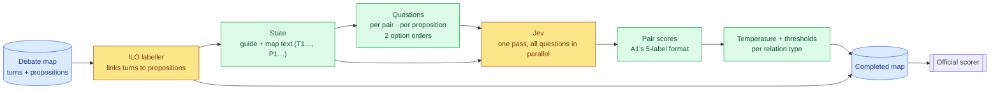

# A4 — Jev: typed decisions with probabilities, no training

> **What this is:** the report on approach A4, from plan to final test result. Each phase was written as a plan first and then became the record of what ran.
> **Status:** final (2026-10-06). The test set was scored once, with nothing changed afterwards: **Global 73.42 / 57.63** (ARI 54.21 / 30.98), between A3 (73.17 / 58.17) and A2 (73.67 / 58.27). On dev (225 maps) A4 is 2nd of the four systems (honest ARI 52.17 / 32.45), and both pre-registered success tests narrowly fail. The planned phases cost **$1.08**, and a later robustness re-run $0.62 more (D082), with no training. At the user's request the scope was kept to A4's core (D076–D077).
> **What came after:** a second identical dev pass scored 51.75 (D082). See [`04-comparison.md`](04-comparison.md) and the [final report](05-final-report.md).
> **Discussion:** [`A4-discussion.md`](A4-discussion.md) asks how Jev performs on argument mining, and where a decision model is useful.
> **Evidence:** [`../results/a4/`](../results/a4/). Decisions D073–D081 in [`../decisionlog.md`](../decisionlog.md).
> **Background:** [A1](A1-cross-encoder.md) (trained pairwise encoder), [A2](A2-whole-map-llm.md) and [its discussion](A2-discussion.md) (Claude reading the whole map), [A3](A3-finetuned-llm.md) and [its discussion](A3-discussion.md) (fine-tuned Qwen3-4B).
> **Jev facts** are from TypeSafe's docs (docs.typesafe.ai: models, API, confidence, "jev-1.13 jaggedness") and Vercel's AI Gateway docs, read on 2026-10-06. A4.1 measured the ones the plan depends on (§5).

## In one minute
- **Where the project stood before A4 (honest dev ARI, general / focused):** A2 54.63 / 34.12 > A1 50.50 / 32.61 > A3 47.65 / 27.23. An A1 + A2 average already scores 55.12 / 36.18, and the per-pair oracle is 66.1 / 46.0. Every approach misses Conflict.
- **What Jev is:** a *decision model*. It takes a **state** (up to 32k tokens) and many **typed questions**, and for each question returns a **probability over a fixed set of options**. It writes no text. Questions are answered in parallel, in one pass. It costs $0.042 per 1M input tokens, output is free, and it can't be fine-tuned.
- **The idea:** put the whole map in the state, ask about every candidate relation as a typed question, and get a **probability for every pair**. That gives whole-map context, as in A2, and a continuous score per pair, as in A1, with no training. Those scores go through the decision layer the other approaches already share.
- **What's new in A4:** besides one question per pair (A1's 5 labels), it asks **one question per proposition**: "which of your candidate propositions do you relate to, and how?" All of a proposition's candidate targets then compete inside one probability distribution. A2 found that deciding jointly was the LLM's real advantage over the encoder, and this is a way to get it without generating text.
- **Cost (measured in A4.1):** the state is billed once per request, so **a dev pass costs ≈ $0.63** at list price, and everything left (pilot, dev, test) ≈ $0.80. Jev turned out not to be on the gateway's free tier (D074), so A4 runs on a small paid credit with a cap (D075).
- **Success (fixed in advance):** with no training, A4 beats A1 on honest dev ARI, *or* adding A4 to the A1 + A2 average gains ≥ 1.0. **Both narrowly fail:** +1.68 over A1 with a 95% interval of [−0.20, +3.65], and +0.39 when added to the A1 + A2 average. A second identical dev pass scores 51.75 (+1.25 over A1). With no tuned thresholds at all, Jev scores 50.84 against A1's 50.08 (D082).
- **Test result (11 maps, scored once): Global 73.42 / 57.63**, ARI 54.21 / 30.98. That is 1st on Global and 2nd on ARI general against the 2024 field (best 67.05 / 48.25), and 2nd of our four systems.
- **On dev (225 maps, the reliable comparison): honest ARI 52.17 / 32.45**, between A1 (50.50 / 32.61) and A2 (54.63 / 34.12), and above A3 (47.65 / 27.23).
- **What Jev does well:**
  - the best Inference F1 (0.38) and neighbouring-turn Inference recall (0.51) of any system;
  - direction 87% right with no reasoning step;
  - the most Conflicts found, though still only 22%;
  - 0.8 s and about $0.003 per map.
- **What it doesn't do well:**
  - Rephrase: it calls restatements support (0.41 F1, against A2's 0.51);
  - its Inference probabilities are over-confident;
  - it falls behind on large maps.
- **What made it work:** ask about each relation twice, once per pair and once per proposition (where the targets compete), and average the two. Either question alone is at A1's level or below.

---

## 1. Where A4 fits

### 1.1 What A1–A3 leave open, and what A4 does about it
| Open problem | Evidence | A4's answer | Test |
|---|---|---|---|
| **Scores too coarse or too noisy for thresholds** | A2: 3 votes × 3 confidence levels, mostly 0. A3: a sample and the greedy answer share only 21% of their relations | A full probability distribution for every question, so every candidate pair gets a continuous score | H1 |
| **Pairwise judging invents relations** | A1 gives a relation to 1,278 unrelated dev pairs, A2 to 697. Deciding jointly is A2's structural edge (A2 discussion, Q1) | *Source questions:* one choice per proposition across all of its candidate targets, so the targets compete | H2 |
| **Conflict within one speaker's talk** | 70% of gold Conflicts (91 of 130). A1–A3 find 7–11% of them at matched density | State the IAT convention in the Conflict option: a speaker's own concession or contrast counts. Jev reads instructions literally, which helps here | H3 |
| **Direction** | A2 read direction from the text; reasoning didn't change it (A2 discussion, Q3) | Tests direction with no reasoning step at all | H4 |
| **Cost and speed** | A2: ~25 s and $0.18 API-equivalent per map, limited by Pro quota. A1: 94 min of training | 0.9 s per request, measured (A4.1); ≈ $0.003 per map; no training | H5 |
| **Complementarity** | A1 and A2 get different pairs right (per-pair oracle 66.1) | A third, cheap opinion whose errors may differ | Success test 2 |

### 1.2 Where it will probably be weak
- **No reasoning step.** TypeSafe's own list of jev-1.13's weak spots includes multi-step reasoning and indirection, literal reading, a **lean toward the first option**, and **lower accuracy as unrelated content grows in the state**. The design answers the last two directly (§4).
- **Questions don't see each other's answers.** Consistency comes from our code, as in A1. The source questions add competition only *within* one proposition's choice.
- **It can't be fine-tuned.** The annotators' habit of linking neighbouring turns (A1's recall advantage) can reach Jev only through stated base rates.
- *Our expectation:* Inference precision between A1's and A2's. The open question is whether calibrated scores make up for that at the thresholds.

---

## 2. How A4 works


*Figure 1: one map's path. Nothing is trained; the only learned parts are the labeller (shared) and the thresholds (tuned on dev). Yellow = models, green = deterministic steps, blue = data.*

**The state**, one JSON object per map:
```json
{"guide": "<IAT relation definitions and the annotators' measured habits: A2's frozen prompt (system_v1), condensed, plus the concession rule for Conflict>",
 "dialogue": "T1  Host: should NHS staff get a pay rise\n    [P1] NHS staff should get a pay rise\nT2  Minister: yes, they deserve one\n    [P2] NHS staff deserve a pay rise\n..."}
```
The map text is `common/serialise.py`'s, as in A2 and A3: turns T1… in dialogue order, propositions renumbered P1…, and no node IDs (D029).

**Two kinds of question**, packed into as few requests as the size limit allows (shown here in forward order; [`../results/a4/samples/`](../results/a4/samples/) has a real one):
```json
"pair_P2_P3_f": {"type": "choice", "instructions": "How is P2 (\"NHS staff deserve a pay rise\") related to P3 (\"…\")?",
  "criteria": {"P2_supports_P3": "P2 is a reason or evidence for P3",
               "P3_supports_P2": "P3 is a reason or evidence for P2",
               "conflict": "P3 attacks P2",
               "rephrase": "P3 makes the same point as P2 again, or answers it",
               "none": "no direct relation"}},
"from_P3_f": {"type": "choice", "instructions": "Which one proposition does P3 (\"…\") most directly bear on, and how? Choose none if it starts no relation.",
  "criteria": {"supports_P1": "P3 is a reason or evidence for P1: \"…\"", "restates_P1": "…", "attacks_P1": "…",
               "supports_P2": "…", "restates_P2": "…", "attacks_P2": "…", "supports_P4": "…",
               "none": "P3 starts no relation"}}
```
- **Pair questions** (one per candidate pair): the same 5 labels as A1, so A4 can replace A1's probabilities directly.
- **Source questions** (one per proposition): its options are "none" plus each candidate target × relation type. Inference is offered in both directions. Conflict and Rephrase are offered only towards *earlier* propositions, because 98% point later → earlier (D020). In gold, half of all propositions start no relation and 95% start at most one, so "pick one or none" fits the data.
- **Turn-type questions were dropped (D076):** the ILO labeller keeps Task B, as in A3's final configuration.
- **Candidates:** pairs at most 10 turns apart, as in A1 (98.8% of dev relations kept, D041). Both question kinds use the same candidate set, so the ceiling is the same.
- **Two option orders.** Every question is asked once with its options in order and once reversed, and the probabilities are averaged. In A4.1 the two orders gave the same choice on only 90.8% of questions, so both stay (D076).

**From answers to pair scores** (A1's 5-label format, so A1's decision layer and `build_map` apply unchanged):
- *Pair view:* the probabilities map directly onto the 5 labels.
- *Source view:* P(P→T Inference) comes from P's question, and P(T→P Inference) from T's. Conflict and Rephrase come from the later proposition's question. None = 1 − the sum.
- *Both:* the mean of the two views. A4.2 chooses between pair, source and both by a fixed rule.

**Size (dev, measured from A1's pair cache):** 81 candidate pairs per map at the median (max 274), 14 propositions (max 32), 12 candidate targets per proposition (max 29). That is about 25 options per source question at the median and at most ~90; Jev allows 255. Measured in A4.1: a median map is 162 pair and 28 source questions over both orders, about 67k tokens, sent as 2 requests of at most ~58k tokens that share the state. Jev counts about 3 characters per token (2.69–3.27).

---

## 3. Concepts used
| Term | Meaning here |
|---|---|
| **Decision model / System One** | TypeSafe's term for a model that returns typed answers with probabilities and writes no text. The name is after Kahneman's fast "System 1" thinking. |
| **State** | The material every question is answered against: here the guide and the map. |
| **Choice question** | Picks one of up to 255 named options. Each option has a short description, and the answer gives a probability for every option. (Jev also offers *noul*, a yes/no probability, and *score*, an ordered rubric.) |
| **Probability vs confidence** | Jev's `confidence` is a summary of how peaked the distribution is: (p_max − 1/n) / (1 − 1/n). We score with the probabilities themselves. |
| **Calibration, ECE** | A calibrated 0.3 is right 30% of the time. Expected calibration error (ECE) is the average gap between stated and observed rates. Here it is measured per relation type (class-wise), because the top-label ECE is dominated by None. |
| **Option-order bias** | The tendency to favour whichever option is listed first. Averaging two reversed orders cancels it to first order. |
| **Pair view / source view** | One question per candidate pair (independent decisions), or one per proposition across all its targets (the targets compete). |
| **Matched density, cross-fitting, paired bootstrap** | As in A3: compare systems at the gold count of relations (8.3 per map); fit thresholds on 4 dev episodes and score the 5th, in rotation; resample maps to test whether a per-map difference is larger than chance. |

---

## 4. Design choices and why
| Choice | Alternatives considered | Why |
|---|---|---|
| **Python calls the gateway's HTTP endpoint** (`POST https://ai-gateway.vercel.sh/v1/evaluate`, with `httpx`, already in the venv) | PLAN's Node runner with the AI SDK; TypeSafe's Python SDK; TypeSafe's direct API | The HTTP endpoint didn't exist when PLAN was written. It keeps A4 in one language with no new dependency. The AI SDK call `experimental_evaluate` is now a deprecated alias of `experimental_decide`. The direct API runs on a waitlist and has no free credit. |
| **A small paid gateway credit, capped** (D075) | The free tier; DigitalOcean credit; skipping A4; a local substitute | Jev is refused on the free tier (403, D074), and TypeSafe's direct signups are paused. The user chose a small top-up with auto top-up off. All of A4 is about $1. |
| **Choice questions** | One yes/no (noul) question per label; score questions | A choice keeps the labels mutually exclusive and returns the whole distribution. TypeSafe lists score interpolation as a weak spot. |
| **Pair and source questions in the same request** | One of them only | In TypeSafe's words, put all the questions in one request "and then use code to decide what is relevant". It costs only tokens, and it makes H2 a free comparison. |
| **Two option orders, averaged** | One order | Jev "leans toward the option that comes first" (jaggedness list). The A4.1 rule kept both, because the orders agree on only 90.8% of choices. |
| **Definitions: one guide in the state, plus a short line per option** | Full definitions repeated in every option (PLAN) | Repeating ~100 tokens of definition in each of ~100 questions multiplies the cost. Not swept (D076). |
| **No worked examples** | A2's 4 retrieved example maps | Examples gave A2 +4.5 general, but Jev's accuracy "falls as the state grows with content unrelated to the decision". Not swept (D076). |
| **Pruning at 10 turns, as A1** | Every pair | Same candidates as A1, same ceiling (98.64 / 94.44). |
| **The labeller's links; gold links on the training-split pilot** | Jev aligns turns itself | The labeller links 98.3% of turns at 99.6% precision. It is the same choice A2 and A3 made. |
| **A1's decision layer:** temperature + per-type thresholds, cross-fitted by episode | Argmax | The rare-label trap, and an honest number comparable with A1–A3. |
| **Turn types: the labeller's** (D076) | Jev's types under A3's strict rule | Core scope only. A2's LLM turn types cost 1.1 ILO on test (D064), and A3 kept the labeller's. |
| **Iterative commitment (PLAN's "4b") deferred** | Run it in the pilot | Source questions test the same idea (decisions that constrain each other) in one pass, at no risk that an early mistake spreads. 4b stays available if H2 fails (D073). |
| **Cache every request by content hash; commit raw answers gzipped** | Re-query | As A2: answers may not be repeatable, and the model can change during early access. Every score is recomputed from the cache. |
| **Report the model version on every answer** | Trust the alias | `typesafe-ai/jev` follows `jev-latest` (1.13.0 today). If the version changes mid-run, the affected maps are re-asked. |

**Code (`a4_jev/`):** `client.py` (HTTP, retries with backoff on 429 / 529, cost and usage per request), `questions.py` (state and the two question kinds), `runner.py` (resumable, cached), `parse.py` (answers → pair scores), `check.py` and `probe.py` (A4.1 gates and measurements), `tune.py` and `evaluate.py` (decision layer, hypotheses, assembly).
**Reused:** `common/serialise.py`, A1's `decide.py` and `build_map`, A2's pilot maps, A3's comparison code (`a3_finetune/tune.py`: system averages, bootstrap, matched density), the scorer, the validator and the labeller's links.

---

## 5. Phase by phase
| Phase | What | Gate | Status |
|---|---|---|---|
| **A4.1 Setup + feasibility** | Key, client, cache, parser; probe on 5 training maps | Lossless round trip; live answers valid; billing, speed, bias and repeatability measured; budget projection within the cap | **Passed** (D076), $0.035 |
| **A4.2 Pilot** | 50 training-split maps: base, a worked example, one wording fix | Settings frozen by the pre-set rules | **Done** (D078), $0.40 |
| **A4.3 Dev run** | 225 dev maps, frozen settings; decision layer; calibration; success tests | Honest dev ARI next to A1–A3; H1–H5 decided | **Done** (D079), $0.62 |
| **A4.4 Assembly + success test 2** | Complete maps, dev Global, A4 added to the A1 + A2 average (no new calls) | 225 / 225 valid; success test 2 | **Done** (D079), $0 |
| **A4.5 Test run + report** | 11 test maps, once | Run once (authorised in D077) | **Done** (D080), $0.04 |

### A4.1 Setup and feasibility — passed (2026-10-06)
Evidence: [`check.json`](../results/a4/check.json), [`probe.json`](../results/a4/probe.json), and the raw answers in [`probe/`](../results/a4/probe/) and [`probe-repeat/`](../results/a4/probe-repeat/). Decisions D074–D076.
- **Route:** the key is saved as `AI_GATEWAY_API_KEY` in WSL `~/.profile`, not in the repo. **Jev is refused on the free tier** (403 `RestrictedModelsError`, D074), so the user added a small paid credit (D075).
- **Offline gate:**

  | Round trip on 225 dev maps (gold written as Jev answers) | ARI general / focused |
  |---|---|
  | Pair view | **98.64 / 94.44**, A1's ceiling exactly |
  | Source view | 98.60 / 94.26: one choice can't carry a proposition's 3rd relation above the threshold |
  | Both | 98.64 / 94.44 |

  All 225 maps are valid, and no request contains a node ID.
- **Live probe** (5 training maps: A2's 3 smoke maps and the 2 largest outside the pilot episodes; 15 requests plus 2 repeats; **$0.035**):

  | Measured | Result |
  |---|---|
  | Validity | every answer has a known choice and probabilities summing to 1 |
  | Billing | **the state is billed once per request**: 691k tokens, against 5.4M if billed per question |
  | Characters per token | 2.96 on average, 2.69–3.27 per request. My first estimate (4.0) sent one request over the 64k limit; it was refused, not charged. The splitter now assumes 3.0 with a 50k budget (≤ ~58k real) |
  | Speed | 0.90 s per request at the median (max 1.35 s), even with 356 questions in one request. 1.4–4.5 s per map when its requests run one after another |
  | Option order | forward and reversed choices agree on **90.8%** of 1,041 questions (pair 91.8%, source 83.3%), with mean distance 0.083. By the rule fixed beforehand, **both orders stay** |
  | Repeatability | the same request twice: 98.1% identical choices, probabilities up to 0.17 apart. Not deterministic, so answers are cached and committed |
  | Sanity score, 5 maps, matched density | pair 47.9 / 27.8 · source 53.8 / 32.6 · **both 56.2 / 37.1**. The answers carry signal; nothing is chosen from 5 maps |

### A4.2 Pilot — done (2026-10-06)
Evidence: [`pilot_table.json`](../results/a4/pilot_table.json), raw answers in `pilot-k0/`, `pilot-k1/` and `pilot-k0-w2/`. Decisions D077–D078.
- **Maps:** A2's 50-map pilot set (`maps_50`: 3 training episodes, kept out of the example pool), with gold links. Dev stays untouched.
- **Arms:** the base design; one retrieved worked example in the state (k = 1, D077); and one wording fix of the source question (D078).
- **Rules, fixed before each run:**
  - k = 1 only with ≥ +1.0 general;
  - the wording fix only if `both` improves;
  - then the best view, with a single view preferred if it is within 1.0 of `both`.

  | ARI at matched density (396 relations) | Pair | Source | Both |
  |---|---|---|---|
  | Base (k = 0) | 47.22 / 25.28 | 48.68 / 27.57 | **51.83 / 31.13** |
  | k = 1 worked example | 46.83 / 24.52 | 50.06 / 28.01 | 51.95 / 31.32 (+0.12: not kept) |
  | Source wording v2 | 47.56 / 25.08 | 48.36 / 26.50 | 51.21 / 30.68 (−0.62: not kept) |

- **Frozen:** k = 0, the original wording, view `both`. Neither single view comes within 1.0 of `both`.
- *Why the wording fix was tried:* source questions get Inference direction right only 76% of the time, against 91% for pair questions. The suspected cause was the word "bear on", which also fits a conclusion's link to its premise. v2 asked what P "supports, restates or attacks"; direction stayed at 76.5%, so the cause is the question form, not the word.
- *Unlike A2*, a worked example doesn't help: +0.12, against A2's +4.5.

### A4.3 Dev run and decision layer — done (2026-10-06)
Evidence: [`dev/dev_report.json`](../results/a4/dev/dev_report.json), [`dev/thresholds.json`](../results/a4/dev/thresholds.json), `dev/responses.jsonl.gz`. Decision D079.
- **Run:** 225 dev maps, the frozen configuration and the labeller's links. 402 requests, all valid; $0.62; 0.75 s per request.
- **Decision layer:** per-type thresholds (Inference 0.55, Conflict 0.75, Rephrase 0.30), stable across folds. There is no temperature step, because Jev already returns probabilities.

  | Dev ARI, general / focused | |
  |---|---|
  | A1 (trained encoder), honest | 50.50 / 32.61 |
  | A2 (Claude, whole map), honest | **54.63 / 34.12** |
  | A3 (fine-tuned Qwen3-4B), honest | 47.65 / 27.23 |
  | **A4 (Jev), both views, honest** | **52.17 / 32.45** |
  | A4, pair view alone / source view alone | 50.50 / 32.57 · 46.32 / 26.73 |

- **Per type** (tuned), P / R / F1:
  - Inference 0.34 / 0.42 / **0.38** (A1 0.32, A2 0.37);
  - Conflict 0.52 / 0.12 / 0.19 (A2 0.19);
  - Rephrase 0.44 / 0.38 / 0.41 (A1 0.47, A2 0.51).
  - 8.6 relations per map (gold 8.3); 8 maps with an invented Conflict (A1 8, A2 8).
- **Success tests and hypotheses:** §6.

### A4.4 Assembly and success test 2 — done (2026-10-06)
Evidence: [`dev/dev_global.json`](../results/a4/dev/dev_global.json). Decision D079.
- **225 / 225 valid maps**, with the labeller's turn types. Honest dev Global is **71.16 / 56.56** (A1 70.29 / 56.63, A2 72.53 / 57.63, A3 68.90 / 53.95).
- **Success test 2** (cross-fitted averages of pair scores): adding A4 to the A1 + A2 average (55.12 / 36.18) gains **+0.39 / +0.83**, below the 1.0 bar.

### A4.5 Test run — done (2026-10-06)
Evidence: [`test_global.json`](../results/a4/test_global.json), [`test_predictions/`](../results/a4/test_predictions/), `test/responses.jsonl.gz`. Decision D080.
- **Protocol:** the 11 test inputs, the configuration frozen from dev (D079). 22 requests, $0.04. The maps were assembled, validated (11 / 11) and saved before `data/evaluation/` was read, then scored once.

  | Test F1, general / focused | ARI | ILO | Global |
  |---|---|---|---|
  | Best 2024 entries | 55.33 / 35.89 | 81.17 / 72.09 | 67.05 / 48.25 |
  | A1 + labeller | 51.38 / 30.77 | 92.64 / 84.28 | 72.01 / 57.53 |
  | A2 + labeller + LLM types | **55.77 / 33.34** | 91.56 / 83.20 | **73.67 / 58.27** |
  | A3 + labeller | 53.70 / 32.05 | 92.64 / 84.28 | 73.17 / 58.17 |
  | **A4 (Jev) + labeller** | **54.21 / 30.98** | 92.64 / 84.28 | **73.42 / 57.63** |

- **Against 2024:** Global 1st / 1st; ARI general 2nd (DFKI 55.33).
- **Per type:**
  - Inference F1 0.42, with direction 86% right;
  - Rephrase 0.49;
  - Conflict 1 of 13;
  - no invented relation types.
- **Dev → test: +2.0 ARI.** A1 moved +0.9, A2 +1.1 and A3 +6.1, and the order A1 < A4 < A2 is the same as on dev.
- **Per map:** A4 beats A1 on 5 of 11 maps, A2 on 4 and A3 on 5. It is the best of all four on map 11 (79.3) and the worst on map 9 (32.8).

---

## 6. What A4 tests (fixed before any run)
**Success (honest dev), if either holds:**
1. **No training, encoder level:** A4's ARI general is above A1's 50.50, with a paired per-map bootstrap 95% interval above 0.
2. **Adds to an A1 + A2 average:** adding A4's pair scores to the cross-fitted A1 + A2 average (55.12) gains ≥ 1.0 general.

**Hypotheses, with decision rules** (dev, matched density at 8.3 relations per map unless stated):
| | Claim | Pass if | Why it matters |
|---|---|---|---|
| **H1** | Jev's probabilities are calibrated | Class-wise ECE on the three relation labels ≤ A1's on the same pairs, before temperature | Tests the vendor's claim, and whether thresholds can rely on the scores |
| **H2** | Competition reduces invented relations | Source view ≥ pair view + 1.0 general, *and* ≤ 90% of the pair view's invented relations | Tests A2 discussion Q1 (joint decision is the advantage) without generation |
| **H3** | Stating the convention finds concessive Conflict | Within-speaker Conflict recall ≥ 15% (A1 9%, A2 7%, A3 11%) | Conflict is every approach's failure. *Confound:* A2's prompt never stated this rule, so a pass credits the definition plus the model |
| **H4** | Direction needs no reasoning | Inference direction ≥ 85% (A1 86%, A2 84%) | PLAN's caveat was that System One might lag here |
| **H5** | It is fast and cheap | Median ≤ 1 s per map; cost per dev pass reported | The research question asks "at what cost and speed" |

**Outcome (dev, D079):**
- **Success test 1 fails, narrowly:** A4 − A1 = +1.68 general, 95% interval [−0.20, +3.65]. A4 is better on 123 maps and A1 on 100.
- **Success test 2 fails:** adding A4 to A1 + A2 gains +0.39 general (+0.83 focused).

| | Result | Verdict |
|---|---|---|
| H1 | Class-wise ECE 0.030 vs A1's 0.018, with Inference measured per direction. Conflict (0.013) and Rephrase (0.007; A1 0.028) are well calibrated. **Inference is over-confident (0.070):** at a stated ~0.9, 35% are right | Fails |
| H2 | Source view 46.07 vs pair view 47.22. Invented relations fall to 67% of the pair view's (778 vs 1,155), but direction drops to 76% (pair 91%). Together the views reach 51.13 | Fails |
| H3 | Within-speaker Conflict recall 12.1%: below the bar, but the best of any system (A1 8.8%, A2 6.6%, A3 11%) | Fails |
| H4 | Inference direction 86.6% (A1 85.8%, A2 84.3%) | **Passes** |
| H5 | 0.83 s per map (requests in parallel; 1.28 s one after another); $0.62 per dev pass | **Passes** |

---

## 7. Ablations
None beyond the core (user, D076). The only comparisons are the ones the tests need, all from saved answers: pair vs source vs both (H2 and the view choice). Dropped: every new-call ablation (no pruning, no guide, names-only options), the pilot sweeps (definitions placement, worked examples), and the extra free re-scorings (thresholds vs argmax, temperature, Jev's confidence).

---

## 8. Budget and time
- **Spent: $1.08** on the planned phases, of the $10 budget (D077). The robustness re-run of the dev set (D082) added $0.62, so A4 cost **$1.70 in all**.

  | Phase | Cost |
  |---|---|
  | A4.1 probe | $0.035 |
  | A4.2 pilot, 3 arms | $0.40 |
  | A4.3 dev | $0.62 |
  | A4.5 test | $0.04 |

  702 answered requests over 392 map passes, about 26M input tokens at $0.042 per million. Output is free, and nothing was trained.
- **Time:** about 0.8 s per request. The whole dev pass (402 requests, 6 at a time) took **69 s**, and the test pass 3.9 s. A2 needed ~2.5 h of calls and A1 94 min of training.
- *For comparison per map:* A2 costs $0.18 API-equivalent and takes ~25 s; A1 needs a GPU and training; A4 costs **$0.003 and takes 0.8 s**.

## 9. Risks
- ~~Jev not on the free tier~~: it wasn't (D074); a paid credit was chosen (D075).
- **Early access:** the API has already renamed `evaluate` to `decide`. The model version is logged on every answer, and raw answers are committed.
- **Distractor state and option-order bias:** no examples in the state; two orders, because they disagree on 9% of choices.
- **Over-linking from independent questions:** source questions plus thresholds. H2 failed on direction, not over-linking, so iterative commitment was not run (D081).
- **Request limits:** large maps are split into several requests sharing the state.
- **Contamination:** Jev's training data is unknown. The dev → test change is compared with A1's (+0.9), A2's (+1.1) and A3's (+6.1).
- **Data leaving the machine:** only map inputs (with gold links on training maps) are sent. Dev and test gold never are. QT30 is a public corpus, and Jev doesn't train on customer requests.

## 10. Settled at approval (D073)
1. **Route:** the Vercel AI Gateway, with the key in WSL `~/.profile`. Jev isn't on the free tier, so A4 runs on a small paid credit (D074–D075).
2. **Iterative commitment (PLAN's 4b):** deferred. It runs only if H2 fails.
3. **D017's Jev corpus profiling:** dropped, because A4.3's per-type breakdown answers the same question.
4. **Success test 1's bar:** beat A1, the trained encoder.

## 11. Assessment
- **A decision model can do argument mining at encoder level with no training.** Honest dev ARI is 52.17, against the trained encoder's 50.50 and Claude's 54.63. That held on test (54.21), at $0.003 and under a second per map.
- **It is strongest where the annotation is closest to plain reading:** support between neighbouring turns (the best recall of any system) and its direction.
- **It is weakest where the annotation follows a convention:** an elaboration counts as Rephrase, and a speaker's own concession counts as Conflict. Jev applies its definitions literally, the guide's convention notes don't reach it, and a worked example doesn't help.
- **How the questions are asked matters more than any setting.**
  - Independent pair questions give good direction but over-link.
  - Competing per-proposition questions over-link less but lose direction.
  - Averaging the two is what lifts Jev from A1's level to between A1 and A2.
- **Calibration is uneven:** good for Conflict and Rephrase, over-confident for Inference. So the decision layer's thresholds were still needed.
- **As an addition to A1 + A2, it adds little:** +0.39 / +0.83 on dev (success test 2).
- **Not separated:** Jev against the guide's wording (only one wording fix was tried). Run-to-run variation is small: a second dev pass scores 51.75 / 32.24 (D082).
- Discussion: [`A4-discussion.md`](A4-discussion.md). Cross-approach comparison: [`04-comparison.md`](04-comparison.md).
